# Meserete Hiwot Super-App — System Documentation

<!--cover-->
**Product:** መሠረተ ሕይወት (Meserete Hiwot) Sunday School super-app — internal code name *Mezmur Zelideta* (package `com.mezmur.zelideta`); the API identifies itself as *Mezmur Zemseretee Hiwot API*.

**Organisation:** Meserete Hiwot Sunday School (መሠረተ ሕይወት ሰንበት ትምህርት ቤት), Debre Enqu St. Lideta Lemaryam Church, Ethiopian Orthodox Tewahdo Church.

**Document version:** 1.0 · **Date:** 2026-10-16 · **Status:** Initial release — reviewed against the source code; items marked *requires verification* could not be confirmed from the code alone.

**System version covered:** production release **1.5.3+16** (latest release recorded in the project logs) and the source tree at **1.5.3+19**, which contains unreleased work that is identified separately throughout.

**Audience:** future developers, technical administrators, the project owner and authorised stakeholders. Credentials, keys and the restricted system-console design are deliberately excluded; see *Appendix F*.

<!--toc-->

## 1. Document control

| Item | Value |
|---|---|
| Document | Meserete Hiwot Super-App — System Documentation |
| Version / date | 1.0 / 2026-10-16 |
| Prepared from | laravel/ (backend), mobile/mobile/ (Flutter app), database schema of the integration-test database (production dump + all applied migrations), project logs (MEMORY.md, GUIDANCE_IMPLEMENTATION_AUDIT_AND_DEBUG_LOG.md, SELECTION.md, prompt.md) |
| Method | Static reading of code, routes (`php artisan route:list`), live schema introspection of `mh_app_test`, execution of both automated test suites |
| Companion files | Feature_and_Module_Inventory.xlsx · IMPLEMENTATION_STATUS.md · System_Architecture.png/.svg · diagrams/ · Amharic presentation |

## 2. Executive summary

Meserete Hiwot is a *super-app* for a Sunday-school community: one Flutter application (Android, web; iOS configured) backed by one Laravel REST API and a MariaDB/MySQL database. It joins the community's main activities in one place:

- **Mezmur** — a hymn library with categories, lyrics (including time-synced lyrics), an audio player and offline downloads.
- **Education** — classes, courses, teachers, marks with an approval workflow, assignments, quizzes, and an online learning platform (categories → subjects → units → lessons).
- **Programs & attendance** — church programs with recurring schedules and reminders, and an HR-controlled attendance session with QR scanning, signatures and offline capture.
- **Holiday Mezmur service selection** — a transparent, configurable scoring of members (attendance, exams, Mezmur attendance, contributions, department participation) with department review and finalisation.
- **Member services** — digital member ID with QR, monthly contributions, property borrowing and the library, department membership, projects and tasks, department chat, and notifications.
- **Administration** — 63 permissions grouped into roles, a permission-filtered admin panel, audit and activity logs, and 15 report types exportable as PDF, Excel and CSV.

The feature inventory lists **98 features**: 79 live in 1.5.3+16, 6 implemented in source but not released, 7 partial, 4 planned/missing, 1 withdrawn and 1 configured but unverified. The API exposes **564 documented routes** (15 of them belong to unreleased work; a small restricted set is excluded) and the database has **128 tables** in the test copy of the schema.

**Key risks** (section 31): plaintext credentials in local project files; a production data dump stored in the project folder; unreleased schema changes in the source tree that make 37 integration tests fail against the un-migrated test database; shared hosting without a cron or queue worker (jobs run after HTTP requests).

## 3. System purpose, scope, objectives and target users

### 3.1 Purpose
To give the Sunday school one trustworthy digital place for its spiritual content (Mezmur, lessons), its organisation (departments, programs, projects) and its accountability (attendance, contributions, property, selection results), replacing paper lists and scattered messaging.

### 3.2 Scope
In scope (verified in code): every module listed in section 4. Out of scope: payments collection through a payment gateway (contributions are *recorded*, not charged), public self-service web pages beyond share links and the APK download page, and any integration not listed in section 6.

### 3.3 Objectives
- Make hymns, lyrics and audio available on every member's phone, including offline.
- Record attendance reliably and fairly: one accountable taker, a signature per mark, no unverifiable 'late' judgement, offline capture without data loss.
- Run education end-to-end: registration, teaching assignments, marks review and publication, online lessons and quizzes.
- Select members for holiday Mezmur service by published, configurable rules, with department review and an audit trail.
- Give leaders reports and exports; give members visibility of their own records (attendance calendar, contributions, results).
- Protect personal data: least-privilege permissions, encryption at rest for sensitive fields, device binding, audit logging.

### 3.4 Target users
| User | What they use |
|---|---|
| Members (students, youth & adults, married, distance) | Mezmur, programs, reminders, own attendance, member card, contributions, library, education (when enabled), department chat |
| Teachers | Their courses: lessons, quizzes, marks entry and submission, assignments |
| Attendance takers | The roster of programs they are assigned to (online or offline) |
| Department leaders / admins | Department members, participation scores, projects, property requests, chat moderation |
| HR | Attendance control: takers, signature exemptions, corrections, offline conflict queue |
| Finance & Property | Contributions, rates, property requests, project budget and expense approval |
| Education administrators / registrars | Classes, courses, teachers, registration, marks review, content |
| Mezmur administrators | Mezmur content, wedding services, selection categories and Mezmur report |
| High administrators / administrators | Users, roles, settings, releases, notifications, reports, audit |

## 4. Functional overview and feature inventory

Status legend: **LIVE** = Live (released 1.5.3+16); **UNREL** = Implemented in source – not yet released; **PARTIAL** = Partially implemented; **MISSING** = Not implemented (planned); **WITHDRAWN** = Withdrawn (removed by request); **CONFIG** = Configured – not verified. The full inventory with evidence is also in *Feature_and_Module_Inventory.xlsx*.

### 4.1 Accounts & security
| Feature | Status | Evidence (source) | Notes |
|---|---|---|---|
| Registration with 4/6-digit PIN, member group, membership profile | LIVE | routes/api/auth.php · AuthService::register |  |
| Sign-in by phone or e-mail + PIN; 5 failures → 15-minute lock | LIVE | AuthService::login (MAX_FAILED, LOCK_MINUTES) |  |
| One trusted device per member; administrators on several devices | LIVE | AuthService::login · Middleware::resolve |  |
| Access JWT + rotating refresh tokens; app sessions do not time out | LIVE | Tokens.php · config mz.jwt | Decision 2026-10-13: automatic logout removed |
| Session list, end one / others / all sessions | LIVE | Sessions.php · /settings/sessions |  |
| PIN reset by 6-digit code via Telegram or e-mail | LIVE | AuthService::forgotPassword/resetPassword |  |
| Admin device reset, force logout, disable, soft delete | LIVE | UserAdmin.php |  |
| Account approval states (pending / active / disabled), can_login flag | LIVE | AuthService::login |  |
| Biometric lock and screenshot blocking on personal screens | LIVE | local_auth · widgets/secure_screen.dart |  |
| Telegram account linking | LIVE | Notifications/Telegram.php · routes/api/telegram.php |  |

### 4.2 Members, HR & departments
| Feature | Status | Evidence (source) | Notes |
|---|---|---|---|
| Membership form (profile) with encrypted personal fields | LIVE | MemberProfile.php · Crypto/EncryptedColumns.php |  |
| Member ID numbers with group prefix; digital ID card with QR | LIVE | MemberIds.php · Members.php · /settings/me |  |
| Member groups (types) management | LIVE | MemberGroups.php |  |
| Profile change requests with approval and permanent history | LIVE | ProfileChanges.php |  |
| 7 departments, membership, role labels, department admins | LIVE | Departments.php · DepartmentAdmins.php |  |
| Monthly department participation score by the department leader | LIVE | Departments::saveParticipation |  |
| Professions catalogue | LIVE | Professions.php |  |
| Bulk import of users / Mezmurs / categories (xlsx, csv, paste; dry run) | LIVE | Import.php |  |

### 4.3 Mezmur
| Feature | Status | Evidence (source) | Notes |
|---|---|---|---|
| Mezmur library: hierarchical categories, search, recent / popular, today's category | LIVE | Mezmurs.php · Categories.php |  |
| Lyrics with adjustable font size; time-synced lyrics (LRC) and LRC maker for admins | LIVE | core/utils/lrc.dart · admin/lrc_maker.dart |  |
| Audio player: background playback, lock-screen controls, queue, shuffle, repeat, speed, sleep timer | LIVE | services/audio_player_service.dart |  |
| Favourites and offline downloads (lyrics always, audio optional) | LIVE | favorites_service.dart · download_service.dart |  |
| YouTube link playback | LIVE | features/mezmurs/youtube_view.dart |  |
| Admin: create / edit / publish Mezmurs, audio & cover upload, bulk category assignment, drafts | LIVE | content_admin.dart · Mezmurs.php |  |
| Share links (/m/{id}) with preview page and app deep link | LIVE | routes/web/public.php |  |

### 4.4 Programs & attendance
| Feature | Status | Evidence (source) | Notes |
|---|---|---|---|
| Programs: once / weekly / monthly / twice monthly / Ethiopian calendar days; occurrence overrides | LIVE | ProgramSchemas.php · Schedule.php |  |
| Audience (all or participants), registration, capacity, member-group targeting | LIVE | Programs.php |  |
| Program reminders (2 d / 1 d / 6 h / 1 h) and 15-day interval reminders; mandatory reminders | LIVE | ReminderJobs.php · program_alarms.dart |  |
| Attendance sessions: one HR-assigned taker, opens 15 min before, Start / End, auto-end | LIVE | AttendanceSessions.php |  |
| QR or manual marking; signature for every Present mark (group exemptions) | LIVE | Attendance::set · attendance.signature setting |  |
| No 'late' status; capture time and elapsed seconds since Start recorded | LIVE | Attendance.php (LATE_REMOVED) |  |
| Absence excuse requests with deadline and monthly / quarterly limits; admin cancel of approved excuse | LIVE | Permissions.php |  |
| Corrections after closure with review | LIVE | Attendance::requestCorrection/reviewCorrection |  |
| Offline attendance with encrypted queue and HR conflict review queue | LIVE | Sync.php · /admin/attendance/conflicts |  |
| Member attendance calendar and statistics | LIVE | Attendance::calendar/stats · /settings/attendance |  |
| Class attendance through programs linked to classes (edu_attendance frozen) | UNREL | migration 2026_10_20_000002 · Settings::eduAttendanceCutover | Release target +19 (F4) |
| Elapsed-time interval percentages per attendance category for selection | UNREL | Selections::validateIntervalRules/scoreOccurrenceInterval | Release target +19 (F6) |

### 4.5 Education
| Feature | Status | Evidence (source) | Notes |
|---|---|---|---|
| Classes, courses (subjects), schedules, staff, registration windows, regular / distance streams | LIVE | Edu.php · EduRegistration.php |  |
| Teacher assignments with history; only active teachers enter marks | LIVE | EduTeachers.php · edu_course_teachers |  |
| Marks workflow draft → submitted → approved / rejected → published, amendments with reason | LIVE | EduMarks.php · edu_score_history |  |
| Assignments (individual / group), submissions and grading | PARTIAL | Edu.php | No publish time, deadline enforcement or late rule (F9) |
| Student requests (class / stream / mode change, add / drop) and complaints (EC-YYYY-NNNNNN) | LIVE | EduRequests.php · EduComplaints.php |  |
| Learning platform: categories → subjects → units → lessons with materials and progress | LIVE | EduLearning.php · features/edu/learn |  |
| Quizzes: 4 question types, timer, attempts, manual grading, send to score sheet | LIVE | EduQuizzes.php |  |
| Question banks / random draws | PARTIAL | EduQuizzes.php | Banks not implemented (F12) |
| Module gate: Education can be switched off per member (403 MODULE_DISABLED) | LIVE | Http/ModuleGate.php |  |
| Academic years, terms, Grades 1–12 levels, exclusive enrolment, course offerings | UNREL | EduAcademicYears.php · migration 2026_10_20_000001 | Release target +18 (F1–F3) |
| Course outcomes and pass marks | MISSING | pass_mark column added in unreleased migration only | F10 |
| Failed courses and online retakes | MISSING | — | F11 |
| Certificates and verification | MISSING | — | F13 – needs wording/signatory decision (D7) |
| Student dashboard | PARTIAL | EduDashboard::forUser | F14 |
| Academic and engagement scores for admins | MISSING | — | F15 |

### 4.6 Holiday selection & Mezmur services
| Feature | Status | Evidence (source) | Notes |
|---|---|---|---|
| Holiday selection: 5 weighted components, minimums, pass mark, bonus, per-program weights | LIVE | Selections.php (DEFAULT_CONFIG) |  |
| Lifecycle draft → open → review → finalized (+ cancel); required department reviews; overrides with reason | LIVE | Selections::setStatus/submitReview/override |  |
| Service categories (ወረብ / መዝሙር), rankings, publication, member feedback | LIVE | Selections::assignCategories/publish/submitFeedback |  |
| Selection and Mezmur-selection reports (PDF / XLSX / CSV) | LIVE | ReportExport.php · SelectionReports.php |  |
| Contribution month range for selection | UNREL | routes/api/selections.php start_month/end_month | Was a defect (F5); fix in source |
| Selection configuration versions | UNREL | Selections::recordConfigVersion | F6 |
| Department-based criteria (50/30/10/10) | WITHDRAWN | backups/department-criteria-2026-10-15 | Removed 2026-10-15; tables kept unused |
| Wedding (other) Mezmur services with manual participant selection | LIVE | Weddings.php |  |
| Daily choir eligibility computation | LIVE | Choir::refresh · job choir:eligibility 02:15 |  |

### 4.7 Contributions, property & library
| Feature | Status | Evidence (source) | Notes |
|---|---|---|---|
| Monthly contributions by Ethiopian month, rates per member type, receipts, verification | LIVE | Payments.php |  |
| 'Paid after due month' label (grace days) — financial rule kept | LIVE | payments.policy grace_days |  |
| Items / property inventory with categories, codes, departments, history | LIVE | Items.php |  |
| Borrowing: direct, bulk, approval, renewal, return conditions, signatures | LIVE | Borrowings.php |  |
| Fines: per day / week, grace, cap, override with reason, daily recalculation | LIVE | Fines.php · job fines:recalculate |  |
| Library: digital PDF books (encrypted on device), physical book requests | PARTIAL | Library.php · book_vault.dart | No sub-categories, favourites, reading progress (F16) |
| Physical library with per-copy IDs | PARTIAL | items quantity-based | F17 – decision D6 needed |
| Department property requests with review, issue, partial issue, return | LIVE | PropertyRequests.php |  |

### 4.8 Projects & collaboration
| Feature | Status | Evidence (source) | Notes |
|---|---|---|---|
| Department projects, teams, tasks with several assignees, statuses with reasons | LIVE | Projects/ProjectService.php · TaskService.php |  |
| Budgets by category, expenses with receipts, over-budget control, adjustments (Finance approval) | LIVE | Projects/BudgetService.php |  |
| Issues, suggestions (convert to task), comments, files, activity feed, reports | LIVE | Projects/FeedbackService.php · ReportService.php |  |
| Department chat: group + private threads, media for leaders, meeting links, Task Bot | LIVE | Chat.php · Projects/Bot.php |  |
| Task deadline reminders | LIVE | ProjectReminders.php · scheduled_notifications |  |

### 4.9 Communication
| Feature | Status | Evidence (source) | Notes |
|---|---|---|---|
| In-app notification centre with topics and per-user preferences | LIVE | Notifications.php (8 topics) |  |
| Push notifications (Firebase Cloud Messaging) | LIVE | Fcm.php · push_service.dart | Requires Firebase credentials in the environment |
| E-mail delivery (SMTP) | LIVE | Mailer.php | Requires SMTP settings |
| Admin broadcasts to one / selected / filtered / all, resend, delivery history | LIVE | Broadcasts.php · Targeting.php |  |
| Banners (advertisements) and internal pages | LIVE | Promotions.php |  |
| Notification delivery health screen | LIVE | Notifications::health · /admin/notification-health |  |
| In-app guidance: 56 bilingual articles, tours, contextual help | LIVE | GuidanceService.php · guidance_catalog.dart |  |

### 4.10 Administration, reports & audit
| Feature | Status | Evidence (source) | Notes |
|---|---|---|---|
| Role-based access: 63 permissions, roles, direct grants and revocations | LIVE | Auth/Catalog.php · Admins.php |  |
| Admin panel with 10 permission-filtered groups | LIVE | features/admin/admin_home.dart |  |
| Dashboard and reports | LIVE | Reports.php |  |
| 15 export kinds in PDF / XLSX / CSV, each audited | LIVE | ReportExport.php |  |
| Audit log and user activity log | LIVE | Auth/Audit.php · Activity.php |  |
| System settings with validated schemas | LIVE | Settings.php |  |
| App releases: APK hosting, download page, mandatory update / minimum build | LIVE | Releases.php · update_service.dart |  |

### 4.11 Platform
| Feature | Status | Evidence (source) | Notes |
|---|---|---|---|
| Ethiopian calendar (Amete Mihret) for periods, dates, reports and program days | LIVE | Support/Ethiopian.php · ethiopian_date_picker.dart |  |
| Amharic (template) and English localisation (2,754 keys) | LIVE | lib/l10n/app_am.arb · app_en.arb |  |
| Light / dark theme, church branding and module watermarks | LIVE | core/theme · widgets/brand.dart |  |
| Offline: cache of GET responses, offline pack, sync queue for listed operations | PARTIAL | local_db.dart · sync_service.dart | Platform-wide offline incl. admins planned (F7) |
| Offline queue preserved on sign-out | UNREL | features/auth/session.dart logout(discard) | Was a defect (F0a) |
| Background jobs without cron (after-response tick) | LIVE | Jobs/Jobs.php |  |
| At-rest encryption of sensitive columns | LIVE | Crypto/Seal.php · DataEncryptor.php |  |
| Web app (PWA) build | LIVE | mobile/mobile/web · deployed per records |  |
| iOS app | CONFIG | ios/ project, Info.plist | No build or store release verified |
| Shared Settings filtered by module; Education edit pen; role guidance for students/teachers; responsive checks of admin tables | PARTIAL | prompt.md F18–F21 | Polish items |

## 5. System architecture and component relationships

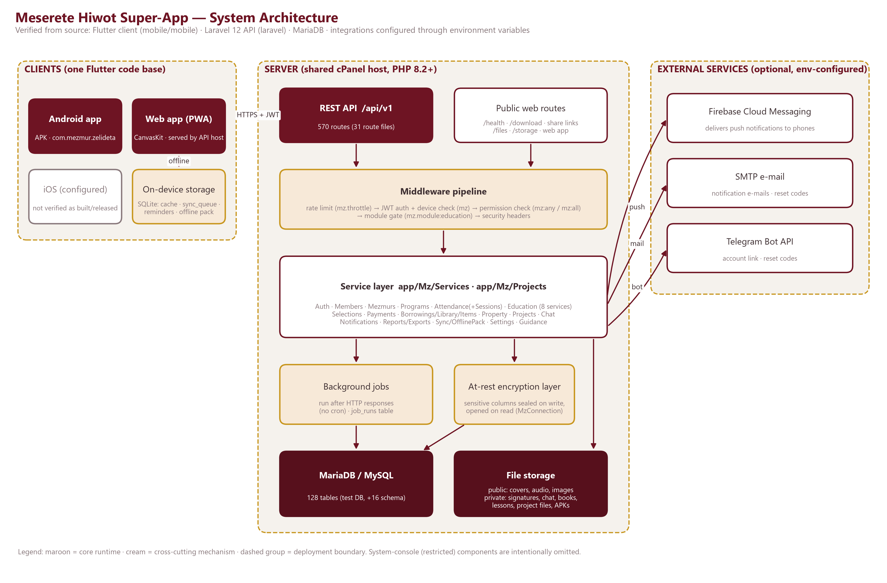

*Figure 5.1 — System architecture (editable source: System_Architecture.svg).*

**Request path.** The Flutter client calls `https://<host>/api/v1/...` over HTTPS with a bearer JWT. Every API route passes the global rate limiter, then (for protected routes) the `mz` middleware, which verifies the token, the account status, the token version, the trusted device (members) and revocation; permission middleware (`mz:any,...` / `mz:all,...`) and, for Education, the module gate follow. Route closures in `routes/api/*.php` validate input with the project's schema library (`App\Mz\Support\Z`) and call static service classes; services re-check authorisation for row-level rules, write audit records and return arrays that `Http::ok` wraps in the standard envelope.

**Data path.** Services use Laravel's query builder through a custom connection (`MzConnection`/`MzBuilder`) that seals configured sensitive columns on write and opens them on read. Files are stored under a configurable storage root, split into *public* (covers, audio, images) and *private* (signatures, chat, books, lesson materials, project files, APKs) areas; private files are streamed only by authorised routes.

**Background work.** There is no cron requirement: after an HTTP response is sent, at most once a minute one request takes a database named lock and runs due jobs (section 28).

**Client side.** The app keeps an on-device SQLite database (cache of GET responses, downloaded Mezmurs, favourites, reminders, the sync queue and the offline pack). Offline-capable operations are queued and replayed through `POST /api/v1/sync` (section 21).

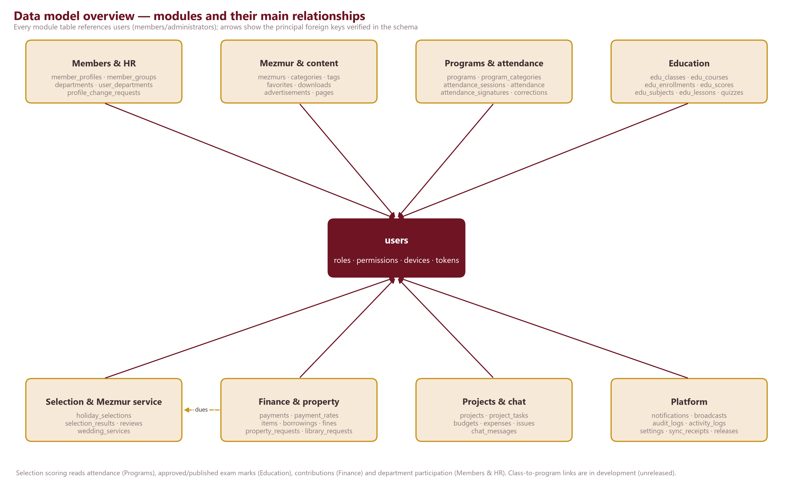

*Figure 5.2 — Module-level data relationships.*

## 6. Technology stack, frameworks, libraries and external dependencies

### 6.1 Backend (`laravel/composer.json`)
| Component | Version / detail |
|---|---|
| Language | PHP ^8.2 (development machine: PHP 8.3.29) |
| Framework | Laravel framework ^12.0 (installed 12.69.3) |
| PDF generation | dompdf/dompdf ^3.1 (report exports, Amharic via Noto Sans Ethiopic) |
| Other runtime | laravel/tinker |
| Dev / test | phpunit ^11.5, mockery, fakerphp, laravel/pint, pail, sail, collision |
| In-house libraries | JWT (Support/Jwt.php), validation DSL (Support/Z.php, V.php), XLSX reader/writer (Support/Xlsx.php), Ethiopian calendar (Support/Ethiopian.php), at-rest encryption (Crypto/*), TOTP (Auth/Totp.php) |
| Database | MariaDB / MySQL (services use MySQL-specific SQL; tests run on MariaDB 10.4) |

### 6.2 Mobile / web client (`mobile/mobile/pubspec.yaml`)
| Area | Packages |
|---|---|
| SDK | Flutter 3.44.1 (stable), Dart SDK ^3.12.1; app version 1.5.3+19 in source |
| State & navigation | flutter_riverpod ^3.4.3, go_router ^18.0.1 |
| Networking & storage | dio, flutter_secure_storage, sqflite (+ sqflite_common_ffi_web for web), shared_preferences, path_provider, connectivity_plus, device_info_plus, uuid, intl |
| Audio & media | just_audio, just_audio_background, audio_session, video_player, youtube_player_iframe, pdfrx (PDF reader) |
| Notifications | firebase_core, firebase_messaging, flutter_local_notifications, timezone, flutter_timezone |
| Security & device | local_auth (biometrics), pointycastle (AES-GCM), mobile_scanner (QR), qr_flutter, signature (signature pad) |
| Files & sharing | image_picker, file_picker, photo_manager, share_plus, url_launcher, cached_network_image, flutter_cache_manager, package_info_plus |
| Fonts | Noto Sans Ethiopic (400–700), Noto Serif Ethiopic (500–700) bundled as assets |
| Dev / test | flutter_test, flutter_lints, mocktail, sqflite_common_ffi, flutter_launcher_icons |

### 6.3 External services (all optional, configured by environment variables)
| Service | Use | Configuration keys (names only) |
|---|---|---|
| Firebase Cloud Messaging (HTTP v1) | Push notifications | FIREBASE_PROJECT_ID, FIREBASE_CLIENT_EMAIL, FIREBASE_PRIVATE_KEY |
| SMTP server | Notification e-mails, PIN-reset codes | SMTP_HOST, SMTP_PORT, SMTP_USER, SMTP_PASSWORD, SMTP_FROM |
| Telegram Bot API | Account linking, reset codes, temporary passwords | TELEGRAM_BOT_TOKEN, TELEGRAM_BOT_USERNAME, TELEGRAM_WEBHOOK_SECRET |
| Android App Links | Share links open the app | ANDROID_PACKAGE, ANDROID_CERT_SHA256 |

*Note:* `.env.production.example` still lists legacy names (FCM_SERVER_KEY, FIREBASE_CREDENTIALS, MAIL_*) while `config/mz.php` reads the names above — *requires verification* when configuring a new server.

## 7. Backend architecture and major modules

The backend is a port of an earlier Node.js backend (comments reference the original files) organised as follows:
| Folder | Content |
|---|---|
| routes/api/*.php (31 files) | Route closures under /api/v1, one file per area; input validation and permission middleware |
| routes/web.php, routes/web/public.php | /health, the API root, public files, APK download page, share links, Android asset links |
| routes/console.php | Artisan commands: mz:jobs, mz:encrypt-data, mz:repair-text and one restricted account-bootstrap command (Appendix F) |
| app/Mz/Services (58 classes) | Business logic as static service classes |
| app/Mz/Projects (11 classes) | Project management: access, projects, tasks, budgets, feedback, files, reports, reminders, chat Task Bot |
| app/Mz/Auth | AuthContext, permission catalogue, audit, holders, passwords (Argon2id), tokens, TOTP |
| app/Mz/Http | Middleware (auth/permissions), ModuleGate, Throttle, SecurityHeaders, Upload, Ctx (request helpers) |
| app/Mz/Db | MzConnection / MzBuilder (encryption hooks), named locks, UTC handling |
| app/Mz/Crypto | Seal (envelope encryption), EncryptedColumns (map), DataEncryptor (bulk encrypt/rotate) |
| app/Mz/Notifications | Notifications, FCM, Mailer, Telegram, deep links |
| app/Mz/Jobs | Jobs runner, reminder jobs, scheduled notifications |
| app/Mz/Support | Validation (Z, V, *Schemas), Ethiopian calendar, dates, XLSX, JWT, crypto helpers, pagination, error type, text repair |
| database/migrations (26 files) | Baseline schema + additive, reversible migrations (2 are unreleased) |
| tests/Unit, tests/Integration | PHPUnit suites (section 30) |

### 7.1 Service catalogue
| Services | Responsibility |
|---|---|
| AuthService, Sessions, Account, Users, UserAdmin | Registration, sign-in, refresh, logout, PIN change/reset; sessions; profile & preferences; user administration |
| Admins, DepartmentAdmins, Permissions (excuses) | Administrators, roles and permission catalogue; department administrators; absence-excuse requests |
| Members, MemberIds, MemberProfile, MemberGroups, ProfileChanges, Professions | Member identity/QR card, ID numbering, membership form, member types, change requests, professions |
| Departments | Departments, membership, leaders, monthly participation |
| Mezmurs, Categories, Promotions | Hymns, category tree, banners and internal pages |
| Programs, Schedule, Reminders | Programs and recurrence, occurrences/overrides, personal reminders |
| Attendance, AttendanceSessions | Rosters, marking, signatures, corrections, statistics; sessions, takers, conflict queue |
| Edu, EduRegistration, EduTeachers, EduMarks, EduRequests, EduComplaints, EduJourney, EduDashboard, EduLearning, EduQuizzes, EduAcademicYears* | Education (*unreleased) |
| Selections, SelectionReports, Choir, Weddings | Holiday selection, Mezmur report, choir eligibility, wedding services |
| Payments | Contributions and rates |
| Items, Borrowings, Fines, Library, PropertyRequests | Inventory, loans, fines, library, department property |
| Chat | Department chat |
| Broadcasts, Targeting | Admin messaging and recipient selection |
| Reports, ReportExport | Dashboard/report queries and PDF/XLSX/CSV exports |
| Sync, OfflinePack | Offline operation replay and offline data pack |
| Settings, Storage, Releases, GuidanceService, Import, Activity | Settings, file storage, app releases, guidance, bulk import, activity tracking |

## 8. Frontend / mobile architecture and navigation

**Structure (`mobile/mobile/lib`).** `app/` (router, shell, top bar, navigation layout), `core/` (config, network client, storage, theme, localisation helpers, utilities), `features/<module>/` (screens), `repositories/` (API access per area), `services/` (audio, downloads, sync, push, reminders, offline pack, updates), `models/`, `widgets/` (brand, dialogs, Ethiopian date picker, QR, secure screen, pickers), `l10n/` (ARB files).

**State and routing.** Riverpod providers; GoRouter with one shell (`StatefulShellRoute.indexedStack`) and section-aware bottom navigation. Mezmur section: Home · Categories · My library · Programs · Settings (notifications in the top bar). Education section (approved navigation option A): Home · Learn · Classes · Progress · More, with Settings as a top-bar gear. Admin routes live under `/admin`; routes without the needed permission are hidden and the server rejects them regardless.

**Network client.** Dio wrapper with bearer auth, single-flight token refresh, envelope unwrapping, error-code normalisation (`ApiException`), retries of GETs on connection drops and a per-user last-good-response cache for offline display.

**Branding.** Maroon `#6E1423` and gold `#C8961E` on a warm canvas `#F5F2ED`, dark theme `#1A1113`; Noto Ethiopic fonts; module watermarks (kebero pattern for Mezmur, lectern/Ge'ez pattern for Education, church-seal pattern elsewhere).

### 8.1 Screen map
| Area | Routes | Purpose |
|---|---|---|
| Shell / auth | /splash, /login, /register, /forgot, /change-password, /update | Start-up, sign-in with PIN, registration, PIN reset, forced PIN change, forced update |
| Hub | /hub | Super-app landing: Education, Mezmur, About me cards; Take-attendance card for assigned takers |
| Mezmur | /home, /home/search, /home/categories, /home/category/:id, /home/mezmurs, /home/mezmur/:id, /home/page/:id | Mezmur home, search, category tree, lists, lyrics + player, internal pages |
| Player | /player (mini player in shell) | Now playing: queue, shuffle, repeat, speed, sleep timer, synced lyrics |
| Library | /library, /edu/library, /library-request/:id | My collection (favorites, downloads), books, book requests |
| Programs | /programs, /programs/:id | Program list/calendar, detail, registration, reminders, excuse requests |
| Notifications | /notifications | In-app notification centre |
| Education | /edu, /edu/learn/*, /edu/classes, /edu/progress, /edu/more, /edu/search | Home · Learn · Classes · Progress · More |
| Education (study) | /edu/class/:id, /edu/course/:id, /edu/quiz/:id, /edu/attempt/:id, /edu/services, /edu/complaint/:id | Class & course pages, quizzes, self-service requests, complaints |
| Education (staff) | /edu/manage/*, /edu/courses, /edu/registrations, /edu/register, /edu/review/*, /edu/content/*, /edu/quiz-edit/:id, /edu/attendance/:id, /edu/journey/:id, /edu/calendar | Class/course management, registration, marks review, content authoring, quiz editor, journey |
| Settings / About me | /settings, /settings/me, /settings/profile, /settings/payments, /settings/attendance, /settings/sessions, /settings/password, /settings/notifications, /settings/downloads, /settings/categories, /settings/borrowings, /settings/about, /settings/guidance | Member card + QR, profile, contributions, attendance calendar, sessions, PIN, notification & download preferences |
| Department chat | /settings/chat, /settings/chat/:id, /settings/chat/:id/private, /settings/chat/:id/user/:uid | Department group chat and private threads |
| Projects | /projects, /projects/my-tasks, /projects/approvals (+ project/task detail) | Projects, tasks, budgets, issues, suggestions, reports |
| Guidance | /guidance, /settings/guidance | Help centre, tours, contextual help |
| Admin panel | /admin and 50 sub-routes | 10 permission-filtered groups (see section 12) |

### 8.2 Representative screens (rendered from the app's own widgets with sample data)

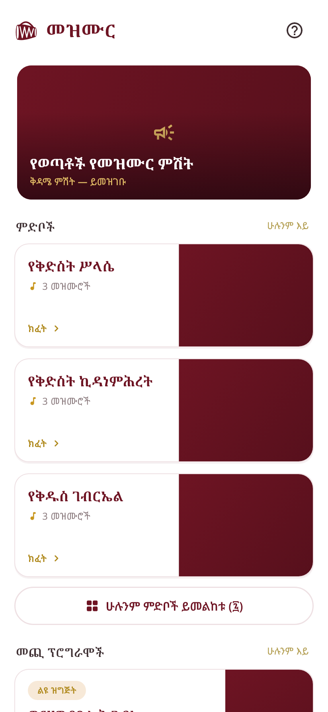{w=2.0} 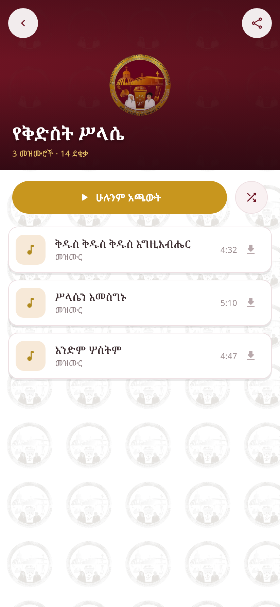{w=2.0} 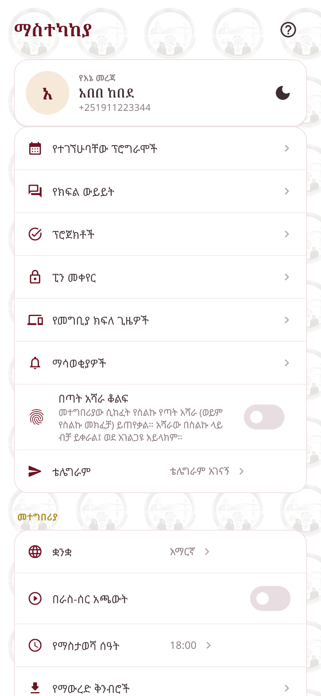{w=2.0}

{w=2.0} 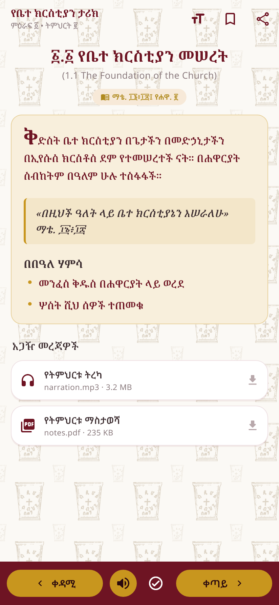{w=2.0} 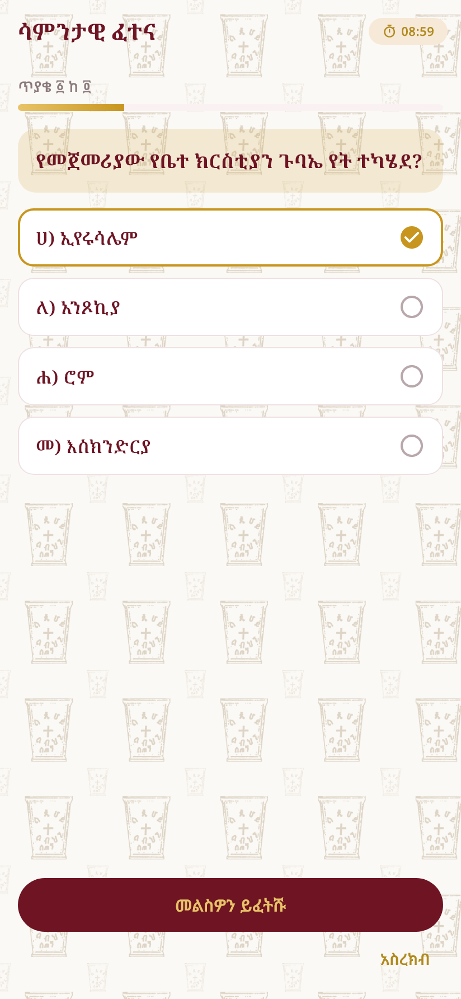{w=2.0}

*Figure 8.1 — Screens produced by `test/screenshots_test.dart` and `test/edu_screenshots_test.dart` (sample data, not production records).*

## 9. Database documentation

The schema was read directly from the integration-test database `mh_app_test` (production dump `hersolot_mh_prod.sql` + every migration up to `2026_10_19_000001`, i.e. the 1.5.3+16 schema): **128 tables**. Engine InnoDB, charset utf8mb4 (two legacy tables were converted by `2026_10_17_000001`). The full data dictionary (every column, type, nullability, key and default) is *Appendix C*; foreign keys are listed there per table.

### 9.1 Tables by module
#### Identity, access & sessions
| Table | Cols | References | Purpose |
|---|---|---|---|
| `users` | 35 | roles, users | Every account (members and administrators): identity, sign-in credentials (hashed), status, trusted device, member number and group. |
| `roles` | 11 | departments | Administrative roles with a level; department roles carry department_id. One hidden system role exists (restricted). |
| `permissions` | 4 | — | The permission catalogue (63 keys) mirrored from app/Mz/Auth/Catalog.php. |
| `role_permissions` | 2 | permissions, roles | Permissions granted to each role. |
| `user_permissions` | 4 | permissions, users | Direct permission grants to a single account. |
| `user_permission_revocations` | 4 | permissions, users | Per-account revocations that override role grants. |
| `refresh_tokens` | 12 | users | Rotating refresh tokens (stored as hashes) grouped by session family; device and client metadata. |
| `revoked_access_tokens` | 3 | — | Access-token ids (jti) revoked before expiry (sign-out of one session). |
| `password_resets` | 7 | users | Hashed 6-digit reset codes with expiry and attempt counter. |
| `device_history` | 8 | users | Device bind / login / rejected-login / reset events per account. |
| `user_preferences` | 11 | users | Theme, language, audio, reminder time, lyrics font scale and notification topics. |
| `user_preferred_categories` | 2 | categories, users |  |
| `telegram_link_tokens` | 6 | users |  |
| `telegram_state` | 2 | — |  |
| `fcm_tokens` | 8 | users | Firebase push tokens per device. |

#### Members, HR & departments
| Table | Cols | References | Purpose |
|---|---|---|---|
| `member_profiles` | 39 | users | The membership form (birth, baptism, address, emergency contact, education, profession, confession father...). Many columns are encrypted at rest. |
| `member_groups` | 10 | users | Member types (Children, Youth & Adult, Married, distance...) used for targeting, attendance and payments. |
| `id_sequences` | 2 | — | Counters for permanent member numbers. |
| `profile_change_requests` | 13 | users | Member requests to change name, phone or profile fields, awaiting approval. |
| `profile_change_history` | 9 | profile_change_requests, users | Append-only history of applied profile changes (old → new). |
| `professions` | 7 | — |  |
| `departments` | 10 | users | The 7 church departments (Amharic + English names, code prefix). |
| `user_departments` | 7 | departments, users | Department membership and role label of each member. |
| `department_admins` | 7 | departments, roles, users | Department administrators and their department role. |
| `department_participation` | 9 | departments, users | Monthly participation score per member per department (recorded by the department leader). |
| `department_participation_history` | 9 | departments, users |  |

#### Mezmur & content
| Table | Cols | References | Purpose |
|---|---|---|---|
| `mezmurs` | 25 | categories, users | Hymns: title, lyrics, optional LRC timing, audio/cover, category, status, counters, content version. |
| `categories` | 14 | categories, users | Hierarchical Mezmur categories (parent_id, depth), with images and 'today' highlighting (study_on). |
| `tags` | 2 | — |  |
| `mezmur_tags` | 2 | mezmurs, tags |  |
| `favorites` | 3 | mezmurs, users | Member favourite Mezmurs. |
| `downloads` | 5 | mezmurs, users | Mezmurs downloaded for offline use (with or without audio). |
| `advertisements` | 15 | pages, programs, users | Home banners linked to pages or programs, scheduled by date. |
| `ad_attachments` | 10 | advertisements |  |
| `pages` | 17 | programs, users | Internal content pages with call-to-action and optional program link. |
| `page_images` | 5 | pages |  |

#### Programs, attendance & excuses
| Table | Cols | References | Purpose |
|---|---|---|---|
| `programs` | 37 | program_categories, users | Church programs/events: schedule, recurrence, audience, registration, attendance and reminder settings. |
| `program_categories` | 11 | users | Program types with colour, default reminder offsets and repeat interval. |
| `program_participants` | 7 | programs, users | Invited / registered participants of participant-only programs. |
| `program_attendance_takers` | 4 | programs, users | The one default attendance taker of each program. |
| `program_occurrence_overrides` | 10 | programs, users | Cancelled or rescheduled occurrences of recurring programs. |
| `program_reminder_choices` | 4 | programs, users |  |
| `reminders` | 13 | borrowings, programs, users | Personal reminders (local-first, synced) for programs, borrowings or free text. |
| `attendance` | 21 | programs, users | One mark per member per program occurrence: status, capture time, elapsed seconds, method, signature link, sync metadata. |
| `attendance_sessions` | 17 | programs, users | One session per program occurrence: taker, status, start/end times and sources. |
| `attendance_signatures` | 9 | — | Signature images (private files, SHA-256) captured for Present marks. |
| `attendance_sync_conflicts` | 20 | — | HR review queue for offline attendance the server could not apply. |
| `attendance_closures` | 5 | programs, users | Early closure of an occurrence's attendance. |
| `attendance_corrections` | 16 | programs, users | Correction requests after closure, with review outcome. |
| `permission_requests` | 16 | programs, users | Members' requests to be excused from a program occurrence (approve, reject, cancel). |

#### Education
| Table | Cols | References | Purpose |
|---|---|---|---|
| `edu_assessments` | 8 | edu_courses | Assessments of a course (max score, weight, date). |
| `edu_assignments` | 11 | edu_courses, users | Assignments (individual or group) with attachment and due date. |
| `edu_attendance` | 9 | edu_classes, users | Legacy class attendance (to be frozen read-only when class attendance moves to programs). |
| `edu_categories` | 12 | — | Learning categories (Holy Bible, Church History, Liturgy & Order, Hagiography). |
| `edu_class_staff` | 3 | edu_classes, users |  |
| `edu_classes` | 17 | users | Classes (term, academic year, semester, department, streams, registration window, capacity). |
| `edu_complaint_messages` | 7 | — |  |
| `edu_complaints` | 17 | — | Academic complaints with reference EC-YYYY-NNNNNN, private attachment and status. |
| `edu_course_enrollments` | 7 | — |  |
| `edu_course_teachers` | 9 | — | Teacher assignments with status history (only active teachers enter marks). |
| `edu_courses` | 12 | edu_classes, users | Subjects taught in a class (optionally linked to a curriculum subject). |
| `edu_enrollments` | 8 | edu_classes, users | Class enrolment with program (regular / distance) and stream. |
| `edu_featured` | 13 | — | Featured banner entries on the Education home. |
| `edu_group_members` | 2 | edu_groups, users |  |
| `edu_groups` | 5 | edu_courses |  |
| `edu_journey` | 13 | — | Append-only student journey events. |
| `edu_lesson_materials` | 14 | edu_lessons | Lesson files (private) or external links (video). |
| `edu_lesson_progress` | 6 | edu_lessons, users | Per-member lesson start/completion and bookmarks. |
| `edu_lessons` | 17 | edu_subjects, edu_units | Lessons: body, scripture references, objectives, teacher notes, publication status. |
| `edu_quiz_answers` | 7 | edu_quiz_attempts, edu_quiz_questions |  |
| `edu_quiz_attempts` | 13 | edu_quizzes, users | Attempts with auto/manual score and transfer to the score sheet. |
| `edu_quiz_questions` | 9 | edu_quizzes | Quiz questions with type, options, answer, points. |
| `edu_quizzes` | 17 | edu_assessments, edu_courses, edu_lessons | Quizzes (practice or linked to an assessment), timing, attempts, review policy. |
| `edu_requests` | 17 | — | Student requests (class/stream/study-mode change, add/drop) applied on approval. |
| `edu_schedule` | 11 | edu_classes, edu_courses |  |
| `edu_score_history` | 11 | — | Every mark change (old/new score and status, actor, reason). |
| `edu_scores` | 15 | edu_assessments, users | Marks with draft → submitted → approved/rejected → published workflow. |
| `edu_subjects` | 16 | edu_categories | Curriculum subjects with visibility (enrolled-only / all) and sequential option. |
| `edu_submissions` | 13 | edu_assignments, edu_groups, users | Student submissions with grading and feedback. |
| `edu_units` | 8 | edu_subjects | Units inside a subject. |

#### Selection, choir & Mezmur services
| Table | Cols | References | Purpose |
|---|---|---|---|
| `holiday_selections` | 17 | users | Holiday Mezmur service selections: period, member groups, JSON configuration, status, finalisation and publication. |
| `selection_results` | 23 | holiday_selections, users | Per-applicant computed result: components, total, qualified, overrides, service category and rank. |
| `selection_reviews` | 10 | — | Each required department's review decision. |
| `selection_feedback` | 9 | — | Members' feedback on a published result. |
| `selection_config_versions` | 15 | — | Created by the withdrawn department-criteria feature (unused); reused by in-development config versioning. |
| `selection_scores` | 12 | — | Withdrawn department-criteria feature (unused, kept for history). |
| `selection_evaluators` | 6 | — | Withdrawn department-criteria feature (unused, kept for history). |
| `choir_eligibility` | 6 | users | Daily-computed choir eligibility score per member (choir.policy). |
| `choir_selections` | 10 | users |  |
| `wedding_services` | 15 | users | Wedding Mezmur services; legacy eligibility columns kept but ignored. |
| `wedding_service_members` | 9 | users, wedding_services | Members selected for a wedding service. |

#### Contributions (finance)
| Table | Cols | References | Purpose |
|---|---|---|---|
| `payments` | 19 | users | Monthly contributions by Ethiopian period; one payment may cover 1–12 months; status and verification. |
| `payment_rates` | 7 | users | Monthly rate per member type (student / worker) with effective date. |

#### Property, borrowing & library
| Table | Cols | References | Purpose |
|---|---|---|---|
| `items` | 29 | departments, users | Property and library items with stock, condition, domain (education/mezmur), department and borrowing rules. |
| `item_categories` | 9 | — |  |
| `borrowings` | 28 | borrowing_batches, items, users | Individual loans: quantities, due date, return condition, fine and fine overrides. |
| `borrowing_batches` | 5 | users |  |
| `borrowing_signatures` | 7 | borrowings, users | Signatures captured when an item is handed over. |
| `return_conditions` | 6 | — |  |
| `library_requests` | 13 | borrowings, items, users | Members' requests for physical books, linked to the resulting borrowing. |
| `property_requests` | 16 | departments, items, users | Department property requests through review, issue and return. |
| `property_request_events` | 9 | property_requests, users |  |

#### Projects & tasks
| Table | Cols | References | Purpose |
|---|---|---|---|
| `project_budget_adjustments` | 11 | projects, users |  |
| `project_budget_categories` | 6 | — |  |
| `project_budget_lines` | 3 | project_budget_categories, projects |  |
| `project_comments` | 7 | projects, users |  |
| `project_expenses` | 20 | project_budget_categories, projects, users |  |
| `project_files` | 10 | project_issues, project_tasks, projects, users |  |
| `project_issues` | 15 | departments, project_tasks, projects, users |  |
| `project_members` | 5 | projects, users |  |
| `project_suggestions` | 13 | departments, project_tasks, projects, users |  |
| `project_task_assignees` | 4 | project_tasks, users |  |
| `project_tasks` | 25 | departments, programs, project_issues, projects, users | Tasks with assignees, deadlines, status reasons, progress and versioning (offline conflicts). |
| `projects` | 24 | departments, users | Department projects: leader, dates, status, priority, progress, budgets. |

#### Department chat
| Table | Cols | References | Purpose |
|---|---|---|---|
| `chat_messages` | 18 | departments, project_tasks, users | Department group and private messages, attachments, meeting links and Task-Bot posts. |
| `chat_reads` | 6 | departments, users |  |

#### Notifications
| Table | Cols | References | Purpose |
|---|---|---|---|
| `notifications` | 19 | notification_broadcasts, users | In-app notifications per user with push / e-mail delivery status and dedupe key. |
| `notification_broadcasts` | 13 | users | Admin messages to one, many, a filtered group or everyone. |
| `scheduled_notifications` | 15 | users | Time-based notifications stored ahead and released by the dispatcher job. |

#### Guidance
| Table | Cols | References | Purpose |
|---|---|---|---|
| `guidance_articles` | 20 | — | Help-centre articles (bilingual), contextual help per screen and tours. |
| `user_guidance_progress` | 8 | — |  |

#### Platform, audit & operations
| Table | Cols | References | Purpose |
|---|---|---|---|
| `settings` | 4 | users | Validated JSON settings (fines, payments, attendance, borrowing, reminders, member ID format...). |
| `audit_logs` | 10 | users | Administrative audit trail (actor, action, entity, metadata, IP, user agent). |
| `activity_logs` | 9 | users | Member activity events (logins, plays, downloads...). |
| `job_runs` | 5 | — | Last run of each background job. |
| `sync_receipts` | 5 | users | Idempotency receipts of offline operations (op_id per user). |
| `app_releases` | 14 | users | Published APKs: version, size, SHA-256, notes, mandatory flag, minimum supported build. |
| `migrations` | 3 | — |  |

### 9.2 Important constraints and conventions
- **Uniqueness that enforces business rules:** one attendance mark per member per occurrence; one attendance session per program + occurrence date; `attendance.client_event_id` UNIQUE (idempotent offline replay); `sync_receipts (user_id, op_id)`; notification `dedupe_key` (reminders are idempotent); one default attendance taker per program.
- **Soft deletion** is used for Mezmurs, items and reminders (`deleted_at`); users can be soft-deleted by administrators.
- **History tables are append-only:** `edu_score_history`, `profile_change_history`, `department_participation_history`, `property_request_events`, `edu_journey`, `audit_logs`.
- **Encrypted columns** (section 25) cannot be used in WHERE / ORDER BY / JOIN; names, phone and e-mail stay searchable by design.
- **Dates:** stored in UTC (`Db/UtcDateTime`), displayed in Africa/Addis_Ababa; payable periods are Ethiopian `YYYY-MM` strings.
- **Unused tables kept on purpose:** `selection_config_versions`, `selection_scores`, `selection_evaluators` (withdrawn department criteria) — no data was deleted.

### 9.3 Migrations
| Migration | Purpose |
|---|---|
| `2026_10_05_000000_baseline_schema` | Baseline (matches the imported production dump) |
| `2026_10_06_000001_notifications_auth_programs` | Notifications, auth and program additions |
| `2026_10_06_000002_project_management` | Projects, tasks, budgets, issues, suggestions, files |
| `2026_10_07_000001_library_and_registration` | Library requests, education registration |
| `2026_10_08_000001_encrypted_columns` | Column widths for sealed values |
| `2026_10_09_000001_profile_requests_admin_tools` | Profile change requests and admin tools |
| `2026_10_10_000001_member_groups_page_links` | Member groups, page links |
| `2026_10_11_000001_course_schedules_completion` | Course schedules and completion |
| `2026_10_12_000001_notification_center_property` | Notification centre, property requests |
| `2026_10_13_000001_create_professions_table` | Professions |
| `2026_10_13_000001_holiday_selection_review_and_categories` | Selection reviews and service categories |
| `2026_10_13_000002_add_mandatory_reminder_to_programs` | Mandatory reminders |
| `2026_10_14_000001_create_guidance_system_tables` | Guidance articles and progress |
| `2026_10_15_000001_programs_twice_monthly_recurrence` | Twice-monthly recurrence |
| `2026_10_16_000001_app_sessions_without_timeout` | App sessions without timeout |
| `2026_10_16_000002_permission_request_cancellation` | Cancelling approved excuses |
| `2026_10_16_000003_program_type_and_interval_reminders` | Program types, 15-day interval reminders |
| `2026_10_16_000004_education_course_management` | Teachers, marks workflow, requests, complaints, journey |
| `2026_10_16_000005_selection_department_criteria` | Department criteria tables (feature later withdrawn) |
| `2026_10_17_000001_items_borrowings_utf8mb4` | Charset fix for Amharic in items/borrowings |
| `2026_10_17_000002_sessions_never_expire` | Session expiry clean-up |
| `2026_10_17_000003_reseed_untouched_selection_criteria` | Now a no-op (kept for history) |
| `2026_10_18_000001_education_learning_platform` | Learning platform tables, education.content permission |
| `2026_10_19_000001_attendance_sessions` | Attendance sessions, signatures, conflicts, HR permissions |
| `2026_10_20_000001_academic_structure` | **Unreleased** — academic years, terms, levels, exclusive enrolment, course offerings |
| `2026_10_20_000002_program_edu_attendance` | **Unreleased** — program↔class links, class attendance cut-over, config column |

## 10. Authentication, sessions, device restrictions and account recovery

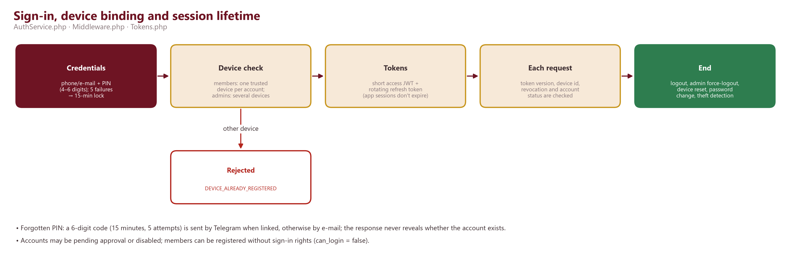

- **Credentials.** Identifier = phone (normalised) or e-mail. All accounts now use a 4–6 digit PIN; a legacy password signs in once and forces a PIN change (`must_change_password`). Hashing: Argon2id (19 MiB memory, 2 iterations) with transparent re-hash; unknown identifiers still run a dummy verify to keep timing constant.
- **Lockout.** 5 consecutive failures lock the account for 15 minutes. Rate limits per IP: global 300 requests/60 s; auth 30/15 min; reset 10/hour.
- **Account states.** `pending` (ACCOUNT_PENDING), `disabled` (ACCOUNT_DISABLED); members may exist without sign-in rights (`can_login = false`).
- **Device binding (members).** The first successful sign-in binds the device id; a different device is refused (DEVICE_ALREADY_REGISTERED) and a device already bound to another member is refused (DEVICE_IN_USE). Every request re-checks that the token's device equals the bound device. Administrators can reset the device (`users.reset_device`), which also forces logout. Administrators may be signed in on several devices.
- **Tokens.** Short-lived access JWT (default 15 min, claims include token version, device id and session id) and an opaque rotating refresh token stored hashed per session family. App refresh tokens do not expire (decision of 2026-10-13, `JWT_REFRESH_TTL_DAYS=0`). A refresh replayed within 120 s or while its replacement is unused continues the session; reuse after the replacement was used is treated as theft.
- **Revocation.** Logout revokes the session family and the current access token id; password change, device reset and admin force-logout bump `token_version`, which invalidates every JWT immediately. Settings → Sessions lists sessions and ends one, the others, or all.
- **Recovery.** `POST /auth/forgot-password` always answers the same way. A 6-digit code (HMAC-stored, 15-minute validity, 5 attempts) is sent through Telegram if linked, otherwise by e-mail; `POST /auth/reset-password` sets a new PIN (administrators need a stronger password, checked in the service).
- **App-side protection.** Tokens in secure storage; optional biometric lock; FLAG_SECURE on member data, profile and QR screens.

## 11. Roles, departments, permissions and administrative hierarchy

Authorisation is permission-based. A user's effective permissions = permissions of their role + their department-admin roles + direct grants − per-user revocations (`user_permission_revocations` always win). Routes declare required permissions; services re-check them and apply row-level rules (e.g. a teacher may only grade their own active courses; a department admin sees only their departments' projects).

### 11.1 Roles (from the database)
| Role key | Name (as stored) | English description | Level | Department-bound | # permissions |
|---|---|---|---|---|---|
| `high_admin` | ከፍተኛ አስተዳዳሪ | High administrator | 50 | no | 59 |
| `mezmur_lead` | የመዝሙር ክፍል መሪ | Mezmur department lead | 20 | no | 19 |
| `moderator` | ሞደሬተር (ትምህርት) | Moderator (education) | 20 | no | 9 |
| `hr_manager` | የሰው ሀብት አስተዳዳሪ | Human-resources manager | 20 | no | 11 |
| `payments_manager` | የክፍያ አስተዳዳሪ | Payments manager | 20 | no | 4 |
| `dept_education` | Education and Training Admin | Education & Training department admin | 15 | yes | 19 |
| `dept_hymns` | Hymns and Arts Admin | Hymns & Arts department admin | 15 | yes | 17 |
| `dept_hr` | Human Resources Admin | Human Resources department admin | 15 | yes | 20 |
| `dept_programs` | Program and Conference Admin | Program & Conference department admin | 15 | yes | 11 |
| `dept_finance` | Finance and Property Admin | Finance & Property department admin | 15 | yes | 14 |
| `dept_planning` | Planning and Development Admin | Planning & Development department admin | 15 | yes | 9 |
| `dept_info` | Information and Communications Admin | Information & Communications department admin | 15 | yes | 11 |
| `edu_registrar` | የትምህርት ተመዝጋቢ አስተዳዳሪ | Education registrar | 15 | no | 2 |
| `admin` | አስተዳዳሪ | Administrator | 10 | no | 56 |

A hidden top-level authority role exists for platform recovery; it is excluded from this document (see Appendix F).

### 11.2 Departments
| Code | Amharic | English |
|---|---|---|
| EDU | ትምህርት እና ሥልጠና ክፍል | Education and Training Department |
| HYM | መዝሙር እና ሥነ-ጥበብ ክፍል | Hymns and Arts Department |
| HR | የሰው ኃብት አስተዳደር ክፍል | Human Resources Management Department |
| PRG | መ/ግ እና ጉባኤ ዝግጅት ክፍል | Program and Conference Preparation Department |
| FIN | ሒሳብ እና ንብረት ክፍል | Finance and Property Department |
| PLN | ዕቅድ እና ልማት ክፍል | Planning and Development Department |
| INF | መረጃ እና የውስጥ ግንኙነት ክፍል | Information and Internal Communications Department |

### 11.3 Member groups
| Key | Amharic | English |
|---|---|---|
| `children` | ሕጻናት | Children |
| `youth_adult` | ወጣቶች እና አዋቂዎች | Youth & Adult |
| `married` | ባለትዳሮች | Married |
| `g_g` | የርቀት | — |

### 11.4 Permission catalogue (63 keys) and the roles that hold them
| Permission | Group | Meaning | Roles holding it |
|---|---|---|---|
| `admins.manage` | admins | Create and configure lower-level administrators | high_admin, admin |
| `admins.view` | admins | View administrator accounts | high_admin, admin |
| `choir.manage` | choir | Manage wedding ceremony choir services (መዝሙር አገልግሎት) | high_admin, mezmur_lead, dept_hymns, admin |
| `selection.configure` | choir | Create and configure holiday selections (period, weights, rules) | high_admin, admin |
| `selection.exams` | choir | Set whether exam results are required for a holiday selection | high_admin, dept_education, dept_hymns, admin |
| `selection.finalize` | choir | Finalize holiday selections | high_admin, admin |
| `selection.review` | choir | Review holiday selection results and record exceptions | high_admin, mezmur_lead, dept_education, admin |
| `selection.view` | choir | View holiday selections and their results | high_admin, mezmur_lead, dept_education, dept_hymns, dept_finance, admin |
| `ads.manage` | content | Manage advertisement banners | high_admin, mezmur_lead, dept_education, admin |
| `categories.manage` | content | Manage categories | high_admin, mezmur_lead, dept_hymns, admin |
| `pages.manage` | content | Manage internal pages | high_admin, mezmur_lead, dept_education, admin |
| `chat.supervise` | departments | Read and moderate every department chat | high_admin, dept_hr, admin |
| `education.content` | education | Manage subject categories, curriculum (subjects, units, lessons, materials) and the featured banner | high_admin, moderator, dept_education, admin |
| `education.manage` | education | Manage classes, courses, teachers and attendance takers | high_admin, moderator, dept_education, admin |
| `education.register` | education | Register members (new or existing) into classes and their courses | high_admin, moderator, dept_education, edu_registrar |
| `hr.manage` | hr | Assign members to departments and give them role labels | high_admin, hr_manager, dept_hr, admin |
| `borrowing.approve` | library | Approve direct borrowings that need approval | high_admin, dept_education, dept_hymns, dept_hr, dept_programs, dept_finance, dept_planning, dept_info, admin |
| `borrowing.configure` | library | Configure which items and members can borrow directly | high_admin, dept_finance, admin |
| `borrowing.manage` | library | Issue and return borrowed items | high_admin, mezmur_lead, moderator, dept_finance, admin |
| `fines.manage` | library | Configure fine policy and override fines | high_admin, dept_finance, admin |
| `items.manage` | library | Manage library items | high_admin, mezmur_lead, moderator, dept_finance, admin |
| `mezmurs.create` | mezmurs | Create Mezmurs | high_admin, mezmur_lead, dept_hymns, admin |
| `mezmurs.delete` | mezmurs | Delete Mezmurs | high_admin, mezmur_lead, admin |
| `mezmurs.update` | mezmurs | Edit Mezmurs, audio and covers | high_admin, mezmur_lead, dept_hymns, admin |
| `mezmurs.view` | mezmurs | View Mezmurs in the admin panel (including drafts) | high_admin, mezmur_lead, dept_hymns, admin |
| `notifications.send` | notifications | Send notifications to individual / selected / filtered users | high_admin, mezmur_lead, moderator, hr_manager, payments_manager, dept_education, dept_hymns, dept_programs, dept_info, admin |
| `notifications.send_all` | notifications | Send notifications to all users | high_admin, dept_education, dept_hymns, dept_programs, dept_info, admin |
| `payments.configure` | payments | Set student / worker monthly payment rates | high_admin, admin |
| `payments.manage` | payments | Record monthly payments | high_admin, payments_manager, dept_planning, admin |
| `payments.view` | payments | View monthly contributions and reports (read-only) | high_admin, payments_manager, dept_finance, dept_planning, admin |
| `attendance.assign` | programs | Assign the one attendance taker of each program occurrence (HR) | hr_manager, dept_hr |
| `attendance.close` | programs | Close an attendance session before the program ends | high_admin, hr_manager, dept_hr, admin |
| `attendance.configure` | programs | Configure attendance (signature rules, sessions) — HR | high_admin, hr_manager, dept_hr, admin |
| `attendance.correction.approve` | programs | Review attendance correction requests | high_admin, hr_manager, dept_hr, admin |
| `attendance.correction.request` | programs | Submit attendance comments and correction requests | dept_education, dept_hymns, dept_programs, dept_info, admin |
| `attendance.manage` | programs | Take attendance: scan, mark and record permissions while the session is open | high_admin, mezmur_lead, hr_manager, dept_hr, admin |
| `attendance.override` | programs | Change attendance after the session has closed | hr_manager, dept_hr, admin |
| `attendance.reports` | programs | View attendance statistics and calendars of members | high_admin, mezmur_lead, moderator, hr_manager, dept_education, dept_hr, dept_info, admin |
| `attendance.view` | programs | View attendance rosters, calendars and summaries | high_admin, mezmur_lead, hr_manager, dept_education, dept_hymns, dept_hr, dept_programs, dept_info, admin |
| `programs.manage` | programs | Manage programs and participants | high_admin, mezmur_lead, dept_programs, admin |
| `programs.reminders_enforce` | programs | Make a program's reminders mandatory for its members | — (direct grant only) |
| `program_categories.manage` | programs | Create and edit program categories | high_admin, dept_programs, admin |
| `projects.all_departments` | projects | Access the projects of every department | high_admin |
| `projects.expenses.approve` | projects | Approve project budgets, expenses and budget adjustments (Finance) | high_admin, dept_finance |
| `projects.manage` | projects | Create and manage projects, tasks and teams in the departments one administers | high_admin, dept_education, dept_hymns, dept_hr, dept_programs, dept_finance, dept_planning, dept_info |
| `projects.reports` | projects | View project and task reports | high_admin, dept_education, dept_hymns, dept_hr, dept_programs, dept_finance, dept_planning, dept_info |
| `projects.view` | projects | View department projects (members always see their own department) | high_admin, dept_education, dept_hymns, dept_hr, dept_programs, dept_finance, dept_planning, dept_info, admin |
| `property.request` | property | Request property for a department | high_admin, dept_education, dept_hymns, dept_hr, dept_programs, dept_finance, dept_planning, dept_info, admin |
| `property.review` | property | Review, approve, reject and issue department property requests | high_admin, dept_finance, dept_planning, admin |
| `activity_logs.view` | reports | View user activity logs | high_admin, admin |
| `audit_logs.view` | reports | View the admin audit log | high_admin, admin |
| `reports.view` | reports | View dashboard and reports | high_admin, mezmur_lead, moderator, admin |
| `departments.manage` | system | Create departments and choose their leads | high_admin, admin |
| `guidance.manage` | system | Manage in-app guidance articles, FAQs, and interactive tours | high_admin, admin |
| `releases.manage` | system | Publish app versions (download page / force update) | high_admin, admin |
| `settings.manage` | system | Manage system settings | high_admin, admin |
| `member_groups.manage` | users | Create and edit member types (groups) used by programs and attendance | high_admin, dept_hr, admin |
| `member_id.configure` | users | Configure member ID prefixes and display style | high_admin, dept_hr, admin |
| `users.create` | users | Create user accounts | high_admin, dept_hr, admin |
| `users.disable` | users | Disable / enable user accounts | high_admin, admin |
| `users.reset_device` | users | Reset a user's registered device and force logout | high_admin, admin |
| `users.update` | users | Edit user accounts | high_admin, dept_hr, admin |
| `users.view` | users | View user accounts | high_admin, mezmur_lead, moderator, hr_manager, payments_manager, dept_education, dept_hymns, dept_hr, dept_finance, dept_planning, dept_info, edu_registrar, admin |

*Notes:* `guidance.manage` exists in the database but not in `Catalog.php` (added by the guidance migration). Some export rules reference `education.view` and `programs.view`, which are not in the catalogue — those alternatives can never match (*requires verification / clean-up*).

## 12. Detailed module-by-module functionality

### 12.1 Admin panel
The admin panel (`/admin`) shows only modules the user may use, in ten groups:
| Group (Amharic label) | Modules |
|---|---|
| User management (የተጠቃሚዎች አስተዳደር) | Users · Member IDs · Member types · Profile change requests |
| Member & activity management (የአባላትና እንቅስቃሴ አስተዳደር) | Monthly contributions · Attendance · Fines · Send notification · Notification delivery |
| Department management (የክፍሎች አስተዳደር) | Departments · Department chat |
| Properties (ንብረቶች) | Items · Borrowing · Property requests |
| Education management (የትምህርት አስተዳደር) | Courses · Library (requests, books) · Classes · Learning content · Student registration |
| Mezmur management (የመዝሙር አስተዳደር) | Service management (holiday selection, other Mezmur services) · Categories · Mezmurs · Bulk import |
| Promotion management (የማስተዋወቅ አስተዳደር) | Program categories · Programs · Banners · Internal pages |
| Project & task management | Projects · My tasks · Approvals |
| Administration management | Administrators · Roles · System settings · App versions · In-app guidance |
| Reports & audit (ሪፖርትና ኦዲት) | Reports · Audit log · User activity |

The admin home also shows a dashboard, 30-day sign-ups, recent activity and pending excuse requests. Several screens offer an *edit mode* pen on member-facing pages (Mezmur home, Programs).

### 12.2 Members and HR
- Registration collects name, phone, optional e-mail, PIN, member group and type (student / worker) and an optional membership profile; administrators can create members, including members without sign-in rights.
- Member numbers are permanent (never reused) and formatted with a group prefix (setting `member_id.format`, e.g. `መ/ሕ/ወ/17`). The member card shows the QR code (UUID payload) used by attendance and borrowing staff; it is also cached offline.
- Profile changes requested by members wait for approval; every applied change is recorded with old and new value.
- HR assigns members to departments with role labels; department leaders record a monthly participation score (max set by `participation.policy`), with history.

### 12.3 Programs (see section 14 for attendance)
- Fields: title, description, image, location, start/end (no end = end of day), category (program type), audience (all / participants), member groups, registration and capacity, status (draft / published / cancelled / completed), event type, 'additional' and 'counts for selection' flags.
- Recurrence: once, weekly, monthly (day of month or n-th weekday), twice monthly (N and N±14, or 1st & 3rd / 2nd & 4th weekday) and Ethiopian calendar days (1–30); occurrences are computed, never stored; individual occurrences can be cancelled or rescheduled.
- Reminders: per-program offsets (2 days, 1 day, 6 hours, 1 hour), members may choose their own offsets unless reminders are enforced; optional repeat every N days (15 by policy, 08:00–21:00 local, no backlog replay); device alarms with snooze work offline.
- Participants can be invited or registered in bulk using the targeting filter; finished one-off programs are marked completed by the nightly clean-up.

### 12.4 Banners, pages and guidance
Banners (advertisements) are scheduled cards on the Mezmur home that link to an internal page, a program or attachments; internal pages carry a cover, gallery, event date, location and a call to action. The guidance centre contains 56 bilingual articles (37 for administrators), interactive tours (welcome, Mezmur, programs, attendance, education, projects, library, choir, admin) and contextual help buttons on major screens; progress is stored per user.

## 13. Mezmur, lyrics, audio, file uploads and media management

- **Catalogue.** Hierarchical categories (parent/child with depth, images, ordering, active flag, 'today' highlighting); Mezmurs with title, lyrics, optional LRC timing, description, tags, cover, audio, status (draft/published), featured flag, view/favourite/download counters and a content version used to refresh offline copies. Search uses a full-text query with title normalisation; duplicate titles are detected.
- **Member experience.** Home (banners, categories, recent, popular, upcoming programs), category pages with play-all/shuffle, lyric view with adjustable font scale, time-synced lyric highlighting when LRC exists, YouTube links, share links, favourites and downloads (lyrics always; audio and cover optional or per preference).
- **Player.** just_audio with background playback and lock-screen/notification controls (church emblem artwork when no cover), queue, shuffle, repeat off/all/one, speed, sleep timer (at a time or after the current track), mini player and full now-playing screen; playback is tracked in activity logs.
- **Administration.** Create/edit/publish Mezmurs with audio and cover upload, LRC maker, bulk category assignment, drafts, and bulk import from Excel/CSV/pasted rows (dry run first).
- **Upload protection.** A first check on declared type and size (Http/Upload.php), then the real type is detected from the file bytes before saving (Services/Storage.php). Limits (env-configurable): images 5 MB, audio 40 MB, documents 20 MB, books 60 MB, APK 250 MB, signatures 512 KB PNG. Public files are served with `X-Content-Type-Options: nosniff` and a sandboxing CSP; private files only through authorised routes with `Cache-Control: private, no-store`.

## 14. Programs, attendance, punctuality, scoring and attendance reports

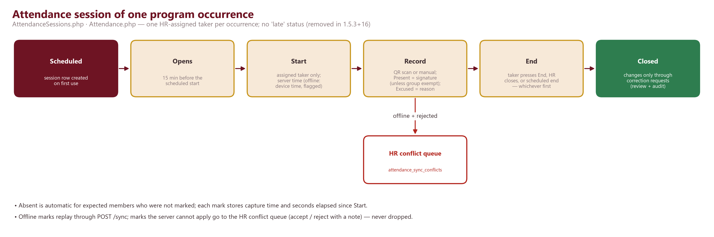

### 14.1 Released behaviour (1.5.3+16)
- **Control by HR.** All attendance-control permissions are held by HR roles (`dept_hr`, `hr_manager`); `attendance.assign` sets each program's one default taker and, per occurrence, a substitute (a reason is required while the session runs).
- **Session.** Created lazily per occurrence; available 15 minutes before the scheduled start; attendance time starts only when the assigned taker presses Start (server time; an offline start keeps the device time adjusted for clock skew and is flagged). The session ends when the taker presses End, HR closes it (`attendance.close`) or at the scheduled end — whichever is first, no grace period.
- **Marking.** Two steps: identify (QR UUID or manual pick, checks eligibility and existing marks without writing), then record. Only *present* and *excused* are recorded; *absent* is implied for expected members who were not marked. Present requires the member's signature (PNG) unless their member group is exempt (setting `attendance.signature`); excused requires a reason; removing a mark requires a reason. A second scan never creates a second record.
- **Punctuality.** The 'late' status was removed from attendance workflows, calculations, reports and selection evaluation (legacy 'late' rows read as present). Instead every mark stores the capture time and `elapsed_seconds` since Start, plus time source (server / device / correction) and method (QR / manual).
- **Excuses.** Members request to be excused from an occurrence before a deadline (setting `attendance.permissions`: deadline hours, monthly/quarterly limits, weight used in scoring). Approval writes an excused mark; an approved excuse can be cancelled by an administrator with a reason, removing only the mark it created.
- **Corrections.** After closure, changes go through correction requests (`attendance.correction.request`) reviewed by `attendance.correction.approve`, optionally with an arrival time; `attendance.override` allows authorised changes after closure.
- **Reports.** Member calendar and statistics, program summaries, per-occurrence roster export (PDF/XLSX/CSV) whose title and file name include the program, Ethiopian date and taker, with captured time, minutes after start, method, signature and sync columns.

### 14.2 Unreleased (source tree, target builds +18/+19)
- Class attendance moves to programs linked to classes (`program_edu_classes`, `attendance_edu_classes`, cut-over setting); legacy `edu_attendance` becomes read-only.
- Selection attendance scoring by elapsed-time intervals per attendance category with an explicit 'after the last interval' percentage, and configuration versions.

## 15. Education, classes and course attendance

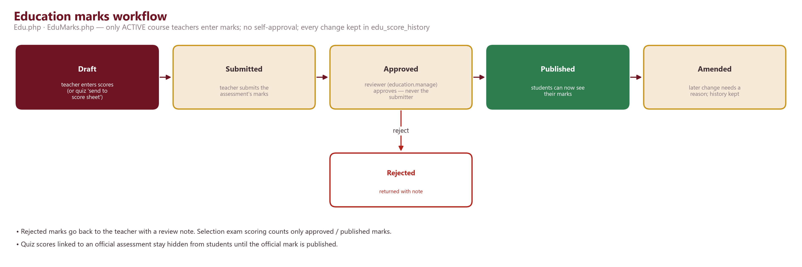

- **Structure.** Classes (name, term, academic year, semester, department, streams, registration window, regular / distance allowance, capacity, status) contain courses (subjects) with schedules (weekday, frequency, week of month, mode, location), staff and groups.
- **Registration.** Registrars (`education.register`) register new or existing members into classes and their courses, transfer and promote; members can enrol during registration windows.
- **Teachers.** `edu_course_teachers` keeps assignment history (assign / suspend / remove); only active assignments can enter marks; re-selecting a suspended teacher reactivates the assignment.
- **Marks.** Assessments (max score, weight, date) → scores in draft → submitted → approved / rejected → published; no self-approval; amendments need a reason; every change is stored in `edu_score_history`; students only see published marks. Deleting a class/course/assessment with academic records is refused (409 HAS_RECORDS — archive instead).
- **Assignments.** Individual or group assignments with attachments, submissions (text/file) and grading with feedback (publish time, deadline enforcement and late rules are not implemented).
- **Self-service.** Requests (class / stream / study-mode change, add or drop a class or subject) applied transactionally on approval; complaints with reference `EC-YYYY-NNNNNN`, messages, internal notes and private attachments; an append-only student journey.
- **Learning platform (1.5.3+15).** Categories (Holy Bible, Church History, Liturgy & Order, Hagiography) → curriculum subjects (visibility enrolled-only by default, optional sequential order) → units → lessons (body, scripture references, objectives, teacher notes, estimated minutes) with private materials (PDF, images, audio, Office files) and external video links; progress, bookmarks, continue-learning, featured banner and search. Active teachers write and publish lessons for subjects they teach; `education.content` holders edit all.
- **Quizzes.** Practice or assessment-linked quizzes with open/close times, time limit, attempt limit, scoring and shuffle options, 4 question types, autosave, manual grading; 'send to score sheet' writes draft marks into the normal workflow. Assessment-linked quiz scores are hidden until the official mark is published.
- **Class attendance (released).** Teachers / attendance takers mark class attendance (present / absent / excused, manual or QR scan; no late status); summaries feed the selection's class-attendance component. Moving this into programs is unreleased (section 14.2).
- **Module switch.** The Education module can be disabled per member/group (setting `modules.policy`); all `/edu` routes return 403 MODULE_DISABLED for them, except holders of education staff permissions.

## 16. Holiday selection: eligibility, review, approval and finalisation

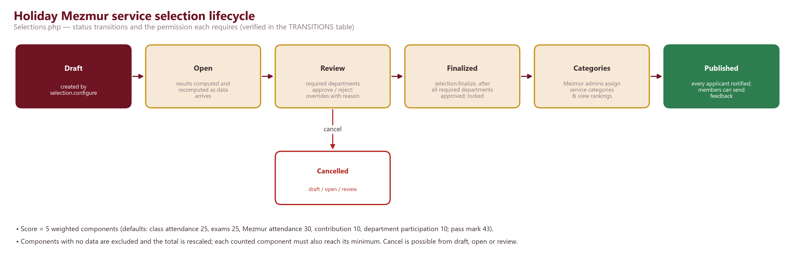

The holiday Mezmur service selection is configured in one place, on the selection itself (the department-based criteria built on 2026-10-13/14 were withdrawn on 2026-10-15 at the church's request).

| Component | Default weight | Default minimum | Measured from |
|---|---|---|---|
| Class attendance | 25 | 10 | Attendance in the member's education classes (chosen classes/courses) |
| Exams | 25 | 10 | Approved / published marks of the subjects the member actually takes |
| Mezmur attendance | 30 | 15 | Attendance at Mezmur programs (chosen categories / included programs) |
| Monthly contribution | 10 | 3 | Months paid ÷ months due (paid after due month counts as paid; exempt = 100 %) |
| Department participation | 10 | 5 | Average monthly participation score from the member's departments |

- Weights must total 100; default passing score 43; default member groups: youth & adult, married.
- attendance % = Σ(program weight × status points) ÷ Σ program weights; component points = % × weight ÷ 100; total = Σ points ÷ Σ counted weights × 100. Components with no data are excluded and the total is rescaled. *Qualified* = total ≥ passing score and every counted component ≥ its minimum. Members are not ranked for qualification.
- Service bonus up to 30 points (percentage or fixed) from chosen service programs; the existing rule gives it only at 100 % Mezmur attendance and caps the component at its weight, so it cannot add points in practice — flagged as needing a business decision.
- Lifecycle and permissions: draft → open (`selection.configure`) → review (`selection.review` or configure) → finalized (`selection.finalize`, only after every required department approved); cancel from draft/open/review. Configuration locks once in review. Results are recomputed while open and at status changes. Overrides (qualified / not qualified) need a reason and are audited; finalized results are locked.
- Required review departments default to Hymns & Arts, Education & Training, and Human Resources Management.
- After finalisation: Mezmur administrators assign service categories (ለወረብ አገልግሎት የተመረጡ / ለመዝሙር አገልግሎት የተመረጡ) and view rankings; publishing notifies every applicant; members may send feedback.
- Reports: selection report (all applicants and components) and Mezmur report (`choir.manage`) in PDF/XLSX/CSV; marked provisional until finalized.
- Separate mechanisms: the *choir eligibility* score (setting `choir.policy`, recomputed nightly) and *wedding services*, whose participants are selected manually by `choir.manage` holders.

## 17. Contributions, finance, property and borrowing workflows

### 17.1 Monthly contributions
- Recorded by Ethiopian month (`YYYY-MM`, Pagume belongs to Nehase). One payment covers 1–12 consecutive months; amount = member's rate (student / worker, effective-dated in `payment_rates`) × months; children do not pay.
- A month counts as paid when covered; payments after the month + `grace_days` are labelled *Paid after due month* (financial rule only). Payments have method, reference, receipt upload, note and verification by a second administrator.
- Members see their own payment history and percentage; `payments.view` gives read-only reports; `payments.configure` sets rates; export kind `contributions`.
### 17.2 Items, borrowing, fines and library
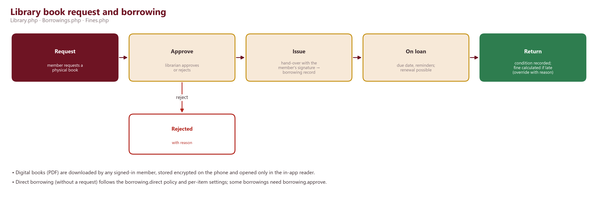

- Items carry name, author, code (auto-generated per category), category (books, department resources, electronics, equipment, furniture, instruments, office, other), quantity/available, condition, location, domain (education / mezmur), department and borrowing rules (direct borrowable, max quantity/days).
- Borrowing: individual or bulk (batch) issues, direct borrowing under the `borrowing.direct` policy (member groups, approval required, limits), approval (`borrowing.approve`), renewal, return with configurable return conditions (may mark lost / restock), signatures at hand-over.
- Fines (`fines.policy`): enabled flag, amount per day or week, grace days, maximum, currency (ETB); recalculated nightly; overrides require a reason; due and overdue reminders are sent.
- Library: digital PDF books downloaded by members are encrypted with AES-256-GCM using a keystore key and opened only in the in-app reader; physical books are requested, approved and issued with a signature, creating a normal borrowing.
### 17.3 Department property requests
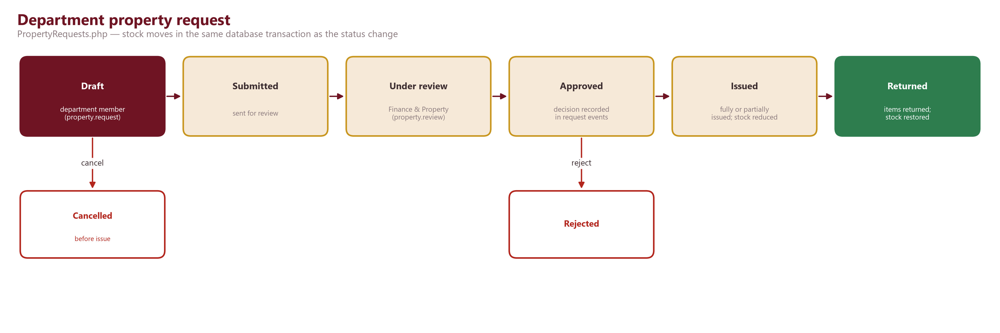

## 18. Departments, chat, projects, tasks, budgets and expenses

- **Projects** belong to one department; leader, team (roles), dates, status, priority, progress (manual or computed from task weights), notes, 'allow late tasks', currency and budgets. Visibility: members see their own department; `projects.all_departments` sees all.
- **Tasks** have several assignees, deadlines within the project deadline, priority, status with reasons (pending reason, status reason), progress, weight, completion note and a version number used to detect offline conflicts; they can originate from issues, suggestions or programs. Deadline reminders are scheduled as notifications.
- **Feedback.** Issues (priority, assignee, due date, resolution), suggestions (review, convert to task), comments, files (private), activity feed and reports (summary, tasks).
- **Chat.** One private group per department plus private leader↔member threads; members send text; leaders and the supervisor (`chat.supervise`) also send media and meeting links; read markers; attachments streamed only to allowed readers; the Task Bot posts task events with action buttons that use the same task rules.

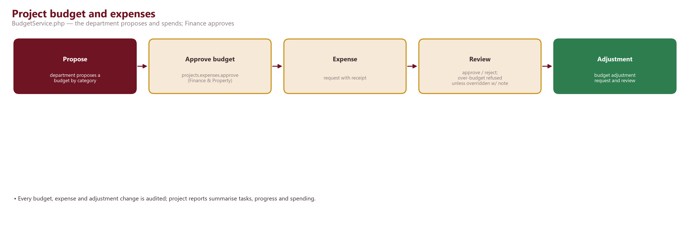

## 19. Notifications, announcements, reminders and delivery mechanisms

- **In-app notifications** are created in bulk with a dedupe key (idempotent), stored per user and shown in the notification centre with unread badge. Topics: program, attendance, project, department, education, property, mezmur, system; members can switch topics and channels (push / e-mail) off, except mandatory types (system, admin message, announcement, borrowing due/overdue).
- **Push** through Firebase Cloud Messaging HTTP v1 (service-account JWT exchanged for an OAuth token on the server; the app holds only client configuration). Android channels separate reminders, programs, borrowing etc. If Firebase is not configured the app works with in-app notifications only.
- **E-mail** through SMTP for notification e-mails and reset codes; **Telegram** for linked accounts (reset codes, temporary passwords).
- **Broadcasts.** Admins send to one user, a selection, a filtered group or everyone (`notifications.send_all`); a resend is a new linked broadcast; delivery history and a delivery-health screen are available.
- **Reminders.** Program reminders (job every 5 minutes), interval reminders, borrowing reminders (every 30 minutes), scheduled notifications (every minute), personal reminders scheduled locally on the phone.
- **Retention.** Read notifications older than `notifications.retention_days` (default 365) are deleted by the nightly clean-up.

## 20. Ethiopian calendar and localisation support

- `Support/Ethiopian.php` converts Gregorian ↔ Ethiopian (Amete Mihret), handles leap years and month lengths (13th month Pagume), and computes payable periods, ranges and month counts; the app has a matching Ethiopian date picker and formatter (covered by `ethiopian_calendar_test.dart`).
- Programs can recur on Ethiopian calendar days; contributions use Ethiopian months; report PDFs print Ethiopian dates and month names; per-occurrence attendance exports include the Ethiopian date.
- Time zone: Africa/Addis_Ababa (server setting `APP_TIMEZONE`, app uses the full tz database).
- Localisation: Amharic is the template language (`app_am.arb`) with English (`app_en.arb`), 2,754 keys; server error codes are mapped to localised messages in `core/l10n/error_text.dart`; server-side texts (notifications, PDFs) use translation files; Ethiopic fonts are bundled for the app and used by the PDF renderer.

## 21. Offline behaviour, synchronisation and conflict handling

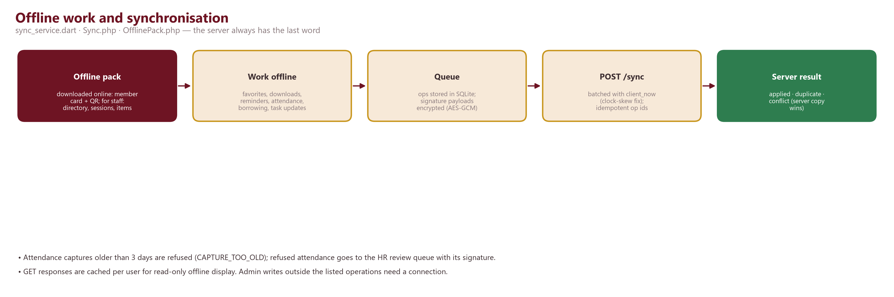

| Capability | Offline behaviour |
|---|---|
| Reading | Last good response of GET requests is cached per user and shown when the network fails (read-only). |
| Mezmur | Downloaded Mezmurs (lyrics, cover, optional audio) and favourites work fully offline. |
| Member card | Own member card and QR are kept in the offline pack. |
| Reminders | Created/edited locally, scheduled as device notifications, synced later. |
| Attendance (takers) | Offline pack contains member directory (no phone numbers), programs/sessions from 3 days ago to 2 weeks ahead, expected members, existing marks and timing rules; Start/End/marks are queued. |
| Borrowing staff | Member directory and lendable items; borrowing and returns are queued. |
| Projects | Task status/progress updates are queued (version check on sync). |
| Preferences | Changed optimistically, queued with base timestamp so a newer server copy is never silently overwritten. |
| Everything else | Needs a connection. |

- Sync protocol: `POST /api/v1/sync` with up to 200 operations `{op_id (UUID), type, payload, client_ts}` and `client_now`; each op is idempotent through `sync_receipts`; results are applied / duplicate / conflict, and on conflict the server copy wins and is returned.
- Attendance specifics: captures older than 3 days are refused (CAPTURE_TOO_OLD); clock skew is corrected using `client_now`; business errors become entries in the HR conflict queue (with signature) instead of being dropped; HR accepts or rejects with a note and cannot resolve their own submissions.
- Queue protection: signature-bearing payloads are encrypted with AES-256-GCM using a keystore key. In 1.5.3+16 signing out deleted the queue (defect F0a); the source tree keeps queued work by default and discards it only on explicit request (unreleased).

## 22. Reporting, exports, audit logs and document generation

`GET /api/v1/reports/export/{kind}?format=pdf|xlsx|csv` renders one template: PDF (A4, logo, title, Ethiopian date, period, generated by/at, filters, summary, tables, header/footer, page numbers, reference id), XLSX (summary sheet + one sheet per table, frozen headers) or CSV (main table, UTF-8 with BOM). Maximum 5,000 rows per export; every export is audited.

| Export kind | Permission (any of) |
|---|---|
| `users` | reports.view, hr.manage |
| `mezmurs` | reports.view, mezmurs.update |
| `attendance` | reports.view, attendance.reports |
| `borrowings` | reports.view, borrowing.manage |
| `notifications` | reports.view |
| `admin-activity` | audit_logs.view |
| `audit-logs` | audit_logs.view |
| `activity-logs` | activity_logs.view |
| `contributions` | payments.view, payments.manage |
| `selection` | selection.view, selection.review, selection.finalize |
| `projects` | projects.reports, projects.all_departments |
| `education` | reports.view, education.manage |
| `programs` | reports.view, programs.manage |
| `education-marks` | education.manage (wide / long layouts, missing marks shown as —) |
| `mezmur-selection` | choir.manage |

**Audit.** `audit_logs` records administrative actions (actor, action, entity, metadata, IP, user agent); `activity_logs` records member events (sign-ins, failures, device changes, plays, downloads). Both have viewers and exports. Known issue: the audit-log PDF export can exhaust 512 MB memory on very large ranges (recorded 2026-10-14).

## 23. API documentation

### 23.1 Conventions
- Base URL: `https://<host>/api/v1`. JSON over HTTPS; uploads are `multipart/form-data` with a `file` field.
- Authentication: `Authorization: Bearer <access JWT>` for routes marked *Bearer token*; obtain tokens from `POST /auth/login`, renew with `POST /auth/refresh`.
- Success envelope: `{ "success": true, "code": "OK", "message": "...", "data": ..., "errors": [] }`; paginated lists add `"meta": {"page", "limit", "total", "pages"}` (query `page`, `limit`).
- Error envelope: `{ "success": false, "code": "UPPER_SNAKE_CODE", "message": "...", "data": null, "errors": [{"field", "code", "message"}] }` with HTTP 400 (bad request), 401 (UNAUTHORIZED, INVALID_TOKEN, SESSION_REVOKED), 403 (FORBIDDEN, ACCOUNT_DISABLED, MODULE_DISABLED), 404, 409 (conflicts such as DEVICE_ALREADY_REGISTERED, SELECTION_LOCKED, HAS_RECORDS), 410, 413 (FILE_TOO_LARGE), 422 (VALIDATION_ERROR), 429 (rate limit, ACCOUNT_LOCKED).
- Validation: every body/query is parsed by a strict schema (`Ctx::body(Z::object([...]))`); unknown fields are rejected on strict schemas; error codes are field-level.
- Permissions: *any of* = at least one listed permission; *all of* = every listed permission. Services apply additional row-level checks.
- An OpenAPI file is served at `/api/openapi.json` (generated from the former Node backend; *requires verification* that it matches the current routes).

### 23.2 Request/response examples
**Sign in**
```http
POST /api/v1/auth/login
Content-Type: application/json

{"identifier": "0911223344", "password": "123456", "device_id": "<stable device id>", "device_name": "TECNO ..."}
```
Response `data`: access token, refresh token, expiry and the public user object (permissions, member group, flags such as `must_change_password`). Errors: INVALID_CREDENTIALS (401), ACCOUNT_LOCKED (429), ACCOUNT_PENDING, DEVICE_ALREADY_REGISTERED, DEVICE_IN_USE.

**Record attendance (two steps)**
```http
GET /api/v1/programs/42/attendance/check?uuid=<member QR uuid>&date=2026-10-19
PUT /api/v1/programs/42/attendance/1057

{"status": "present", "via": "qr", "signature": "data:image/png;base64,...", "date": "2026-10-19"}
```
Errors include LATE_REMOVED, SIGNATURE_REQUIRED, NOT_SESSION_TAKER, BEFORE_SESSION_START, SESSION_NOT_STARTED, ATTENDANCE_CLOSED, MEMBER_NOT_EXPECTED, SELF_ATTENDANCE_NOT_ALLOWED and PROGRAM_CANCELLED; a duplicate scan returns success with `duplicate: true`.

**Offline sync**
```http
POST /api/v1/sync

{"client_now": "2026-10-19T08:05:00Z", "operations": [
  {"op_id": "<uuid>", "type": "attendance.record", "payload": {"program_id": 42, "user_id": 1057, "date": "2026-10-19", ...}, "client_ts": "2026-10-19T07:58:12Z"}
]}
```
Operation types: favorite.add/remove, download.add/remove, reminder.create/update/delete, activity, attendance.session.start/end, attendance.record, attendance.set, attendance.clear, attendance.bulk, edu_attendance.set/scan, borrowing.create, borrowing.return, project.task.update, preferences.update.

**Export a report**
```http
GET /api/v1/reports/export/attendance?format=xlsx&program_id=42&date=2026-10-19
```

### 23.3 Route reference
All 564 documented routes, grouped by route file (restricted system-console routes and test-only routes are excluded; routes marked *(unreleased)* exist only in the source tree). Method, path, authentication, permission middleware and extra gates come from `php artisan route:list`.

#### Authentication (`api/auth.php`, 8 routes)
| Method | Path | Auth | Permissions | Gates |
|---|---|---|---|---|
| POST | `/api/v1/auth/change-password` | Bearer token | — | rate limit: auth |
| POST | `/api/v1/auth/forgot-password` | Public | — | rate limit: reset |
| POST | `/api/v1/auth/login` | Public | — | rate limit: auth |
| POST | `/api/v1/auth/logout` | Optional | — |  |
| GET | `/api/v1/auth/me` | Bearer token | — |  |
| POST | `/api/v1/auth/refresh` | Public | — | rate limit: auth |
| POST | `/api/v1/auth/register` | Public | — | rate limit: auth |
| POST | `/api/v1/auth/reset-password` | Public | — | rate limit: reset |

#### My account (current user) (`api/me.php`, 25 routes)
| Method | Path | Auth | Permissions | Gates |
|---|---|---|---|---|
| GET | `/api/v1/me` | Bearer token | — |  |
| PATCH | `/api/v1/me` | Bearer token | — |  |
| GET | `/api/v1/me/activity` | Bearer token | — |  |
| POST | `/api/v1/me/activity` | Bearer token | — |  |
| DELETE | `/api/v1/me/avatar` | Bearer token | — |  |
| POST | `/api/v1/me/avatar` | Bearer token | — |  |
| GET | `/api/v1/me/card` | Bearer token | — |  |
| DELETE | `/api/v1/me/change-request` | Bearer token | — |  |
| POST | `/api/v1/me/change-request` | Bearer token | — |  |
| GET | `/api/v1/me/change-requests` | Bearer token | — |  |
| DELETE | `/api/v1/me/fcm-tokens` | Bearer token | — |  |
| POST | `/api/v1/me/fcm-tokens` | Bearer token | — |  |
| GET | `/api/v1/me/notification-preferences` | Bearer token | — |  |
| PUT | `/api/v1/me/notification-preferences` | Bearer token | — |  |
| GET | `/api/v1/me/payments` | Bearer token | — |  |
| GET | `/api/v1/me/preferences` | Bearer token | — |  |
| PUT | `/api/v1/me/preferences` | Bearer token | — |  |
| GET | `/api/v1/me/profile` | Bearer token | — |  |
| POST | `/api/v1/me/push-test` | Bearer token | — |  |
| GET | `/api/v1/me/sessions` | Bearer token | — |  |
| POST | `/api/v1/me/sessions/revoke-all` | Bearer token | — |  |
| POST | `/api/v1/me/sessions/revoke-others` | Bearer token | — |  |
| DELETE | `/api/v1/me/sessions/{sid}` | Bearer token | — |  |
| DELETE | `/api/v1/me/telegram` | Bearer token | — |  |
| POST | `/api/v1/me/telegram/link` | Bearer token | — |  |

#### Personal: notifications, reminders, favorites, downloads (`api/personal.php`, 27 routes)
| Method | Path | Auth | Permissions | Gates |
|---|---|---|---|---|
| GET | `/api/v1/attendance/corrections` | Bearer token | any of: attendance.correction.approve, attendance.correction.request |  |
| POST | `/api/v1/attendance/corrections/{id}/review` | Bearer token | all of: attendance.correction.approve |  |
| GET | `/api/v1/attendance/me` | Bearer token | — |  |
| GET | `/api/v1/attendance/me/calendar` | Bearer token | — |  |
| GET | `/api/v1/attendance/me/stats` | Bearer token | — |  |
| GET | `/api/v1/attendance/signature-policy` | Bearer token | any of: attendance.manage, attendance.view, attendance.configure, attendance.assign |  |
| PUT | `/api/v1/attendance/signature-policy` | Bearer token | all of: attendance.configure |  |
| GET | `/api/v1/attendance/sync-conflicts` | Bearer token | any of: attendance.override, attendance.correction.approve |  |
| POST | `/api/v1/attendance/sync-conflicts/{id}/resolve` | Bearer token | all of: attendance.override |  |
| GET | `/api/v1/attendance/sync-conflicts/{id}/signature` | Bearer token | any of: attendance.override, attendance.correction.approve |  |
| GET | `/api/v1/attendance/users/{id}` | Bearer token | any of: attendance.manage, attendance.reports, attendance.view |  |
| GET | `/api/v1/attendance/users/{id}/calendar` | Bearer token | any of: attendance.manage, attendance.reports, attendance.view |  |
| GET | `/api/v1/attendance/users/{id}/stats` | Bearer token | any of: attendance.manage, attendance.reports, attendance.view |  |
| GET | `/api/v1/notifications` | Bearer token | — |  |
| POST | `/api/v1/notifications/read-all` | Bearer token | — |  |
| GET | `/api/v1/notifications/unread-count` | Bearer token | — |  |
| POST | `/api/v1/notifications/{id}/read` | Bearer token | — |  |
| GET | `/api/v1/permissions` | Bearer token | all of: attendance.manage |  |
| GET | `/api/v1/permissions/policy` | Bearer token | all of: attendance.manage |  |
| PUT | `/api/v1/permissions/policy` | Bearer token | all of: attendance.manage |  |
| GET | `/api/v1/permissions/summary` | Bearer token | all of: attendance.manage |  |
| PATCH | `/api/v1/permissions/{id}` | Bearer token | all of: attendance.manage |  |
| POST | `/api/v1/permissions/{id}/cancel` | Bearer token | all of: attendance.manage |  |
| GET | `/api/v1/reminders` | Bearer token | — |  |
| POST | `/api/v1/reminders` | Bearer token | — |  |
| DELETE | `/api/v1/reminders/{id}` | Bearer token | — |  |
| PATCH | `/api/v1/reminders/{id}` | Bearer token | — |  |

#### App bootstrap, sync and offline pack (`api/app.php`, 3 routes)
| Method | Path | Auth | Permissions | Gates |
|---|---|---|---|---|
| GET | `/api/v1/home` | Optional | — |  |
| GET | `/api/v1/offline/pack` | Bearer token | — |  |
| POST | `/api/v1/sync` | Bearer token | — |  |

#### Mezmurs, categories, home, pages, banners (member side) (`api/content.php`, 31 routes)
| Method | Path | Auth | Permissions | Gates |
|---|---|---|---|---|
| GET | `/api/v1/categories` | Optional | — |  |
| POST | `/api/v1/categories` | Bearer token | all of: categories.manage |  |
| POST | `/api/v1/categories/reorder` | Bearer token | all of: categories.manage |  |
| DELETE | `/api/v1/categories/{id}` | Bearer token | all of: categories.manage |  |
| GET | `/api/v1/categories/{id}` | Optional | — |  |
| PATCH | `/api/v1/categories/{id}` | Bearer token | all of: categories.manage |  |
| DELETE | `/api/v1/categories/{id}/image` | Bearer token | all of: categories.manage |  |
| POST | `/api/v1/categories/{id}/image` | Bearer token | all of: categories.manage |  |
| GET | `/api/v1/categories/{id}/mezmurs` | Optional | — |  |
| PUT | `/api/v1/categories/{id}/today` | Bearer token | all of: categories.manage |  |
| GET | `/api/v1/downloads` | Bearer token | — |  |
| DELETE | `/api/v1/downloads/{mezmurId}` | Bearer token | — |  |
| PUT | `/api/v1/downloads/{mezmurId}` | Bearer token | — |  |
| GET | `/api/v1/favorites` | Bearer token | — |  |
| DELETE | `/api/v1/favorites/{mezmurId}` | Bearer token | — |  |
| PUT | `/api/v1/favorites/{mezmurId}` | Bearer token | — |  |
| GET | `/api/v1/mezmurs` | Optional | — |  |
| POST | `/api/v1/mezmurs` | Bearer token | all of: mezmurs.create |  |
| GET | `/api/v1/mezmurs/admin/list` | Bearer token | all of: mezmurs.view |  |
| GET | `/api/v1/mezmurs/admin/{id}` | Bearer token | all of: mezmurs.view |  |
| POST | `/api/v1/mezmurs/bulk/category` | Bearer token | all of: mezmurs.update |  |
| POST | `/api/v1/mezmurs/changes` | Bearer token | — |  |
| GET | `/api/v1/mezmurs/lyrics-pack` | Bearer token | — |  |
| DELETE | `/api/v1/mezmurs/{id}` | Bearer token | all of: mezmurs.delete |  |
| GET | `/api/v1/mezmurs/{id}` | Optional | — |  |
| PATCH | `/api/v1/mezmurs/{id}` | Bearer token | all of: mezmurs.update |  |
| DELETE | `/api/v1/mezmurs/{id}/audio` | Bearer token | all of: mezmurs.update |  |
| POST | `/api/v1/mezmurs/{id}/audio` | Bearer token | all of: mezmurs.update |  |
| DELETE | `/api/v1/mezmurs/{id}/cover` | Bearer token | all of: mezmurs.update |  |
| POST | `/api/v1/mezmurs/{id}/cover` | Bearer token | all of: mezmurs.update |  |
| PUT | `/api/v1/mezmurs/{id}/today` | Bearer token | all of: mezmurs.update |  |

#### Programs, sessions and attendance (`api/programs.php`, 38 routes)
| Method | Path | Auth | Permissions | Gates |
|---|---|---|---|---|
| GET | `/api/v1/programs` | Optional | — |  |
| POST | `/api/v1/programs` | Bearer token | all of: programs.manage |  |
| GET | `/api/v1/programs/admin/list` | Bearer token | all of: programs.manage |  |
| GET | `/api/v1/programs/admin/{id}` | Bearer token | all of: programs.manage |  |
| GET | `/api/v1/programs/attendance/signatures/{attendanceId}` | Bearer token | any of: attendance.reports, attendance.override, attendance.correction.approve |  |
| GET | `/api/v1/programs/attendance/takeable` | Bearer token | — |  |
| GET | `/api/v1/programs/calendar` | Optional | — |  |
| GET | `/api/v1/programs/categories` | Public | — |  |
| POST | `/api/v1/programs/categories` | Bearer token | all of: program_categories.manage |  |
| GET | `/api/v1/programs/categories/all` | Bearer token | all of: program_categories.manage |  |
| DELETE | `/api/v1/programs/categories/{id}` | Bearer token | all of: program_categories.manage |  |
| PATCH | `/api/v1/programs/categories/{id}` | Bearer token | all of: program_categories.manage |  |
| DELETE | `/api/v1/programs/{id}` | Bearer token | all of: programs.manage |  |
| GET | `/api/v1/programs/{id}` | Optional | — |  |
| PATCH | `/api/v1/programs/{id}` | Bearer token | all of: programs.manage |  |
| GET | `/api/v1/programs/{id}/attendance` | Bearer token | — |  |
| GET | `/api/v1/programs/{id}/attendance-takers` | Bearer token | any of: attendance.view, attendance.manage, attendance.assign, programs.manage |  |
| PUT | `/api/v1/programs/{id}/attendance-takers` | Bearer token | all of: attendance.assign |  |
| POST | `/api/v1/programs/{id}/attendance/bulk` | Bearer token | — |  |
| GET | `/api/v1/programs/{id}/attendance/check` | Bearer token | — |  |
| POST | `/api/v1/programs/{id}/attendance/close` | Bearer token | all of: attendance.close |  |
| GET | `/api/v1/programs/{id}/attendance/session` | Bearer token | — |  |
| POST | `/api/v1/programs/{id}/attendance/session/end` | Bearer token | — |  |
| POST | `/api/v1/programs/{id}/attendance/session/start` | Bearer token | — |  |
| PUT | `/api/v1/programs/{id}/attendance/session/taker` | Bearer token | all of: attendance.assign |  |
| DELETE | `/api/v1/programs/{id}/attendance/{userId}` | Bearer token | — |  |
| PUT | `/api/v1/programs/{id}/attendance/{userId}` | Bearer token | — |  |
| POST | `/api/v1/programs/{id}/attendance/{userId}/corrections` | Bearer token | all of: attendance.correction.request |  |
| POST | `/api/v1/programs/{id}/image` | Bearer token | all of: programs.manage |  |
| GET | `/api/v1/programs/{id}/my-attendance` | Bearer token | — |  |
| PUT | `/api/v1/programs/{id}/my-reminders` | Bearer token | — |  |
| GET | `/api/v1/programs/{id}/occurrences` | Bearer token | any of: programs.manage, attendance.manage, attendance.view |  |
| PUT | `/api/v1/programs/{id}/occurrences/{date}` | Bearer token | all of: programs.manage |  |
| GET | `/api/v1/programs/{id}/participants` | Bearer token | all of: programs.manage |  |
| POST | `/api/v1/programs/{id}/participants/bulk` | Bearer token | all of: programs.manage |  |
| DELETE | `/api/v1/programs/{id}/participants/{userId}` | Bearer token | all of: programs.manage |  |
| DELETE | `/api/v1/programs/{id}/permission` | Bearer token | — |  |
| POST | `/api/v1/programs/{id}/permission` | Bearer token | — |  |

#### Education: classes, courses, marks, assignments (`api/edu.php`, 67 routes)
| Method | Path | Auth | Permissions | Gates |
|---|---|---|---|---|
| GET | `/api/v1/edu/admin/academic-years` *(unreleased)* | Bearer token | all of: education.manage | module: education |
| POST | `/api/v1/edu/admin/academic-years` *(unreleased)* | Bearer token | all of: education.manage | module: education |
| DELETE | `/api/v1/edu/admin/academic-years/{id}` *(unreleased)* | Bearer token | all of: education.manage | module: education |
| GET | `/api/v1/edu/admin/academic-years/{id}` *(unreleased)* | Bearer token | all of: education.manage | module: education |
| PATCH | `/api/v1/edu/admin/academic-years/{id}` *(unreleased)* | Bearer token | all of: education.manage | module: education |
| POST | `/api/v1/edu/admin/academic-years/{id}/close` *(unreleased)* | Bearer token | all of: education.manage | module: education |
| POST | `/api/v1/edu/admin/academic-years/{id}/current` *(unreleased)* | Bearer token | all of: education.manage | module: education |
| GET | `/api/v1/edu/admin/academic-years/{id}/terms` *(unreleased)* | Bearer token | all of: education.manage | module: education |
| POST | `/api/v1/edu/admin/academic-years/{id}/terms` *(unreleased)* | Bearer token | all of: education.manage | module: education |
| GET | `/api/v1/edu/admin/classes` | Bearer token | all of: education.manage | module: education |
| POST | `/api/v1/edu/admin/classes` | Bearer token | all of: education.manage | module: education |
| DELETE | `/api/v1/edu/admin/classes/{id}` | Bearer token | all of: education.manage | module: education |
| PATCH | `/api/v1/edu/admin/classes/{id}` | Bearer token | all of: education.manage | module: education |
| POST | `/api/v1/edu/admin/classes/{id}/assign` | Bearer token | all of: education.manage | module: education |
| GET | `/api/v1/edu/admin/classes/{id}/assignable` | Bearer token | all of: education.manage | module: education |
| POST | `/api/v1/edu/admin/classes/{id}/courses` | Bearer token | all of: education.manage | module: education |
| PUT | `/api/v1/edu/admin/classes/{id}/schedule` | Bearer token | all of: education.manage | module: education |
| GET | `/api/v1/edu/admin/classes/{id}/staff` | Bearer token | all of: education.manage | module: education |
| POST | `/api/v1/edu/admin/classes/{id}/staff` | Bearer token | all of: education.manage | module: education |
| DELETE | `/api/v1/edu/admin/classes/{id}/staff/{userId}` | Bearer token | all of: education.manage | module: education |
| DELETE | `/api/v1/edu/admin/classes/{id}/students/{userId}` | Bearer token | all of: education.manage | module: education |
| DELETE | `/api/v1/edu/admin/courses/{id}` | Bearer token | all of: education.manage | module: education |
| PATCH | `/api/v1/edu/admin/courses/{id}` | Bearer token | all of: education.manage | module: education |
| POST | `/api/v1/edu/admin/enrollments/{id}/promote` | Bearer token | all of: education.manage | module: education |
| POST | `/api/v1/edu/admin/enrollments/{id}/transfer` | Bearer token | all of: education.manage | module: education |
| GET | `/api/v1/edu/admin/levels` *(unreleased)* | Bearer token | all of: education.manage | module: education |
| POST | `/api/v1/edu/admin/levels` *(unreleased)* | Bearer token | all of: education.manage | module: education |
| DELETE | `/api/v1/edu/admin/levels/{id}` *(unreleased)* | Bearer token | all of: education.manage | module: education |
| PATCH | `/api/v1/edu/admin/levels/{id}` *(unreleased)* | Bearer token | all of: education.manage | module: education |
| DELETE | `/api/v1/edu/admin/terms/{id}` *(unreleased)* | Bearer token | all of: education.manage | module: education |
| PATCH | `/api/v1/edu/admin/terms/{id}` *(unreleased)* | Bearer token | all of: education.manage | module: education |
| DELETE | `/api/v1/edu/assessments/{id}` | Bearer token | — | module: education |
| PATCH | `/api/v1/edu/assessments/{id}` | Bearer token | — | module: education |
| GET | `/api/v1/edu/assessments/{id}/scores` | Bearer token | — | module: education |
| PUT | `/api/v1/edu/assessments/{id}/scores` | Bearer token | — | module: education |
| DELETE | `/api/v1/edu/assignments/{id}` | Bearer token | — | module: education |
| PATCH | `/api/v1/edu/assignments/{id}` | Bearer token | — | module: education |
| POST | `/api/v1/edu/assignments/{id}/file` | Bearer token | — | module: education |
| GET | `/api/v1/edu/assignments/{id}/submissions` | Bearer token | — | module: education |
| POST | `/api/v1/edu/assignments/{id}/submit` | Bearer token | — | module: education |
| GET | `/api/v1/edu/classes/open` | Bearer token | — | module: education |
| GET | `/api/v1/edu/classes/{id}` | Bearer token | — | module: education |
| GET | `/api/v1/edu/classes/{id}/attendance` | Bearer token | — | module: education |
| PUT | `/api/v1/edu/classes/{id}/attendance` | Bearer token | — | module: education |
| POST | `/api/v1/edu/classes/{id}/attendance/scan` | Bearer token | — | module: education |
| DELETE | `/api/v1/edu/classes/{id}/enroll` | Bearer token | — | module: education |
| POST | `/api/v1/edu/classes/{id}/enroll` | Bearer token | — | module: education |
| GET | `/api/v1/edu/classes/{id}/my-assignments` | Bearer token | — | module: education |
| GET | `/api/v1/edu/classes/{id}/my-attendance` | Bearer token | — | module: education |
| GET | `/api/v1/edu/classes/{id}/my-results` | Bearer token | — | module: education |
| GET | `/api/v1/edu/classes/{id}/students` | Bearer token | — | module: education |
| GET | `/api/v1/edu/courses/{id}` | Bearer token | — | module: education |
| GET | `/api/v1/edu/courses/{id}/assessments` | Bearer token | — | module: education |
| POST | `/api/v1/edu/courses/{id}/assessments` | Bearer token | — | module: education |
| GET | `/api/v1/edu/courses/{id}/assignments` | Bearer token | — | module: education |
| POST | `/api/v1/edu/courses/{id}/assignments` | Bearer token | — | module: education |
| POST | `/api/v1/edu/courses/{id}/groups` | Bearer token | — | module: education |
| DELETE | `/api/v1/edu/groups/{id}` | Bearer token | — | module: education |
| PUT | `/api/v1/edu/groups/{id}/members` | Bearer token | — | module: education |
| GET | `/api/v1/edu/overview` | Bearer token | — | module: education |
| POST | `/api/v1/edu/registrations` | Bearer token | any of: education.register, education.manage | module: education |
| GET | `/api/v1/edu/registrations/classes` | Bearer token | any of: education.register, education.manage | module: education |
| POST | `/api/v1/edu/registrations/classes/{id}/assign` | Bearer token | any of: education.register, education.manage | module: education |
| GET | `/api/v1/edu/registrations/classes/{id}/assignable` | Bearer token | any of: education.register, education.manage | module: education |
| GET | `/api/v1/edu/registrations/classes/{id}/students` | Bearer token | any of: education.register, education.manage | module: education |
| DELETE | `/api/v1/edu/registrations/classes/{id}/students/{userId}` | Bearer token | any of: education.register, education.manage | module: education |
| PUT | `/api/v1/edu/submissions/{id}/grade` | Bearer token | — | module: education |

#### Education: learning platform (categories, subjects, lessons, quizzes) (`api/edu_learning.php`, 56 routes)
| Method | Path | Auth | Permissions | Gates |
|---|---|---|---|---|
| GET | `/api/v1/edu/attempts/{id}` | Bearer token | — | module: education |
| PUT | `/api/v1/edu/attempts/{id}/answers` | Bearer token | — | module: education |
| POST | `/api/v1/edu/attempts/{id}/check` | Bearer token | — | module: education |
| POST | `/api/v1/edu/attempts/{id}/submit` | Bearer token | — | module: education |
| GET | `/api/v1/edu/categories` | Bearer token | — | module: education |
| GET | `/api/v1/edu/categories/{id}/subjects` | Bearer token | — | module: education |
| POST | `/api/v1/edu/content/categories` | Bearer token | any of: education.content, education.manage | module: education |
| PUT | `/api/v1/edu/content/categories/order` | Bearer token | any of: education.content, education.manage | module: education |
| DELETE | `/api/v1/edu/content/categories/{id}` | Bearer token | any of: education.content, education.manage | module: education |
| PATCH | `/api/v1/edu/content/categories/{id}` | Bearer token | any of: education.content, education.manage | module: education |
| DELETE | `/api/v1/edu/content/categories/{id}/image` | Bearer token | any of: education.content, education.manage | module: education |
| POST | `/api/v1/edu/content/categories/{id}/image` | Bearer token | any of: education.content, education.manage | module: education |
| POST | `/api/v1/edu/content/featured` | Bearer token | any of: education.content, education.manage | module: education |
| DELETE | `/api/v1/edu/content/featured/{id}` | Bearer token | any of: education.content, education.manage | module: education |
| PATCH | `/api/v1/edu/content/featured/{id}` | Bearer token | any of: education.content, education.manage | module: education |
| POST | `/api/v1/edu/content/featured/{id}/image` | Bearer token | any of: education.content, education.manage | module: education |
| POST | `/api/v1/edu/content/subjects` | Bearer token | any of: education.content, education.manage | module: education |
| DELETE | `/api/v1/edu/content/subjects/{id}` | Bearer token | any of: education.content, education.manage | module: education |
| PATCH | `/api/v1/edu/content/subjects/{id}` | Bearer token | any of: education.content, education.manage | module: education |
| DELETE | `/api/v1/edu/content/subjects/{id}/cover` | Bearer token | any of: education.content, education.manage | module: education |
| POST | `/api/v1/edu/content/subjects/{id}/cover` | Bearer token | any of: education.content, education.manage | module: education |
| GET | `/api/v1/edu/courses/{id}/quizzes` | Bearer token | — | module: education |
| POST | `/api/v1/edu/courses/{id}/quizzes` | Bearer token | — | module: education |
| GET | `/api/v1/edu/featured` | Bearer token | — | module: education |
| DELETE | `/api/v1/edu/lessons/{id}` | Bearer token | — | module: education |
| GET | `/api/v1/edu/lessons/{id}` | Bearer token | — | module: education |
| PATCH | `/api/v1/edu/lessons/{id}` | Bearer token | — | module: education |
| POST | `/api/v1/edu/lessons/{id}/links` | Bearer token | — | module: education |
| POST | `/api/v1/edu/lessons/{id}/materials` | Bearer token | — | module: education |
| POST | `/api/v1/edu/lessons/{id}/progress` | Bearer token | — | module: education |
| DELETE | `/api/v1/edu/materials/{id}` | Bearer token | — | module: education |
| PATCH | `/api/v1/edu/materials/{id}` | Bearer token | — | module: education |
| GET | `/api/v1/edu/materials/{id}/file` | Bearer token | — | module: education |
| GET | `/api/v1/edu/me/bookmarks` | Bearer token | — | module: education |
| GET | `/api/v1/edu/me/dashboard` | Bearer token | — | module: education |
| GET | `/api/v1/edu/me/progress` | Bearer token | — | module: education |
| GET | `/api/v1/edu/me/quizzes` | Bearer token | — | module: education |
| GET | `/api/v1/edu/quiz-attempts/{id}` | Bearer token | — | module: education |
| PUT | `/api/v1/edu/quiz-attempts/{id}/grade` | Bearer token | — | module: education |
| DELETE | `/api/v1/edu/quizzes/{id}` | Bearer token | — | module: education |
| GET | `/api/v1/edu/quizzes/{id}` | Bearer token | — | module: education |
| PATCH | `/api/v1/edu/quizzes/{id}` | Bearer token | — | module: education |
| POST | `/api/v1/edu/quizzes/{id}/attempts` | Bearer token | — | module: education |
| PUT | `/api/v1/edu/quizzes/{id}/questions` | Bearer token | — | module: education |
| GET | `/api/v1/edu/quizzes/{id}/results` | Bearer token | — | module: education |
| POST | `/api/v1/edu/quizzes/{id}/transfer` | Bearer token | — | module: education |
| GET | `/api/v1/edu/search` | Bearer token | — | module: education |
| GET | `/api/v1/edu/subjects` | Bearer token | — | module: education |
| GET | `/api/v1/edu/subjects/authoring` | Bearer token | — | module: education |
| GET | `/api/v1/edu/subjects/{id}` | Bearer token | — | module: education |
| POST | `/api/v1/edu/subjects/{id}/lessons` | Bearer token | — | module: education |
| PUT | `/api/v1/edu/subjects/{id}/lessons/order` | Bearer token | — | module: education |
| POST | `/api/v1/edu/subjects/{id}/units` | Bearer token | — | module: education |
| PUT | `/api/v1/edu/subjects/{id}/units/order` | Bearer token | — | module: education |
| DELETE | `/api/v1/edu/units/{id}` | Bearer token | — | module: education |
| PATCH | `/api/v1/edu/units/{id}` | Bearer token | — | module: education |

#### Education: course management (teachers, marks review, requests, complaints, journey) (`api/edu_academics.php`, 27 routes)
| Method | Path | Auth | Permissions | Gates |
|---|---|---|---|---|
| POST | `/api/v1/edu/admin/assessments/{id}/amend` | Bearer token | all of: education.manage | module: education |
| GET | `/api/v1/edu/admin/assessments/{id}/history` | Bearer token | all of: education.manage | module: education |
| POST | `/api/v1/edu/admin/assessments/{id}/publish` | Bearer token | all of: education.manage | module: education |
| POST | `/api/v1/edu/admin/assessments/{id}/review` | Bearer token | all of: education.manage | module: education |
| PATCH | `/api/v1/edu/admin/classes/{id}/students/{userId}` | Bearer token | all of: education.manage | module: education |
| GET | `/api/v1/edu/admin/complaints` | Bearer token | all of: education.manage | module: education |
| GET | `/api/v1/edu/admin/complaints/{id}` | Bearer token | all of: education.manage | module: education |
| POST | `/api/v1/edu/admin/complaints/{id}/actions` | Bearer token | all of: education.manage | module: education |
| PATCH | `/api/v1/edu/admin/course-teachers/{id}` | Bearer token | all of: education.manage | module: education |
| GET | `/api/v1/edu/admin/courses/{id}/teachers` | Bearer token | all of: education.manage | module: education |
| POST | `/api/v1/edu/admin/courses/{id}/teachers` | Bearer token | all of: education.manage | module: education |
| GET | `/api/v1/edu/admin/marks` | Bearer token | all of: education.manage | module: education |
| GET | `/api/v1/edu/admin/requests` | Bearer token | all of: education.manage | module: education |
| POST | `/api/v1/edu/admin/requests/{id}/review` | Bearer token | all of: education.manage | module: education |
| GET | `/api/v1/edu/admin/students/{userId}/journey` | Bearer token | all of: education.manage | module: education |
| POST | `/api/v1/edu/admin/students/{userId}/subjects` | Bearer token | all of: education.manage | module: education |
| POST | `/api/v1/edu/assessments/{id}/submit` | Bearer token | — | module: education |
| GET | `/api/v1/edu/complaints/{id}/attachment` | Bearer token | — | module: education |
| GET | `/api/v1/edu/me/complaints` | Bearer token | — | module: education |
| POST | `/api/v1/edu/me/complaints` | Bearer token | — | module: education |
| GET | `/api/v1/edu/me/complaints/{id}` | Bearer token | — | module: education |
| POST | `/api/v1/edu/me/complaints/{id}/messages` | Bearer token | — | module: education |
| GET | `/api/v1/edu/me/journey` | Bearer token | — | module: education |
| GET | `/api/v1/edu/me/requests` | Bearer token | — | module: education |
| POST | `/api/v1/edu/me/requests` | Bearer token | — | module: education |
| DELETE | `/api/v1/edu/me/requests/{id}` | Bearer token | — | module: education |
| GET | `/api/v1/edu/teaching` | Bearer token | — | module: education |

#### Holiday service selection (`api/selections.php`, 20 routes)
| Method | Path | Auth | Permissions | Gates |
|---|---|---|---|---|
| GET | `/api/v1/choir/me` | Bearer token | — |  |
| GET | `/api/v1/choir/me/education-calendar` | Bearer token | — |  |
| GET | `/api/v1/selections` | Bearer token | any of: selection.view, selection.configure, selection.review, selection.finalize |  |
| POST | `/api/v1/selections` | Bearer token | all of: selection.configure |  |
| GET | `/api/v1/selections/options` | Bearer token | any of: selection.view, selection.configure, selection.review, selection.finalize |  |
| GET | `/api/v1/selections/{id}` | Bearer token | any of: selection.view, selection.configure, selection.review, selection.finalize |  |
| PATCH | `/api/v1/selections/{id}` | Bearer token | any of: selection.configure, selection.exams |  |
| POST | `/api/v1/selections/{id}/categories/assign` | Bearer token | any of: selection.finalize, choir.manage, choir.assign |  |
| POST | `/api/v1/selections/{id}/compute` | Bearer token | any of: selection.configure, selection.review |  |
| GET | `/api/v1/selections/{id}/feedback` | Bearer token | any of: selection.view, selection.configure, selection.review, selection.finalize |  |
| POST | `/api/v1/selections/{id}/feedback` | Bearer token | — |  |
| POST | `/api/v1/selections/{id}/publish` | Bearer token | all of: selection.finalize |  |
| GET | `/api/v1/selections/{id}/ranked-categories` | Bearer token | any of: selection.view, selection.configure, selection.review, selection.finalize |  |
| PUT | `/api/v1/selections/{id}/required-reviewers` | Bearer token | all of: selection.configure |  |
| GET | `/api/v1/selections/{id}/results` | Bearer token | any of: selection.view, selection.configure, selection.review, selection.finalize |  |
| GET | `/api/v1/selections/{id}/results/{userId}` | Bearer token | any of: selection.view, selection.configure, selection.review, selection.finalize |  |
| PUT | `/api/v1/selections/{id}/results/{userId}/override` | Bearer token | any of: selection.review, selection.finalize |  |
| GET | `/api/v1/selections/{id}/reviews` | Bearer token | any of: selection.view, selection.configure, selection.review, selection.finalize |  |
| POST | `/api/v1/selections/{id}/reviews` | Bearer token | any of: selection.review, selection.configure |  |
| POST | `/api/v1/selections/{id}/status` | Bearer token | any of: selection.configure, selection.review, selection.finalize |  |

#### Wedding (other) Mezmur services (`api/weddings.php`, 9 routes)
| Method | Path | Auth | Permissions | Gates |
|---|---|---|---|---|
| GET | `/api/v1/weddings` | Bearer token | all of: choir.manage |  |
| POST | `/api/v1/weddings` | Bearer token | all of: choir.manage |  |
| GET | `/api/v1/weddings/eligible` | Bearer token | all of: choir.manage |  |
| GET | `/api/v1/weddings/{id}` | Bearer token | all of: choir.manage |  |
| PATCH | `/api/v1/weddings/{id}` | Bearer token | all of: choir.manage |  |
| POST | `/api/v1/weddings/{id}/announce` | Bearer token | all of: choir.manage |  |
| GET | `/api/v1/weddings/{id}/candidates` | Bearer token | all of: choir.manage |  |
| POST | `/api/v1/weddings/{id}/members` | Bearer token | all of: choir.manage |  |
| PATCH | `/api/v1/weddings/{id}/members/{userId}` | Bearer token | all of: choir.manage |  |

#### User administration (`api/users.php`, 16 routes)
| Method | Path | Auth | Permissions | Gates |
|---|---|---|---|---|
| GET | `/api/v1/users` | Bearer token | all of: users.view |  |
| POST | `/api/v1/users` | Bearer token | all of: users.create |  |
| POST | `/api/v1/users/bulk/preview` | Bearer token | all of: users.view |  |
| GET | `/api/v1/users/change-requests` | Bearer token | all of: users.view |  |
| POST | `/api/v1/users/change-requests/{id}/approve` | Bearer token | all of: users.update |  |
| POST | `/api/v1/users/change-requests/{id}/reject` | Bearer token | all of: users.update |  |
| DELETE | `/api/v1/users/{id}` | Bearer token | all of: users.disable |  |
| GET | `/api/v1/users/{id}` | Bearer token | all of: users.view |  |
| PATCH | `/api/v1/users/{id}` | Bearer token | all of: users.update |  |
| GET | `/api/v1/users/{id}/devices` | Bearer token | all of: users.view |  |
| POST | `/api/v1/users/{id}/disable` | Bearer token | all of: users.disable |  |
| POST | `/api/v1/users/{id}/enable` | Bearer token | all of: users.disable |  |
| POST | `/api/v1/users/{id}/force-logout` | Bearer token | all of: users.reset_device |  |
| GET | `/api/v1/users/{id}/profile-history` | Bearer token | all of: users.view |  |
| POST | `/api/v1/users/{id}/reset-device` | Bearer token | all of: users.reset_device |  |
| POST | `/api/v1/users/{id}/reset-password` | Bearer token | all of: users.update |  |

#### Administrators and roles (`api/admins.php`, 12 routes)
| Method | Path | Auth | Permissions | Gates |
|---|---|---|---|---|
| GET | `/api/v1/admins` | Bearer token | all of: admins.view |  |
| POST | `/api/v1/admins` | Bearer token | all of: admins.manage |  |
| GET | `/api/v1/admins/permissions` | Bearer token | all of: admins.view |  |
| POST | `/api/v1/admins/promote` | Bearer token | all of: admins.manage |  |
| GET | `/api/v1/admins/roles` | Bearer token | all of: admins.view |  |
| POST | `/api/v1/admins/roles` | Bearer token | all of: admins.manage |  |
| DELETE | `/api/v1/admins/roles/{id}` | Bearer token | all of: admins.manage |  |
| PATCH | `/api/v1/admins/roles/{id}` | Bearer token | all of: admins.manage |  |
| GET | `/api/v1/admins/{id}` | Bearer token | all of: admins.view |  |
| PATCH | `/api/v1/admins/{id}` | Bearer token | all of: admins.manage |  |
| POST | `/api/v1/admins/{id}/demote` | Bearer token | all of: admins.manage |  |
| POST | `/api/v1/admins/{id}/reset-password` | Bearer token | all of: admins.manage |  |

#### Member groups (types) (`api/member_groups.php`, 4 routes)
| Method | Path | Auth | Permissions | Gates |
|---|---|---|---|---|
| GET | `/api/v1/member-groups` | Bearer token | — |  |
| POST | `/api/v1/member-groups` | Bearer token | all of: member_groups.manage |  |
| DELETE | `/api/v1/member-groups/{key}` | Bearer token | all of: member_groups.manage |  |
| PATCH | `/api/v1/member-groups/{key}` | Bearer token | all of: member_groups.manage |  |

#### Member ID numbering (`api/member_ids.php`, 2 routes)
| Method | Path | Auth | Permissions | Gates |
|---|---|---|---|---|
| GET | `/api/v1/member-ids/format` | Bearer token | any of: member_id.configure, users.view |  |
| PUT | `/api/v1/member-ids/format` | Bearer token | all of: member_id.configure |  |

#### Professions catalogue (`api/professions.php`, 6 routes)
| Method | Path | Auth | Permissions | Gates |
|---|---|---|---|---|
| GET | `/api/v1/admin/professions` | Bearer token | any of: users.manage, settings.manage |  |
| POST | `/api/v1/admin/professions` | Bearer token | any of: users.manage, settings.manage |  |
| DELETE | `/api/v1/admin/professions/{id}` | Bearer token | any of: users.manage, settings.manage |  |
| PUT | `/api/v1/admin/professions/{id}` | Bearer token | any of: users.manage, settings.manage |  |
| GET | `/api/v1/professions` | Public | — |  |
| GET | `/api/v1/professions/categories` | Public | — |  |

#### Departments, HR, payments, choir (`api/org.php`, 29 routes)
| Method | Path | Auth | Permissions | Gates |
|---|---|---|---|---|
| GET | `/api/v1/departments` | Bearer token | — |  |
| GET | `/api/v1/departments/admins` | Bearer token | all of: admins.view |  |
| GET | `/api/v1/departments/admins/of-user/{id}` | Bearer token | all of: admins.view |  |
| PUT | `/api/v1/departments/admins/of-user/{id}/permissions` | Bearer token | all of: admins.manage |  |
| GET | `/api/v1/departments/led` | Bearer token | — |  |
| GET | `/api/v1/departments/of-user/{id}` | Bearer token | all of: hr.manage |  |
| PATCH | `/api/v1/departments/{id}` | Bearer token | all of: departments.manage |  |
| GET | `/api/v1/departments/{id}/admins` | Bearer token | all of: admins.view |  |
| PUT | `/api/v1/departments/{id}/admins/{userId}` | Bearer token | all of: admins.manage |  |
| GET | `/api/v1/departments/{id}/members` | Bearer token | all of: hr.manage |  |
| POST | `/api/v1/departments/{id}/members` | Bearer token | all of: hr.manage |  |
| DELETE | `/api/v1/departments/{id}/members/{userId}` | Bearer token | all of: hr.manage |  |
| PATCH | `/api/v1/departments/{id}/members/{userId}` | Bearer token | all of: hr.manage |  |
| GET | `/api/v1/departments/{id}/participation` | Bearer token | — |  |
| PUT | `/api/v1/departments/{id}/participation` | Bearer token | — |  |
| GET | `/api/v1/members/{uuid}` | Bearer token | — |  |
| GET | `/api/v1/payments` | Bearer token | any of: payments.view, payments.manage |  |
| POST | `/api/v1/payments` | Bearer token | all of: payments.manage |  |
| GET | `/api/v1/payments/member/{id}` | Bearer token | any of: payments.view, payments.manage |  |
| GET | `/api/v1/payments/policy` | Bearer token | any of: payments.view, payments.manage |  |
| PUT | `/api/v1/payments/policy` | Bearer token | all of: payments.configure |  |
| GET | `/api/v1/payments/rates` | Bearer token | any of: payments.view, payments.manage |  |
| POST | `/api/v1/payments/rates` | Bearer token | all of: payments.configure |  |
| DELETE | `/api/v1/payments/rates/{id}` | Bearer token | all of: payments.configure |  |
| PATCH | `/api/v1/payments/rates/{id}` | Bearer token | all of: payments.configure |  |
| DELETE | `/api/v1/payments/{id}` | Bearer token | all of: payments.manage |  |
| PATCH | `/api/v1/payments/{id}` | Bearer token | all of: payments.manage |  |
| POST | `/api/v1/payments/{id}/receipt` | Bearer token | all of: payments.manage |  |
| POST | `/api/v1/payments/{id}/verify` | Bearer token | all of: payments.manage |  |

#### Items, borrowing, fines (`api/borrowing.php`, 36 routes)
| Method | Path | Auth | Permissions | Gates |
|---|---|---|---|---|
| GET | `/api/v1/borrowings` | Bearer token | all of: borrowing.manage |  |
| POST | `/api/v1/borrowings` | Bearer token | all of: borrowing.manage |  |
| POST | `/api/v1/borrowings/bulk` | Bearer token | all of: borrowing.manage |  |
| GET | `/api/v1/borrowings/direct-policy` | Bearer token | all of: borrowing.manage |  |
| PUT | `/api/v1/borrowings/direct-policy` | Bearer token | all of: borrowing.configure |  |
| GET | `/api/v1/borrowings/me` | Bearer token | — |  |
| GET | `/api/v1/borrowings/me/{id}` | Bearer token | — |  |
| GET | `/api/v1/borrowings/return-conditions` | Bearer token | — |  |
| POST | `/api/v1/borrowings/return-conditions` | Bearer token | all of: borrowing.manage |  |
| PATCH | `/api/v1/borrowings/return-conditions/{id}` | Bearer token | all of: borrowing.manage |  |
| GET | `/api/v1/borrowings/{id}` | Bearer token | all of: borrowing.manage |  |
| POST | `/api/v1/borrowings/{id}/approve` | Bearer token | all of: borrowing.approve |  |
| DELETE | `/api/v1/borrowings/{id}/fine` | Bearer token | all of: fines.manage |  |
| PUT | `/api/v1/borrowings/{id}/fine` | Bearer token | all of: fines.manage |  |
| POST | `/api/v1/borrowings/{id}/fine/status` | Bearer token | all of: fines.manage |  |
| POST | `/api/v1/borrowings/{id}/reject` | Bearer token | all of: borrowing.approve |  |
| POST | `/api/v1/borrowings/{id}/renew` | Bearer token | all of: borrowing.manage |  |
| POST | `/api/v1/borrowings/{id}/return` | Bearer token | all of: borrowing.manage |  |
| GET | `/api/v1/borrowings/{id}/signature` | Bearer token | — |  |
| POST | `/api/v1/borrowings/{id}/signature` | Bearer token | all of: borrowing.manage |  |
| GET | `/api/v1/fines/policy` | Bearer token | — |  |
| PUT | `/api/v1/fines/policy` | Bearer token | all of: fines.manage |  |
| GET | `/api/v1/fines/summary` | Bearer token | all of: fines.manage |  |
| GET | `/api/v1/items` | Bearer token | — |  |
| POST | `/api/v1/items` | Bearer token | all of: items.manage |  |
| GET | `/api/v1/items/categories` | Bearer token | — |  |
| POST | `/api/v1/items/categories` | Bearer token | all of: items.manage |  |
| DELETE | `/api/v1/items/categories/{key}` | Bearer token | all of: items.manage |  |
| PATCH | `/api/v1/items/categories/{key}` | Bearer token | all of: items.manage |  |
| GET | `/api/v1/items/next-code` | Bearer token | all of: items.manage |  |
| DELETE | `/api/v1/items/{id}` | Bearer token | all of: items.manage |  |
| GET | `/api/v1/items/{id}` | Bearer token | — |  |
| PATCH | `/api/v1/items/{id}` | Bearer token | all of: items.manage |  |
| POST | `/api/v1/items/{id}/file` | Bearer token | all of: items.manage |  |
| GET | `/api/v1/items/{id}/history` | Bearer token | any of: items.manage, borrowing.manage, property.review |  |
| POST | `/api/v1/items/{id}/image` | Bearer token | all of: items.manage |  |

#### Library (books, requests) (`api/library.php`, 10 routes)
| Method | Path | Auth | Permissions | Gates |
|---|---|---|---|---|
| GET | `/api/v1/library/books` | Bearer token | — |  |
| GET | `/api/v1/library/books/{id}/file` | Bearer token | — |  |
| POST | `/api/v1/library/books/{id}/request` | Bearer token | — |  |
| GET | `/api/v1/library/categories` | Bearer token | — |  |
| GET | `/api/v1/library/requests` | Bearer token | all of: borrowing.manage |  |
| GET | `/api/v1/library/requests/me` | Bearer token | — |  |
| DELETE | `/api/v1/library/requests/{id}` | Bearer token | — |  |
| POST | `/api/v1/library/requests/{id}/approve` | Bearer token | all of: borrowing.manage |  |
| POST | `/api/v1/library/requests/{id}/issue` | Bearer token | all of: borrowing.manage |  |
| POST | `/api/v1/library/requests/{id}/reject` | Bearer token | all of: borrowing.manage |  |

#### Department property requests (`api/property.php`, 6 routes)
| Method | Path | Auth | Permissions | Gates |
|---|---|---|---|---|
| GET | `/api/v1/property-requests` | Bearer token | any of: property.request, property.review |  |
| POST | `/api/v1/property-requests` | Bearer token | all of: property.request |  |
| GET | `/api/v1/property-requests/{id}` | Bearer token | any of: property.request, property.review |  |
| POST | `/api/v1/property-requests/{id}/issue` | Bearer token | all of: property.review |  |
| POST | `/api/v1/property-requests/{id}/return` | Bearer token | all of: property.review |  |
| POST | `/api/v1/property-requests/{id}/{action}` | Bearer token | any of: property.request, property.review |  |

#### Projects, tasks, budgets (`api/projects.php`, 53 routes)
| Method | Path | Auth | Permissions | Gates |
|---|---|---|---|---|
| POST | `/api/v1/chat/{id}/messages/{messageId}/task-status` | Bearer token | — |  |
| GET | `/api/v1/projects` | Bearer token | — |  |
| POST | `/api/v1/projects` | Bearer token | — |  |
| GET | `/api/v1/projects/approvals` | Bearer token | — |  |
| GET | `/api/v1/projects/budget-categories` | Bearer token | — |  |
| POST | `/api/v1/projects/budget-categories` | Bearer token | — |  |
| PATCH | `/api/v1/projects/budget-categories/{id}` | Bearer token | — |  |
| PATCH | `/api/v1/projects/budget/adjustments/{id}` | Bearer token | — |  |
| GET | `/api/v1/projects/departments/{id}/people` | Bearer token | — |  |
| GET | `/api/v1/projects/events` | Bearer token | — |  |
| GET | `/api/v1/projects/expenses` | Bearer token | — |  |
| PATCH | `/api/v1/projects/expenses/{id}` | Bearer token | — |  |
| GET | `/api/v1/projects/expenses/{id}/receipt` | Bearer token | — |  |
| DELETE | `/api/v1/projects/files/{id}` | Bearer token | — |  |
| GET | `/api/v1/projects/files/{id}` | Bearer token | — |  |
| GET | `/api/v1/projects/issues` | Bearer token | — |  |
| GET | `/api/v1/projects/issues/{id}` | Bearer token | — |  |
| PATCH | `/api/v1/projects/issues/{id}` | Bearer token | — |  |
| POST | `/api/v1/projects/issues/{id}/comments` | Bearer token | — |  |
| GET | `/api/v1/projects/my-tasks` | Bearer token | — |  |
| GET | `/api/v1/projects/overview` | Bearer token | — |  |
| GET | `/api/v1/projects/reports/summary` | Bearer token | — |  |
| GET | `/api/v1/projects/reports/tasks` | Bearer token | — |  |
| GET | `/api/v1/projects/suggestions` | Bearer token | — |  |
| POST | `/api/v1/projects/suggestions` | Bearer token | — |  |
| GET | `/api/v1/projects/suggestions/{id}` | Bearer token | — |  |
| PATCH | `/api/v1/projects/suggestions/{id}` | Bearer token | — |  |
| POST | `/api/v1/projects/suggestions/{id}/comments` | Bearer token | — |  |
| POST | `/api/v1/projects/suggestions/{id}/convert` | Bearer token | — |  |
| DELETE | `/api/v1/projects/tasks/{id}` | Bearer token | — |  |
| GET | `/api/v1/projects/tasks/{id}` | Bearer token | — |  |
| PATCH | `/api/v1/projects/tasks/{id}` | Bearer token | — |  |
| POST | `/api/v1/projects/tasks/{id}/ask-status` | Bearer token | — |  |
| PUT | `/api/v1/projects/tasks/{id}/assignees` | Bearer token | — |  |
| GET | `/api/v1/projects/tasks/{id}/comments` | Bearer token | — |  |
| POST | `/api/v1/projects/tasks/{id}/comments` | Bearer token | — |  |
| POST | `/api/v1/projects/tasks/{id}/status` | Bearer token | — |  |
| DELETE | `/api/v1/projects/{id}` | Bearer token | — |  |
| GET | `/api/v1/projects/{id}` | Bearer token | — |  |
| PATCH | `/api/v1/projects/{id}` | Bearer token | — |  |
| GET | `/api/v1/projects/{id}/activity` | Bearer token | — |  |
| GET | `/api/v1/projects/{id}/activity/{logId}` | Bearer token | — |  |
| GET | `/api/v1/projects/{id}/budget` | Bearer token | — |  |
| PUT | `/api/v1/projects/{id}/budget` | Bearer token | — |  |
| POST | `/api/v1/projects/{id}/budget/adjustments` | Bearer token | — |  |
| POST | `/api/v1/projects/{id}/budget/approve` | Bearer token | — |  |
| POST | `/api/v1/projects/{id}/expenses` | Bearer token | — |  |
| GET | `/api/v1/projects/{id}/files` | Bearer token | — |  |
| POST | `/api/v1/projects/{id}/files` | Bearer token | — |  |
| POST | `/api/v1/projects/{id}/issues` | Bearer token | — |  |
| GET | `/api/v1/projects/{id}/tasks` | Bearer token | — |  |
| POST | `/api/v1/projects/{id}/tasks` | Bearer token | — |  |
| PUT | `/api/v1/projects/{id}/team` | Bearer token | — |  |

#### Department chat (`api/chat.php`, 8 routes)
| Method | Path | Auth | Permissions | Gates |
|---|---|---|---|---|
| GET | `/api/v1/chat` | Bearer token | — |  |
| GET | `/api/v1/chat/messages/{id}/file` | Bearer token | — |  |
| GET | `/api/v1/chat/{id}/contacts` | Bearer token | — |  |
| GET | `/api/v1/chat/{id}/messages` | Bearer token | — |  |
| POST | `/api/v1/chat/{id}/messages` | Bearer token | — |  |
| DELETE | `/api/v1/chat/{id}/messages/{messageId}` | Bearer token | — |  |
| POST | `/api/v1/chat/{id}/read` | Bearer token | — |  |
| GET | `/api/v1/chat/{id}/threads` | Bearer token | — |  |

#### Admin notifications / broadcasts (`api/admin_notifications.php`, 5 routes)
| Method | Path | Auth | Permissions | Gates |
|---|---|---|---|---|
| GET | `/api/v1/admin/notifications/broadcasts` | Bearer token | all of: notifications.send |  |
| GET | `/api/v1/admin/notifications/broadcasts/{id}` | Bearer token | all of: notifications.send |  |
| POST | `/api/v1/admin/notifications/broadcasts/{id}/resend` | Bearer token | all of: notifications.send |  |
| GET | `/api/v1/admin/notifications/health` | Bearer token | any of: notifications.send, settings.manage |  |
| POST | `/api/v1/admin/notifications/send` | Bearer token | all of: notifications.send |  |

#### Banners (ads) and internal pages (admin) (`api/promotions.php`, 20 routes)
| Method | Path | Auth | Permissions | Gates |
|---|---|---|---|---|
| GET | `/api/v1/advertisements` | Public | — |  |
| POST | `/api/v1/advertisements` | Bearer token | all of: ads.manage |  |
| GET | `/api/v1/advertisements/admin/list` | Bearer token | all of: ads.manage |  |
| POST | `/api/v1/advertisements/reorder` | Bearer token | all of: ads.manage |  |
| DELETE | `/api/v1/advertisements/{id}` | Bearer token | all of: ads.manage |  |
| PATCH | `/api/v1/advertisements/{id}` | Bearer token | all of: ads.manage |  |
| POST | `/api/v1/advertisements/{id}/attachments` | Bearer token | all of: ads.manage |  |
| DELETE | `/api/v1/advertisements/{id}/attachments/{attachmentId}` | Bearer token | all of: ads.manage |  |
| POST | `/api/v1/advertisements/{id}/image` | Bearer token | all of: ads.manage |  |
| POST | `/api/v1/advertisements/{id}/links` | Bearer token | all of: ads.manage |  |
| POST | `/api/v1/pages` | Bearer token | all of: pages.manage |  |
| GET | `/api/v1/pages/admin/list` | Bearer token | all of: pages.manage |  |
| GET | `/api/v1/pages/admin/{id}` | Bearer token | all of: pages.manage |  |
| GET | `/api/v1/pages/link-targets` | Bearer token | all of: pages.manage |  |
| DELETE | `/api/v1/pages/{id}` | Bearer token | all of: pages.manage |  |
| GET | `/api/v1/pages/{id}` | Optional | — |  |
| PATCH | `/api/v1/pages/{id}` | Bearer token | all of: pages.manage |  |
| POST | `/api/v1/pages/{id}/cover` | Bearer token | all of: pages.manage |  |
| POST | `/api/v1/pages/{id}/images` | Bearer token | all of: pages.manage |  |
| DELETE | `/api/v1/pages/{id}/images/{imageId}` | Bearer token | all of: pages.manage |  |

#### Reports, exports, audit and activity logs (`api/supervision.php`, 14 routes)
| Method | Path | Auth | Permissions | Gates |
|---|---|---|---|---|
| GET | `/api/v1/activity-logs` | Bearer token | all of: activity_logs.view |  |
| GET | `/api/v1/audit-logs` | Bearer token | all of: audit_logs.view |  |
| GET | `/api/v1/reports/admin-activity` | Bearer token | all of: reports.view; all of: audit_logs.view |  |
| GET | `/api/v1/reports/attendance` | Bearer token | all of: reports.view |  |
| GET | `/api/v1/reports/borrowings` | Bearer token | all of: reports.view |  |
| GET | `/api/v1/reports/dashboard` | Bearer token | all of: reports.view |  |
| GET | `/api/v1/reports/export/{kind}` | Bearer token | — |  |
| GET | `/api/v1/reports/mezmurs` | Bearer token | all of: reports.view |  |
| GET | `/api/v1/reports/notifications` | Bearer token | all of: reports.view |  |
| GET | `/api/v1/reports/users` | Bearer token | all of: reports.view |  |
| GET | `/api/v1/settings` | Bearer token | all of: settings.manage |  |
| GET | `/api/v1/settings/modules` | Bearer token | all of: settings.manage |  |
| PUT | `/api/v1/settings/modules` | Bearer token | all of: settings.manage |  |
| PUT | `/api/v1/settings/{key}` | Bearer token | all of: settings.manage |  |

#### Bulk import (`api/import.php`, 2 routes)
| Method | Path | Auth | Permissions | Gates |
|---|---|---|---|---|
| GET | `/api/v1/import/templates/{kind}` | Bearer token | — |  |
| POST | `/api/v1/import/{kind}` | Bearer token | — |  |

#### App releases (`api/releases.php`, 5 routes)
| Method | Path | Auth | Permissions | Gates |
|---|---|---|---|---|
| GET | `/api/v1/app/version` | Public | — |  |
| GET | `/api/v1/releases` | Bearer token | all of: releases.manage |  |
| POST | `/api/v1/releases` | Bearer token | all of: releases.manage |  |
| DELETE | `/api/v1/releases/{id}` | Bearer token | all of: releases.manage |  |
| PATCH | `/api/v1/releases/{id}` | Bearer token | all of: releases.manage |  |

#### In-app guidance (`api/guidance.php`, 12 routes)
| Method | Path | Auth | Permissions | Gates |
|---|---|---|---|---|
| GET | `/api/v1/guidance` | Optional | — |  |
| POST | `/api/v1/guidance/admin` | Bearer token | — |  |
| GET | `/api/v1/guidance/admin/all` | Bearer token | — |  |
| DELETE | `/api/v1/guidance/admin/{id}` | Bearer token | — |  |
| PATCH | `/api/v1/guidance/admin/{id}` | Bearer token | — |  |
| POST | `/api/v1/guidance/admin/{id}/publish` | Bearer token | — |  |
| POST | `/api/v1/guidance/admin/{id}/retire` | Bearer token | — |  |
| GET | `/api/v1/guidance/contextual` | Optional | — |  |
| GET | `/api/v1/guidance/progress` | Bearer token | — |  |
| POST | `/api/v1/guidance/progress` | Bearer token | — |  |
| POST | `/api/v1/guidance/progress/reset` | Bearer token | — |  |
| GET | `/api/v1/guidance/{idOrSlug}` | Optional | — |  |

#### Telegram webhook / linking (`api/telegram.php`, 1 routes)
| Method | Path | Auth | Permissions | Gates |
|---|---|---|---|---|
| POST | `/api/v1/telegram/webhook` | Public | — |  |

#### Public web routes (no /api prefix) (`web/public.php`, 8 routes)
| Method | Path | Auth | Permissions | Gates |
|---|---|---|---|---|
| GET | `/.well-known/assetlinks.json` | Public | — |  |
| GET | `/api/openapi.json` | Public | — |  |
| GET | `/download` | Public | — |  |
| GET | `/download/android/{code}.apk` | Public | — |  |
| GET | `/download/assets/logo.jpg` | Public | — |  |
| GET | `/files/{path}` | Public | — |  |
| GET | `/open/{type}/{id}` | Public | — |  |
| GET | `/{kind}/{id}` | Public | — |  |

#### Public web routes (no /api prefix) (`web.php`, 2 routes)
| Method | Path | Auth | Permissions | Gates |
|---|---|---|---|---|
| GET | `/` | Public | — |  |
| GET | `/health` | Public | — |  |

#### Framework: local-disk file serving (Laravel 'serve' option of the local disk) (`vendor/laravel/framework/src/Illuminate/Filesystem/FilesystemServiceProvider.php`, 2 routes)
| Method | Path | Auth | Permissions | Gates |
|---|---|---|---|---|
| GET | `/storage/{path}` | Public | — |  |
| PUT | `/storage/{path}` | Public | — |  |

## 24. Important workflows (diagrams)

The following diagrams are drawn from the verified code paths named in each subtitle; editable SVG versions are in `diagrams/`.

**Sign-in and device binding**


**Attendance session**


**Offline sync**


**Holiday selection**


**Marks workflow**


**Library and borrowing**


**Property requests**


**Project budget and expenses**


## 25. Security, privacy, authorisation, data validation and file-upload protections

- **Least privilege.** 63 fine-grained permissions; per-user revocations override role grants; the admin UI hides modules without permission and the server enforces every check independently; row-level checks in services.
- **Authentication hardening.** Argon2id hashing, constant-time behaviour for unknown accounts, lockout, IP rate limits, device binding for members, token versioning, per-session revocation, refresh-token reuse detection, uniform responses from password recovery.
- **Encryption at rest.** Sensitive columns (membership form personal fields, chat bodies and meeting links, notification bodies, notes, reasons, review notes, complaint descriptions, IP addresses and user agents) are sealed with an application key on write and opened on read; keys come from the environment (DATA_ENCRYPTION_KEY with rotation support via DATA_ENCRYPTION_OLD_KEYS). Back up the key with the database: without it encrypted data cannot be read. Identifiers, names, phone and e-mail remain plain so that sign-in and search work.
- **Device-side protection.** Secure storage for tokens; AES-256-GCM encryption for downloaded books and queued signatures; FLAG_SECURE on personal screens; the offline directory never contains phone numbers.
- **Validation.** Strict schemas on every route; enumerations for statuses; phone normalisation; length limits; error codes per field.
- **File uploads.** Size limits per kind, declared-type pre-check, byte-level type detection, private storage for personal/internal files, path traversal rejected on public file routes, nosniff and sandbox CSP headers, private no-store caching for sensitive downloads.
- **HTTP headers.** Helmet-equivalent security headers on every response (CSP permitting the Flutter CanvasKit/WASM runtime), `X-Powered-By` removed, CORS restricted to `CORS_ORIGINS`.
- **Privacy in design.** Students see only published marks; special-event programs are not shown on public share pages; links in e-mails to private entities open the app and re-check access; the hidden authority's actions are attributed without revealing identity.
- **Auditability.** Sensitive administrative actions and every export are written to `audit_logs`.
- **Open security concerns (section 31):** plaintext credentials in local project files; production SQL dump inside the project folder; `APP_DEBUG` must be false in production (*requires verification* on the server).

## 26. Installation, environment configuration, deployment and hosting

### 26.1 Requirements
| Component | Requirement |
|---|---|
| Server | PHP 8.2+ with pdo_mysql, mbstring, openssl, sodium/argon2, gd or imagick (dompdf), zip, fileinfo; Composer |
| Database | MariaDB 10.4+ or MySQL 8 (utf8mb4) |
| Web server | Apache/LiteSpeed (cPanel) or Nginx with document root = `laravel/public` |
| Client build | Flutter 3.44.x / Dart 3.12, Android SDK, JDK 17 |

### 26.2 Environment variables (names only)
| Area | Variables |
|---|---|
| Application | APP_ENV, APP_KEY, APP_DEBUG (false in production), APP_URL, APP_TIMEZONE (Africa/Addis_Ababa), PUBLIC_BASE_URL, CORS_ORIGINS, STORAGE_PATH |
| Database | DB_CONNECTION=mysql, DB_HOST, DB_PORT, DB_DATABASE, DB_USERNAME, DB_PASSWORD |
| Tokens | JWT_SECRET, JWT_REFRESH_SECRET, JWT_ACCESS_TTL, JWT_REFRESH_TTL_DAYS (0 = no expiry), JWT_ISSUER, JWT_AUDIENCE |
| Encryption | DATA_ENCRYPTION, DATA_ENCRYPTION_KEY, DATA_ENCRYPTION_OLD_KEYS |
| Uploads | MAX_IMAGE_MB, MAX_AUDIO_MB, MAX_DOCUMENT_MB, MAX_BOOK_MB, MAX_APK_MB |
| Integrations | FIREBASE_*, SMTP_*, TELEGRAM_*, ANDROID_PACKAGE, ANDROID_CERT_SHA256 |
| Jobs | JOBS_ENABLED |
| Restricted | System-console variables — see Appendix F |

### 26.3 First installation
```bash
composer install --no-dev --optimize-autoloader
cp .env.production.example .env   # then fill in values (see 26.2)
php artisan key:generate
php artisan mz:encrypt-data --generate-key   # store DATA_ENCRYPTION_KEY in .env AND a safe place
php artisan migrate --force
php artisan db:seed --class=GuidanceSeeder --force
php artisan storage:link
php artisan optimize:clear
```
*Note:* the baseline migration matches the imported production dump; a brand-new installation from an empty database should be tested before relying on it (*requires verification*).

### 26.4 Client builds
```bash
cd mobile/mobile
flutter pub get && flutter gen-l10n
flutter build apk --release        # build/app/outputs/flutter-apk/app-release.apk
flutter build web --release        # build/web → copied into laravel/public
```
The API base URL defaults to the production host in `core/config/app_config.dart` and can be overridden with `--dart-define`. The web build needs `sqflite_sw.js` and `sqlite3.wasm` next to `index.html`.

### 26.5 Release routine used by the project
1. Back up the production database (gzip, stored under `~/backups` on the server).
2. Run `deploy.py`: packages backend + web build (+ APK), uploads over SFTP, unzips, runs `migrate --force` and the GuidanceSeeder. It excludes `.env*` and never deletes server files removed locally — delete those by hand.
3. Run `php artisan optimize:clear`; check `/health`, the web root and the API.
4. Register the APK through Admin → App versions (`Releases::publish`: private file, SHA-256, audit); set *mandatory* / *minimum supported build* to force older apps to update.
5. Build the web app only after all source edits are finished (a build fails if sources change mid-compile).

Hosting (from project records): a shared cPanel account with the API and web app on one sub-domain (document root = `public`); the APK download page is `/download` and builds are served from `/download/android/{code}.apk`.

## 27. Database setup, migrations, backups and recovery

- **Setup.** Create a utf8mb4 database, import the baseline (or the latest backup), then `php artisan migrate --force`. Migrations are additive, idempotent (`hasTable`/`hasColumn`) and reversible; they never delete live rows.
- **Test database.** `mh_app_test` = production dump + migrations; integration tests run inside rolled-back transactions. After pulling unreleased migrations run `DB_DATABASE=mh_app_test php artisan migrate --force` before the integration suite.
- **Backups.** Before every release a compressed dump is taken on the server; the project records list them by release (e.g. before 1.5.3+16). Back up the storage root (private files: signatures, books, lessons, chat, APKs) and the `.env` keys together with the database.
- **Recovery.** Restore the dump and the storage root, restore the same `APP_KEY` / `DATA_ENCRYPTION_KEY` / JWT secrets, run `php artisan migrate --force` (applies only missing migrations) and `optimize:clear`. A migration can be rolled back with `php artisan migrate:rollback --step=1` (each migration implements `down()`).
- **Text repair.** `php artisan mz:repair-text <dump> [--dry-run]` restores Amharic values saved as '?' in items/borrowings from a dump (historical latin1 issue).
- **Re-keying.** `php artisan mz:encrypt-data --dry-run | --rotate | --decrypt` manages encrypted columns; always back up first.
- *No automated off-server backup schedule was found in the code (requires verification with the hosting provider).*

## 28. Background jobs, scheduled processes, queues and notification delivery

Jobs run **without cron or a queue worker**: after each HTTP response, at most once per 60 s, one request acquires the MySQL named lock `mz:jobs:tick` and runs the due jobs; the last run of each job is kept in `job_runs`. `php artisan mz:jobs [--list] [names] [--force]` runs them by hand. Because jobs depend on traffic, a site with no requests runs no jobs — add an external ping or a cron calling `php artisan mz:jobs` for guaranteed timing.

| Job | Schedule | Work |
|---|---|---|
| notifications:dispatch | every 60 s | Send pending push / e-mail deliveries |
| scheduled:dispatch | every 60 s | Release due scheduled notifications (task deadlines, etc.) |
| programs:reminders | every 5 min | Program offset and interval reminders |
| borrowings:reminders | every 30 min | Due and overdue borrowing reminders |
| fines:recalculate | daily 00:30 | Recalculate fines of open borrowings |
| choir:eligibility | daily 02:15 | Recompute choir eligibility |
| cleanup | daily 03:00 | Purge old revoked tokens, resets, sync receipts, old read notifications, stale FCM tokens; mark finished programs completed |
| telegram:webhook / telegram:updates | daily / every 60 s | Register the webhook, or poll updates when no webhook secret is set |

Attendance sessions need no job: the scheduled end is applied whenever a session is read. Selection results of open selections are recomputed after relevant writes (deferred to the end of the request).

## 29. Logging, troubleshooting, known errors and maintenance

| Symptom | Likely cause / action |
|---|---|
| Members 'logged out by themselves' | Fixed in 1.5.3+12–14 (refresh failures no longer sign out; sessions don't expire). If it recurs check `JWT_REFRESH_TTL_DAYS=0` on the server and the device-binding rules. |
| Amharic shows as ???? | Table not utf8mb4 when written; run the utf8mb4 migration and `mz:repair-text`; re-enter values written after the import. |
| Reminders / pushes not sent | No traffic (jobs are request-driven) or FCM not configured; see Admin → Notification delivery and `mz:jobs --list`. |
| Removed backend file still active | deploy.py does not delete server files; remove them on the server and `route:clear`. |
| 500 on education endpoints after updating code | New migrations not applied: `php artisan migrate --force`. |
| Audit-log PDF export fails | Memory exhaustion on very large ranges; narrow the period or use XLSX/CSV. |
| Web build fails | Sources changed during compile; rebuild after edits finish. |
| Offline attendance missing | Check the HR conflict queue (`/admin/attendance/conflicts`); captures > 3 days old are refused. |

Logs: Laravel log (`storage/logs`), job results in `job_runs.last_result`, audit and activity logs in the database. The app logs overflow errors in debug builds; `/health` returns `{"status":"ok"}` when the database answers.

## 30. Testing approach and verified test coverage

Both suites were executed on 2026-10-16 on the development machine against the current source tree (1.5.3+19):

| Suite | Result | Notes |
|---|---|---|
| Flutter (`flutter test`, 24 test files) | **176 passed, 12 skipped, 0 failed** | Skipped = screenshot renderers that run only with `--dart-define=SCREENSHOTS=true` (run separately, they produced the screenshots in this document). |
| Laravel PHPUnit (`php vendor/bin/phpunit`) | **119 tests: 82 passed, 34 failures, 3 errors** (581 assertions) | All 37 failing tests are Integration tests touching Education/attendance. Their errors trace to the test database missing the two unreleased migrations (table `edu_academic_years` missing; column `config` missing). Unit tests all passed. The last fully green run recorded in the project log is 98 tests / 1,131 assertions at release 1.5.3+16. |

Coverage areas (by test file): authentication/sessions/permissions, guidance, module access and security, selections, PDF export, program reminders, attendance sessions and regressions (Mezmur playback, borrowing signatures, contributions, finalisation), education workflow, teacher assignment, learning platform, exports, wedding selection, Amharic items; Flutter: offline resilience and encrypted queue, attendance session card, Ethiopian calendar, time zones, library/registration, notification centre, projects, members, guidance, overflow checks at 360 dp and 130 % text.

**To re-establish a green backend run:** apply the unreleased migrations to `mh_app_test` (`DB_DATABASE=mh_app_test php artisan migrate --force`) and re-run. This was not done during documentation, to avoid altering the shared test database while development work is in progress.

## 31. Current limitations, technical debt, incomplete features and risks

| # | Item | Impact | Recommendation |
|---|---|---|---|
| 1 | Plaintext credentials (server, database) in local project files (`.env-ssh`, `deploy.py`, `MEMORY.md`) | High — anyone with the folder can access production | Rotate all credentials; move to environment variables or a secrets manager; remove from files and backups |
| 2 | Production SQL dump (`hersolot_mh_prod.sql`) and archives inside the project folder | High — personal data exposure | Move to encrypted storage outside the project; restrict access |
| 3 | Unreleased schema changes in the source tree (F0a, F1–F6, builds +17…+19); test DB not migrated (37 failing integration tests) | Medium — risk of deploying untested changes | Migrate the test DB, get a green run, release per plan with backups |
| 4 | Request-driven jobs on shared hosting | Medium — reminders late when traffic is low | Add a cron/uptime ping calling `php artisan mz:jobs` |
| 5 | deploy.py does not remove deleted files | Medium — stale routes/classes remain live | Use rsync-style sync or a release-folder deploy |
| 6 | Offline mode limited to listed operations; admin writes need a connection | Medium | F7 plan |
| 7 | Education gaps: outcomes/pass marks, retakes, certificates, engagement scores, assignment deadlines, question banks | Functional gaps | F9–F15 plan; decisions D7, D8 needed |
| 8 | Physical library quantity-based (no per-copy IDs) | Low/Medium | F17, decision D6 |
| 9 | Selection service bonus cannot add points under the current rule | Business-rule ambiguity | Decide the intended rule |
| 10 | Unused tables from withdrawn department criteria | Low | Keep for history or drop after archiving |
| 11 | Permission keys referenced but not in the catalogue (`education.view`, `programs.view`); `guidance.manage` only in DB | Low | Align Catalog.php |
| 12 | Audit-log PDF export memory use | Low | Stream/paginate PDF generation |
| 13 | iOS build not verified; OpenAPI file may be outdated | Low | Verify or remove |
| 14 | Environment example lists legacy variable names | Low | Update `.env.production.example` |

## 32. Recommended future improvements (proposals, not existing functionality)

- Complete the approved roadmap in order: +17 (F0a, F5) → +18 (F1–F3) → +19 (F4, F6) → +20 platform-wide offline (F7) → +21 results pipeline (F8–F12) → +22 certificates, dashboard, scores (F13–F15) → +23 libraries (F16–F17) → +24 settings, edit pen, guidance, responsive polish (F18–F21).
- Introduce secrets management and credential rotation; add automated off-site database and storage backups with periodic restore tests.
- Add a real scheduler (cron) for jobs; consider a queue for e-mail/push at scale.
- Add CI: run Flutter and PHPUnit suites on every change against a freshly migrated database; static analysis (Pint, flutter analyze) as gates.
- Monitoring: uptime checks on /health, error tracking, and alerting on job failures recorded in job_runs.
- Refresh the OpenAPI specification from the Laravel routes and publish it for integrators.
- Consider an iOS release once Apple developer access and push certificates are available.

## 33. Glossary

| Term | Meaning |
|---|---|
| መዝሙር (Mezmur) | Spiritual hymn of the Ethiopian Orthodox Tewahedo Church |
| ወረብ (Wereb) | Liturgical chant/dance service; one of the two holiday service categories |
| Selection (holiday service selection) | The scoring process choosing members for holiday Mezmur service |
| Occurrence | One dated instance of a (possibly recurring) program |
| Attendance taker | The one person assigned by HR to record attendance for an occurrence |
| Session | The attendance window of one occurrence (scheduled → active → ended) |
| Excuse (permission request) | A member's request to be excused from an occurrence |
| Correction | A reviewed change to attendance after the session closed |
| Member group | Member type (children, youth & adult, married, distance...) used for targeting and rules |
| Period | Ethiopian month `YYYY-MM` used for contributions |
| Pagume (ጳጉሜ) | 13th Ethiopian month (5–6 days); counted with Nehase for payments |
| Offline pack | Data downloaded to a phone for offline work |
| Sync queue | Operations made offline and replayed later through /sync |
| Seal / encrypted column | A database column stored encrypted at rest |
| Module gate | Server-side switch that disables the Education module for some members |
| Release / build | App version `1.5.3+N`; N is the build number used for forced updates |

## Appendix A. Screen and route map of the admin panel

`/admin` sub-routes: users, users/:id, mezmurs, mezmurs/edit/:id, categories, ads, pages, pages/edit/:id, programs, programs/edit/:id, programs/:id/participants, programs/:id/attendance, attendance, attendance/corrections, attendance/rules (signature policy), attendance/conflicts, permissions (excuses), import, departments, payments, selections, member-ids, member-groups, weddings, property-requests, library-requests, borrowings/direct-policy, program-categories, change-requests, releases, notify, notify/:id, notification-health, items, borrowings, borrowings/new, borrowings/bulk, borrowings/:id, fines, reports, audit, activity, admins, admins/:id, roles, settings, guidance, chat, chat/:id, chat/:id/private, chat/:id/user/:uid.

## Appendix B. Settings keys

| Key | Purpose |
|---|---|
| fines.policy | Fine amount per day/week, grace days, maximum, currency |
| borrowing.reminders | Days before due, overdue repeat days, default loan days |
| borrowing.direct | Member groups allowed to borrow directly, approval, limits |
| programs.reminder_defaults | Default reminder settings and offsets for new programs |
| notifications.retention_days | Retention of read notifications (30–3650, default 365) |
| payments.policy | Currency, start period, grace days |
| attendance.permissions | Excuse requests: enabled, deadline hours, monthly/quarterly limits, weight |
| attendance.signature | Member groups exempt from signatures |
| participation.policy | Maximum monthly participation score |
| choir.policy | Choir eligibility weights, minimums, window and sources |
| member_id.format | Member ID prefixes and display style |
| modules.policy | Per-group module access (Education switch) |

## Appendix C. Data dictionary

Columns as read from `information_schema` (PK = primary key, UNI = unique, MUL = indexed). Foreign keys follow each table.

#### `users`
Every account (members and administrators): identity, sign-in credentials (hashed), status, trusted device, member number and group.

| Column | Type | Null | Key | Default / extra |
|---|---|---|---|---|
| id | int(10) unsigned | NO | PRI | auto_increment |
| full_name | varchar(150) | NO | MUL |  |
| phone | varchar(20) | YES | UNI | NULL |
| email | varchar(190) | YES | UNI | NULL |
| password_hash | varchar(255) | NO |  |  |
| profile_image | varchar(255) | YES |  | NULL |
| status | enum('active','disabled','pending') | NO |  | 'active' |
| account_type | enum('user','admin') | NO | MUL | 'user' |
| role_id | int(10) unsigned | YES | MUL | NULL |
| created_by | int(10) unsigned | YES | MUL | NULL |
| device_id | varchar(128) | YES | MUL | NULL |
| device_name | varchar(150) | YES |  | NULL |
| device_bound_at | datetime | YES |  | NULL |
| token_version | int(10) unsigned | NO |  | 0 |
| failed_login_count | int(10) unsigned | NO |  | 0 |
| locked_until | datetime | YES |  | NULL |
| last_login_at | datetime | YES |  | NULL |
| password_changed_at | datetime | YES |  | NULL |
| must_change_password | tinyint(1) | NO |  | 0 |
| totp_secret_enc | varchar(255) | YES |  | NULL |
| created_at | datetime | NO | MUL | current_timestamp() |
| updated_at | datetime | NO |  | current_timestamp() on update current_timestamp() |
| deleted_at | datetime | YES |  | NULL |
| telegram_chat_id | bigint(20) | YES | UNI | NULL |
| telegram_username | varchar(64) | YES |  | NULL |
| telegram_linked_at | datetime | YES |  | NULL |
| member_uuid | varchar(36) | YES | UNI | NULL |
| member_type | enum('student','worker') | YES |  | NULL |
| member_group | varchar(40) | NO | MUL | 'youth_adult' |
| can_login | tinyint(1) | NO |  | 1 |
| membership_status | enum('active','deceased','inactive','university','abroad') | NO |  | 'active' |
| membership_status_date | date | YES |  | NULL |
| membership_status_detail | text | YES |  | NULL |
| spiritual_level | tinyint(3) unsigned | YES |  | NULL |
| member_no | int(10) unsigned | YES | UNI | NULL |

Foreign keys: `created_by` → `users.id` (on delete set null); `role_id` → `roles.id` (on delete set null)

Unique: `users_email_unique` (email); `users_member_no_unique` (member_no); `users_member_uuid_unique` (member_uuid); `users_phone_unique` (phone); `users_telegram_chat_id_unique` (telegram_chat_id)

#### `roles`
Administrative roles with a level; department roles carry department_id. One hidden system role exists (restricted).

| Column | Type | Null | Key | Default / extra |
|---|---|---|---|---|
| id | int(10) unsigned | NO | PRI | auto_increment |
| slug | varchar(64) | NO | UNI |  |
| name | varchar(120) | NO |  |  |
| description | varchar(500) | YES |  | NULL |
| level | int(11) | NO | MUL |  |
| is_hidden | tinyint(1) | NO |  | 0 |
| is_system | tinyint(1) | NO |  | 0 |
| created_at | datetime | NO |  | current_timestamp() |
| updated_at | datetime | NO |  | current_timestamp() on update current_timestamp() |
| is_active | tinyint(1) | NO |  | 1 |
| department_id | int(10) unsigned | YES | MUL | NULL |

Foreign keys: `department_id` → `departments.id` (on delete set null)

Unique: `roles_slug_unique` (slug)

#### `permissions`
The permission catalogue (63 keys) mirrored from app/Mz/Auth/Catalog.php.

| Column | Type | Null | Key | Default / extra |
|---|---|---|---|---|
| id | int(10) unsigned | NO | PRI | auto_increment |
| key | varchar(80) | NO | UNI |  |
| group_key | varchar(40) | NO |  |  |
| description | varchar(255) | YES |  | NULL |

Unique: `permissions_key_unique` (key)

#### `role_permissions`
Permissions granted to each role.

| Column | Type | Null | Key | Default / extra |
|---|---|---|---|---|
| role_id | int(10) unsigned | NO | PRI |  |
| permission_id | int(10) unsigned | NO | PRI |  |

Foreign keys: `permission_id` → `permissions.id` (on delete cascade); `role_id` → `roles.id` (on delete cascade)

#### `user_permissions`
Direct permission grants to a single account.

| Column | Type | Null | Key | Default / extra |
|---|---|---|---|---|
| user_id | int(10) unsigned | NO | PRI |  |
| permission_id | int(10) unsigned | NO | PRI |  |
| granted_by | int(10) unsigned | YES | MUL | NULL |
| created_at | datetime | NO |  | current_timestamp() |

Foreign keys: `granted_by` → `users.id` (on delete set null); `permission_id` → `permissions.id` (on delete cascade); `user_id` → `users.id` (on delete cascade)

#### `user_permission_revocations`
Per-account revocations that override role grants.

| Column | Type | Null | Key | Default / extra |
|---|---|---|---|---|
| user_id | int(10) unsigned | NO | PRI |  |
| permission_id | int(10) unsigned | NO | PRI |  |
| revoked_by | int(10) unsigned | YES | MUL | NULL |
| created_at | datetime | NO |  | current_timestamp() |

Foreign keys: `permission_id` → `permissions.id` (on delete cascade); `revoked_by` → `users.id` (on delete set null); `user_id` → `users.id` (on delete cascade)

#### `refresh_tokens`
Rotating refresh tokens (stored as hashes) grouped by session family; device and client metadata.

| Column | Type | Null | Key | Default / extra |
|---|---|---|---|---|
| id | bigint(20) unsigned | NO | PRI | auto_increment |
| user_id | int(10) unsigned | NO | MUL |  |
| token_hash | varchar(64) | NO | UNI |  |
| family_id | varchar(36) | NO | MUL |  |
| scope | enum('app','system') | NO |  | 'app' |
| device_id | varchar(128) | YES |  | NULL |
| expires_at | datetime | NO | MUL |  |
| revoked_at | datetime | YES |  | NULL |
| replaced_by | bigint(20) unsigned | YES |  | NULL |
| ip | text | YES |  | NULL |
| user_agent | text | YES |  | NULL |
| created_at | datetime | NO |  | current_timestamp() |

Foreign keys: `user_id` → `users.id` (on delete cascade)

Unique: `refresh_tokens_token_hash_unique` (token_hash)

#### `revoked_access_tokens`
Access-token ids (jti) revoked before expiry (sign-out of one session).

| Column | Type | Null | Key | Default / extra |
|---|---|---|---|---|
| jti | char(36) | NO | PRI |  |
| user_id | int(10) unsigned | YES |  | NULL |
| expires_at | datetime | NO | MUL |  |

#### `password_resets`
Hashed 6-digit reset codes with expiry and attempt counter.

| Column | Type | Null | Key | Default / extra |
|---|---|---|---|---|
| id | bigint(20) unsigned | NO | PRI | auto_increment |
| user_id | int(10) unsigned | NO | MUL |  |
| code_hash | varchar(64) | NO |  |  |
| attempts | int(10) unsigned | NO |  | 0 |
| expires_at | datetime | NO |  |  |
| used_at | datetime | YES |  | NULL |
| created_at | datetime | NO |  | current_timestamp() |

Foreign keys: `user_id` → `users.id` (on delete cascade)

#### `device_history`
Device bind / login / rejected-login / reset events per account.

| Column | Type | Null | Key | Default / extra |
|---|---|---|---|---|
| id | bigint(20) unsigned | NO | PRI | auto_increment |
| user_id | int(10) unsigned | NO | MUL |  |
| device_id | varchar(128) | YES |  | NULL |
| device_name | varchar(150) | YES |  | NULL |
| event | enum('bound','login','login_rejected','reset','force_logout') | NO |  |  |
| actor_id | int(10) unsigned | YES | MUL | NULL |
| ip | text | YES |  | NULL |
| created_at | datetime | NO |  | current_timestamp() |

Foreign keys: `actor_id` → `users.id` (on delete set null); `user_id` → `users.id` (on delete cascade)

#### `user_preferences`
Theme, language, audio, reminder time, lyrics font scale and notification topics.

| Column | Type | Null | Key | Default / extra |
|---|---|---|---|---|
| user_id | int(10) unsigned | NO | PRI |  |
| notifications_enabled | tinyint(1) | NO |  | 1 |
| notification_topics | text | YES |  | NULL |
| audio_autoplay | tinyint(1) | NO |  | 0 |
| download_audio | tinyint(1) | NO |  | 1 |
| theme | enum('system','light','dark') | NO |  | 'system' |
| reminder_time | varchar(5) | NO |  | '18:00' |
| language | varchar(8) | NO |  | 'am' |
| lyrics_font_scale | int(10) unsigned | NO |  | 100 |
| created_at | datetime | NO |  | current_timestamp() |
| updated_at | datetime | NO |  | current_timestamp() on update current_timestamp() |

Foreign keys: `user_id` → `users.id` (on delete cascade)

#### `user_preferred_categories`
| Column | Type | Null | Key | Default / extra |
|---|---|---|---|---|
| user_id | int(10) unsigned | NO | PRI |  |
| category_id | int(10) unsigned | NO | PRI |  |

Foreign keys: `category_id` → `categories.id` (on delete cascade); `user_id` → `users.id` (on delete cascade)

#### `telegram_link_tokens`
| Column | Type | Null | Key | Default / extra |
|---|---|---|---|---|
| id | bigint(20) unsigned | NO | PRI | auto_increment |
| user_id | int(10) unsigned | NO | MUL |  |
| token_hash | varchar(64) | NO | UNI |  |
| expires_at | datetime | NO |  |  |
| used_at | datetime | YES |  | NULL |
| created_at | datetime | NO |  | current_timestamp() |

Foreign keys: `user_id` → `users.id` (on delete cascade)

Unique: `telegram_link_tokens_token_hash_unique` (token_hash)

#### `telegram_state`
| Column | Type | Null | Key | Default / extra |
|---|---|---|---|---|
| key | varchar(40) | NO | PRI |  |
| value | bigint(20) | NO |  |  |

#### `fcm_tokens`
Firebase push tokens per device.

| Column | Type | Null | Key | Default / extra |
|---|---|---|---|---|
| id | bigint(20) unsigned | NO | PRI | auto_increment |
| user_id | int(10) unsigned | NO | MUL |  |
| token | varchar(255) | NO | UNI |  |
| device_id | varchar(128) | YES |  | NULL |
| platform | enum('android','ios','web') | NO |  | 'android' |
| last_seen_at | datetime | NO |  | current_timestamp() |
| invalidated_at | datetime | YES |  | NULL |
| created_at | datetime | NO |  | current_timestamp() |

Foreign keys: `user_id` → `users.id` (on delete cascade)

Unique: `fcm_tokens_token_unique` (token)

#### `member_profiles`
The membership form (birth, baptism, address, emergency contact, education, profession, confession father...). Many columns are encrypted at rest.

| Column | Type | Null | Key | Default / extra |
|---|---|---|---|---|
| user_id | int(10) unsigned | NO | PRI |  |
| gender | enum('male','female') | YES |  | NULL |
| mother_name | text | YES |  | NULL |
| birth_date | date | YES |  | NULL |
| birth_diocese | text | YES |  | NULL |
| birth_city | text | YES |  | NULL |
| birth_woreda | text | YES |  | NULL |
| birth_kebele | text | YES |  | NULL |
| birth_place_name | text | YES |  | NULL |
| christian_name | text | YES |  | NULL |
| baptism_church | text | YES |  | NULL |
| baptism_date | date | YES |  | NULL |
| address_woreda | text | YES |  | NULL |
| house_number | text | YES |  | NULL |
| phone_home | text | YES |  | NULL |
| emergency_name | text | YES |  | NULL |
| emergency_phone_home | text | YES |  | NULL |
| emergency_phone_mobile | text | YES |  | NULL |
| abinet_education | enum('qes','deacon','none','other') | YES |  | NULL |
| abinet_other | text | YES |  | NULL |
| theology_education | enum('masters','degree','diploma','certificate') | YES |  | NULL |
| secular_education | enum('doctorate','masters','degree','diploma','certificate') | YES |  | NULL |
| institution_name | text | YES |  | NULL |
| field_of_study | text | YES |  | NULL |
| employer_type | enum('private','government') | YES |  | NULL |
| profession_id | int(10) unsigned | YES | MUL | NULL |
| profession_category | varchar(100) | YES | MUL | NULL |
| profession | text | YES |  | NULL |
| profession_other | varchar(255) | YES |  | NULL |
| experience_profession | text | YES |  | NULL |
| church_service | text | YES |  | NULL |
| school_name | text | YES |  | NULL |
| confession_father_name | text | YES |  | NULL |
| confession_father_phone | text | YES |  | NULL |
| marital_status | enum('married','single') | YES |  | NULL |
| marriage_type | enum('teklil','kurban','other') | YES |  | NULL |
| marriage_other | text | YES |  | NULL |
| created_at | datetime | NO |  | current_timestamp() |
| updated_at | datetime | NO |  | current_timestamp() on update current_timestamp() |

Foreign keys: `user_id` → `users.id` (on delete cascade)

#### `member_groups`
Member types (Children, Youth & Adult, Married, distance...) used for targeting, attendance and payments.

| Column | Type | Null | Key | Default / extra |
|---|---|---|---|---|
| key | varchar(40) | NO | PRI |  |
| name | varchar(100) | NO |  |  |
| name_en | varchar(100) | YES |  | NULL |
| description | varchar(500) | YES |  | NULL |
| sort_order | int(11) | NO |  | 0 |
| is_active | tinyint(1) | NO |  | 1 |
| built_in | tinyint(1) | NO |  | 0 |
| created_by | int(10) unsigned | YES | MUL | NULL |
| created_at | datetime | NO |  | current_timestamp() |
| updated_at | datetime | NO |  | current_timestamp() on update current_timestamp() |

Foreign keys: `created_by` → `users.id` (on delete set null)

#### `id_sequences`
Counters for permanent member numbers.

| Column | Type | Null | Key | Default / extra |
|---|---|---|---|---|
| name | varchar(40) | NO | PRI |  |
| value | bigint(20) unsigned | NO |  | 0 |

#### `profile_change_requests`
Member requests to change name, phone or profile fields, awaiting approval.

| Column | Type | Null | Key | Default / extra |
|---|---|---|---|---|
| id | int(10) unsigned | NO | PRI | auto_increment |
| user_id | int(10) unsigned | NO | MUL |  |
| old_full_name | varchar(150) | NO |  |  |
| old_phone | varchar(20) | YES |  | NULL |
| full_name | varchar(150) | YES |  | NULL |
| phone | varchar(20) | YES |  | NULL |
| changes | mediumtext | YES |  | NULL |
| note | text | YES |  | NULL |
| status | enum('pending','approved','rejected','cancelled') | NO | MUL | 'pending' |
| reason | text | YES |  | NULL |
| reviewed_by | int(10) unsigned | YES | MUL | NULL |
| reviewed_at | datetime | YES |  | NULL |
| created_at | datetime | NO |  | current_timestamp() |

Foreign keys: `reviewed_by` → `users.id` (on delete set null); `user_id` → `users.id` (on delete cascade)

#### `profile_change_history`
Append-only history of applied profile changes (old → new).

| Column | Type | Null | Key | Default / extra |
|---|---|---|---|---|
| id | int(10) unsigned | NO | PRI | auto_increment |
| user_id | int(10) unsigned | NO | MUL |  |
| field | varchar(60) | NO |  |  |
| old_value | mediumtext | YES |  | NULL |
| new_value | mediumtext | YES |  | NULL |
| source | enum('request','admin','self') | NO |  |  |
| request_id | int(10) unsigned | YES | MUL | NULL |
| changed_by | int(10) unsigned | YES | MUL | NULL |
| created_at | datetime | NO |  | current_timestamp() |

Foreign keys: `changed_by` → `users.id` (on delete set null); `request_id` → `profile_change_requests.id` (on delete set null); `user_id` → `users.id` (on delete cascade)

#### `professions`
| Column | Type | Null | Key | Default / extra |
|---|---|---|---|---|
| id | int(10) unsigned | NO | PRI | auto_increment |
| category | varchar(100) | NO | MUL |  |
| name | varchar(150) | NO |  |  |
| is_active | tinyint(1) | NO | MUL | 1 |
| sort_order | int(11) | NO |  | 0 |
| created_at | timestamp | YES |  | NULL |
| updated_at | timestamp | YES |  | NULL |

Unique: `professions_category_name_unique` (category,name)

#### `departments`
The 7 church departments (Amharic + English names, code prefix).

| Column | Type | Null | Key | Default / extra |
|---|---|---|---|---|
| id | int(10) unsigned | NO | PRI | auto_increment |
| name | varchar(150) | NO |  |  |
| description | varchar(1000) | YES |  | NULL |
| is_active | tinyint(1) | NO |  | 1 |
| created_by | int(10) unsigned | YES | MUL | NULL |
| created_at | datetime | NO |  | current_timestamp() |
| updated_at | datetime | NO |  | current_timestamp() on update current_timestamp() |
| name_en | varchar(150) | YES |  | NULL |
| code_prefix | varchar(8) | YES |  | NULL |
| sort_order | tinyint(3) unsigned | NO |  | 99 |

Foreign keys: `created_by` → `users.id` (on delete set null)

#### `user_departments`
Department membership and role label of each member.

| Column | Type | Null | Key | Default / extra |
|---|---|---|---|---|
| id | int(10) unsigned | NO | PRI | auto_increment |
| user_id | int(10) unsigned | NO | MUL |  |
| department_id | int(10) unsigned | NO | MUL |  |
| assigned_by | int(10) unsigned | YES | MUL | NULL |
| created_at | datetime | NO |  | current_timestamp() |
| updated_at | datetime | NO |  | current_timestamp() on update current_timestamp() |
| role | enum('member','leader') | NO |  | 'member' |

Foreign keys: `assigned_by` → `users.id` (on delete set null); `department_id` → `departments.id` (on delete cascade); `user_id` → `users.id` (on delete cascade)

Unique: `user_departments_user_id_department_id_unique` (user_id,department_id)

#### `department_admins`
Department administrators and their department role.

| Column | Type | Null | Key | Default / extra |
|---|---|---|---|---|
| id | int(10) unsigned | NO | PRI | auto_increment |
| user_id | int(10) unsigned | NO | MUL |  |
| department_id | int(10) unsigned | NO | MUL |  |
| role_id | int(10) unsigned | NO | MUL |  |
| assigned_by | int(10) unsigned | YES | MUL | NULL |
| created_at | datetime | NO |  | current_timestamp() |
| updated_at | datetime | NO |  | current_timestamp() on update current_timestamp() |

Foreign keys: `assigned_by` → `users.id` (on delete set null); `department_id` → `departments.id` (on delete cascade); `role_id` → `roles.id` (on delete restrict); `user_id` → `users.id` (on delete cascade)

Unique: `department_admins_user_id_department_id_role_id_unique` (user_id,department_id,role_id)

#### `department_participation`
Monthly participation score per member per department (recorded by the department leader).

| Column | Type | Null | Key | Default / extra |
|---|---|---|---|---|
| id | int(10) unsigned | NO | PRI | auto_increment |
| department_id | int(10) unsigned | NO | MUL |  |
| user_id | int(10) unsigned | NO | MUL |  |
| period | varchar(7) | NO |  |  |
| note | text | YES |  | NULL |
| recorded_by | int(10) unsigned | YES | MUL | NULL |
| created_at | datetime | NO |  | current_timestamp() |
| updated_at | datetime | NO |  | current_timestamp() on update current_timestamp() |
| score | decimal(4,1) | YES |  | NULL |

Foreign keys: `department_id` → `departments.id` (on delete cascade); `recorded_by` → `users.id` (on delete set null); `user_id` → `users.id` (on delete cascade)

Unique: `department_participation_department_id_user_id_period_unique` (department_id,user_id,period)

#### `department_participation_history`
| Column | Type | Null | Key | Default / extra |
|---|---|---|---|---|
| id | int(10) unsigned | NO | PRI | auto_increment |
| department_id | int(10) unsigned | NO | MUL |  |
| user_id | int(10) unsigned | NO | MUL |  |
| period | varchar(7) | NO |  |  |
| old_score | decimal(4,1) | YES |  | NULL |
| new_score | decimal(4,1) | NO |  |  |
| note | text | YES |  | NULL |
| changed_by | int(10) unsigned | YES | MUL | NULL |
| created_at | datetime | NO |  | current_timestamp() |

Foreign keys: `changed_by` → `users.id` (on delete set null); `department_id` → `departments.id` (on delete cascade); `user_id` → `users.id` (on delete cascade)

#### `mezmurs`
Hymns: title, lyrics, optional LRC timing, audio/cover, category, status, counters, content version.

| Column | Type | Null | Key | Default / extra |
|---|---|---|---|---|
| id | int(10) unsigned | NO | PRI | auto_increment |
| title | varchar(255) | NO | MUL |  |
| lyrics | mediumtext | NO |  |  |
| lrc | mediumtext | YES |  | NULL |
| description | varchar(2000) | YES |  | NULL |
| category_id | int(10) unsigned | YES | MUL | NULL |
| cover_image | varchar(255) | YES |  | NULL |
| audio_path | varchar(255) | YES |  | NULL |
| audio_mime | varchar(60) | YES |  | NULL |
| audio_size | int(10) unsigned | YES |  | NULL |
| audio_duration_sec | int(10) unsigned | YES |  | NULL |
| status | enum('draft','published','archived') | NO | MUL | 'draft' |
| is_featured | tinyint(1) | NO |  | 0 |
| view_count | int(10) unsigned | NO |  | 0 |
| favorite_count | int(10) unsigned | NO |  | 0 |
| download_count | int(10) unsigned | NO |  | 0 |
| content_version | int(10) unsigned | NO |  | 1 |
| published_at | datetime | YES |  | NULL |
| created_by | int(10) unsigned | YES | MUL | NULL |
| updated_by | int(10) unsigned | YES | MUL | NULL |
| created_at | datetime | NO |  | current_timestamp() |
| updated_at | datetime | NO | MUL | current_timestamp() on update current_timestamp() |
| deleted_at | datetime | YES |  | NULL |
| youtube_url | varchar(255) | YES |  | NULL |
| study_on | date | YES | MUL | NULL |

Foreign keys: `category_id` → `categories.id` (on delete set null); `created_by` → `users.id` (on delete set null); `updated_by` → `users.id` (on delete set null)

#### `categories`
Hierarchical Mezmur categories (parent_id, depth), with images and 'today' highlighting (study_on).

| Column | Type | Null | Key | Default / extra |
|---|---|---|---|---|
| id | int(10) unsigned | NO | PRI | auto_increment |
| parent_id | int(10) unsigned | YES | MUL | NULL |
| name | varchar(150) | NO |  |  |
| description | varchar(1000) | YES |  | NULL |
| image | varchar(255) | YES |  | NULL |
| icon | varchar(60) | YES |  | NULL |
| display_order | int(11) | NO |  | 0 |
| is_active | tinyint(1) | NO | MUL | 1 |
| depth | int(10) unsigned | NO |  | 0 |
| created_by | int(10) unsigned | YES | MUL | NULL |
| updated_by | int(10) unsigned | YES | MUL | NULL |
| created_at | datetime | NO |  | current_timestamp() |
| updated_at | datetime | NO |  | current_timestamp() on update current_timestamp() |
| study_on | date | YES | MUL | NULL |

Foreign keys: `created_by` → `users.id` (on delete set null); `parent_id` → `categories.id` (on delete restrict); `updated_by` → `users.id` (on delete set null)

#### `tags`
| Column | Type | Null | Key | Default / extra |
|---|---|---|---|---|
| id | int(10) unsigned | NO | PRI | auto_increment |
| name | varchar(80) | NO | UNI |  |

Unique: `tags_name_unique` (name)

#### `mezmur_tags`
| Column | Type | Null | Key | Default / extra |
|---|---|---|---|---|
| mezmur_id | int(10) unsigned | NO | PRI |  |
| tag_id | int(10) unsigned | NO | PRI |  |

Foreign keys: `mezmur_id` → `mezmurs.id` (on delete cascade); `tag_id` → `tags.id` (on delete cascade)

#### `favorites`
Member favourite Mezmurs.

| Column | Type | Null | Key | Default / extra |
|---|---|---|---|---|
| user_id | int(10) unsigned | NO | PRI |  |
| mezmur_id | int(10) unsigned | NO | PRI |  |
| created_at | datetime | NO |  | current_timestamp() |

Foreign keys: `mezmur_id` → `mezmurs.id` (on delete cascade); `user_id` → `users.id` (on delete cascade)

#### `downloads`
Mezmurs downloaded for offline use (with or without audio).

| Column | Type | Null | Key | Default / extra |
|---|---|---|---|---|
| user_id | int(10) unsigned | NO | PRI |  |
| mezmur_id | int(10) unsigned | NO | PRI |  |
| with_audio | tinyint(1) | NO |  | 0 |
| content_version | int(10) unsigned | NO |  | 1 |
| downloaded_at | datetime | NO |  | current_timestamp() |

Foreign keys: `mezmur_id` → `mezmurs.id` (on delete cascade); `user_id` → `users.id` (on delete cascade)

#### `advertisements`
Home banners linked to pages or programs, scheduled by date.

| Column | Type | Null | Key | Default / extra |
|---|---|---|---|---|
| id | int(10) unsigned | NO | PRI | auto_increment |
| kind | enum('advertisement','event','announcement','campaign','info') | NO |  | 'advertisement' |
| title | varchar(255) | NO |  |  |
| short_description | varchar(500) | YES |  | NULL |
| image | varchar(255) | YES |  | NULL |
| starts_at | datetime | YES |  | NULL |
| ends_at | datetime | YES |  | NULL |
| display_order | int(11) | NO | MUL | 0 |
| is_active | tinyint(1) | NO | MUL | 1 |
| page_id | int(10) unsigned | YES | MUL | NULL |
| program_id | int(10) unsigned | YES | MUL | NULL |
| created_by | int(10) unsigned | YES | MUL | NULL |
| updated_by | int(10) unsigned | YES | MUL | NULL |
| created_at | datetime | NO |  | current_timestamp() |
| updated_at | datetime | NO |  | current_timestamp() on update current_timestamp() |

Foreign keys: `created_by` → `users.id` (on delete set null); `page_id` → `pages.id` (on delete set null); `program_id` → `programs.id` (on delete set null); `updated_by` → `users.id` (on delete set null)

#### `ad_attachments`
| Column | Type | Null | Key | Default / extra |
|---|---|---|---|---|
| id | int(10) unsigned | NO | PRI | auto_increment |
| ad_id | int(10) unsigned | NO | MUL |  |
| kind | enum('file','link') | NO |  |  |
| title | varchar(255) | YES |  | NULL |
| path | varchar(255) | YES |  | NULL |
| url | varchar(1000) | YES |  | NULL |
| mime | varchar(100) | YES |  | NULL |
| size | int(10) unsigned | YES |  | NULL |
| display_order | int(11) | NO |  | 0 |
| created_at | datetime | NO |  | current_timestamp() |

Foreign keys: `ad_id` → `advertisements.id` (on delete cascade)

#### `pages`
Internal content pages with call-to-action and optional program link.

| Column | Type | Null | Key | Default / extra |
|---|---|---|---|---|
| id | int(10) unsigned | NO | PRI | auto_increment |
| title | varchar(255) | NO |  |  |
| summary | varchar(500) | YES |  | NULL |
| cover_image | varchar(255) | YES |  | NULL |
| content | mediumtext | NO |  |  |
| event_date | datetime | YES |  | NULL |
| location | varchar(255) | YES |  | NULL |
| cta_label | varchar(80) | YES |  | NULL |
| cta_action | varchar(30) | NO |  | 'none' |
| cta_target_id | int(10) unsigned | YES |  | NULL |
| cta_url | varchar(500) | YES |  | NULL |
| program_id | int(10) unsigned | YES | MUL | NULL |
| status | enum('draft','published') | NO | MUL | 'draft' |
| created_by | int(10) unsigned | YES | MUL | NULL |
| updated_by | int(10) unsigned | YES | MUL | NULL |
| created_at | datetime | NO |  | current_timestamp() |
| updated_at | datetime | NO |  | current_timestamp() on update current_timestamp() |

Foreign keys: `created_by` → `users.id` (on delete set null); `program_id` → `programs.id` (on delete set null); `updated_by` → `users.id` (on delete set null)

#### `page_images`
| Column | Type | Null | Key | Default / extra |
|---|---|---|---|---|
| id | int(10) unsigned | NO | PRI | auto_increment |
| page_id | int(10) unsigned | NO | MUL |  |
| path | varchar(255) | NO |  |  |
| caption | varchar(255) | YES |  | NULL |
| display_order | int(11) | NO |  | 0 |

Foreign keys: `page_id` → `pages.id` (on delete cascade)

#### `programs`
Church programs/events: schedule, recurrence, audience, registration, attendance and reminder settings.

| Column | Type | Null | Key | Default / extra |
|---|---|---|---|---|
| id | int(10) unsigned | NO | PRI | auto_increment |
| title | varchar(255) | NO |  |  |
| description | text | YES |  | NULL |
| image | varchar(255) | YES |  | NULL |
| location | varchar(255) | YES |  | NULL |
| starts_at | datetime | NO | MUL |  |
| ends_at | datetime | NO | MUL |  |
| has_end_time | tinyint(1) | NO |  | 1 |
| requires_registration | tinyint(1) | NO |  | 0 |
| requires_attendance | tinyint(1) | NO |  | 1 |
| capacity | int(10) unsigned | YES |  | NULL |
| audience | enum('all','participants') | NO |  | 'all' |
| status | enum('draft','published','cancelled','completed') | NO | MUL | 'draft' |
| reminder_enabled | tinyint(1) | NO |  | 1 |
| is_mandatory_reminder | tinyint(1) | NO |  | 0 |
| reminder_days_before | int(10) unsigned | NO |  | 1 |
| reminder_title | varchar(255) | YES |  | NULL |
| reminder_body | varchar(1000) | YES |  | NULL |
| created_by | int(10) unsigned | YES | MUL | NULL |
| updated_by | int(10) unsigned | YES | MUL | NULL |
| created_at | datetime | NO |  | current_timestamp() |
| updated_at | datetime | NO |  | current_timestamp() on update current_timestamp() |
| event_type | varchar(40) | YES |  | NULL |
| category_id | int(10) unsigned | YES | MUL | NULL |
| recurrence | enum('once','weekly','monthly','twice_monthly','ethiopian_days') | NO | MUL | 'once' |
| monthly_rule | enum('day_of_month','nth_weekday') | YES |  | NULL |
| recurrence_until | date | YES |  | NULL |
| member_groups | varchar(1000) | YES |  | NULL |
| ethiopian_days | varchar(60) | YES |  | NULL |
| is_additional | tinyint(1) | NO |  | 0 |
| counts_for_selection | tinyint(1) | NO |  | 1 |
| on_time_minutes | smallint(5) unsigned | YES |  | NULL |
| late_minutes | smallint(5) unsigned | YES |  | NULL |
| reminder_offsets | varchar(60) | YES |  | NULL |
| reminder_interval_days | smallint(5) unsigned | YES |  | NULL |
| reminder_interval_start | date | YES |  | NULL |
| reminder_interval_last_at | datetime | YES |  | NULL |

Foreign keys: `category_id` → `program_categories.id` (on delete set null); `created_by` → `users.id` (on delete set null); `updated_by` → `users.id` (on delete set null)

#### `program_categories`
Program types with colour, default reminder offsets and repeat interval.

| Column | Type | Null | Key | Default / extra |
|---|---|---|---|---|
| id | int(10) unsigned | NO | PRI | auto_increment |
| name | varchar(120) | NO |  |  |
| name_en | varchar(120) | YES |  | NULL |
| color | varchar(9) | YES |  | NULL |
| reminder_offsets | varchar(60) | YES |  | NULL |
| reminder_interval_days | smallint(5) unsigned | YES |  | NULL |
| display_order | int(11) | NO |  | 0 |
| is_active | tinyint(1) | NO |  | 1 |
| created_by | int(10) unsigned | YES | MUL | NULL |
| created_at | datetime | NO |  | current_timestamp() |
| updated_at | datetime | NO |  | current_timestamp() on update current_timestamp() |

Foreign keys: `created_by` → `users.id` (on delete set null)

#### `program_participants`
Invited / registered participants of participant-only programs.

| Column | Type | Null | Key | Default / extra |
|---|---|---|---|---|
| program_id | int(10) unsigned | NO | PRI |  |
| user_id | int(10) unsigned | NO | PRI |  |
| status | enum('invited','registered','cancelled') | NO |  | 'registered' |
| source | enum('self','admin') | NO |  | 'self' |
| added_by | int(10) unsigned | YES | MUL | NULL |
| created_at | datetime | NO |  | current_timestamp() |
| updated_at | datetime | NO |  | current_timestamp() on update current_timestamp() |

Foreign keys: `added_by` → `users.id` (on delete set null); `program_id` → `programs.id` (on delete cascade); `user_id` → `users.id` (on delete cascade)

#### `program_attendance_takers`
The one default attendance taker of each program.

| Column | Type | Null | Key | Default / extra |
|---|---|---|---|---|
| program_id | int(10) unsigned | NO | PRI |  |
| user_id | int(10) unsigned | NO | PRI |  |
| added_by | int(10) unsigned | YES | MUL | NULL |
| created_at | datetime | NO |  | current_timestamp() |

Foreign keys: `added_by` → `users.id` (on delete set null); `program_id` → `programs.id` (on delete cascade); `user_id` → `users.id` (on delete cascade)

Unique: `pat_one_taker` (program_id)

#### `program_occurrence_overrides`
Cancelled or rescheduled occurrences of recurring programs.

| Column | Type | Null | Key | Default / extra |
|---|---|---|---|---|
| id | int(10) unsigned | NO | PRI | auto_increment |
| program_id | int(10) unsigned | NO | MUL |  |
| occurrence_date | date | NO |  |  |
| action | enum('cancelled','rescheduled') | NO |  |  |
| starts_at | datetime | YES |  | NULL |
| ends_at | datetime | YES |  | NULL |
| reason | varchar(500) | YES |  | NULL |
| changed_by | int(10) unsigned | YES | MUL | NULL |
| created_at | datetime | NO |  | current_timestamp() |
| updated_at | datetime | NO |  | current_timestamp() on update current_timestamp() |

Foreign keys: `changed_by` → `users.id` (on delete set null); `program_id` → `programs.id` (on delete cascade)

Unique: `program_occurrence_overrides_program_id_occurrence_date_unique` (program_id,occurrence_date)

#### `program_reminder_choices`
| Column | Type | Null | Key | Default / extra |
|---|---|---|---|---|
| user_id | int(10) unsigned | NO | PRI |  |
| program_id | int(10) unsigned | NO | PRI |  |
| offsets | varchar(60) | NO |  | '' |
| updated_at | datetime | NO |  | current_timestamp() on update current_timestamp() |

Foreign keys: `program_id` → `programs.id` (on delete cascade); `user_id` → `users.id` (on delete cascade)

#### `reminders`
Personal reminders (local-first, synced) for programs, borrowings or free text.

| Column | Type | Null | Key | Default / extra |
|---|---|---|---|---|
| id | bigint(20) unsigned | NO | PRI | auto_increment |
| user_id | int(10) unsigned | NO | MUL |  |
| program_id | int(10) unsigned | YES | MUL | NULL |
| client_uuid | varchar(36) | NO |  |  |
| title | varchar(255) | NO |  |  |
| note | varchar(500) | YES |  | NULL |
| remind_at | datetime | NO |  |  |
| repeat | enum('none','daily','weekly') | NO |  | 'none' |
| is_enabled | tinyint(1) | NO |  | 1 |
| created_at | datetime | NO |  | current_timestamp() |
| updated_at | datetime | NO |  | current_timestamp() on update current_timestamp() |
| deleted_at | datetime | YES |  | NULL |
| borrowing_id | int(10) unsigned | YES | MUL | NULL |

Foreign keys: `borrowing_id` → `borrowings.id` (on delete cascade); `program_id` → `programs.id` (on delete cascade); `user_id` → `users.id` (on delete cascade)

Unique: `reminders_user_id_client_uuid_unique` (user_id,client_uuid); `reminders_user_id_program_id_remind_at_unique` (user_id,program_id,remind_at)

#### `attendance`
One mark per member per program occurrence: status, capture time, elapsed seconds, method, signature link, sync metadata.

| Column | Type | Null | Key | Default / extra |
|---|---|---|---|---|
| id | bigint(20) unsigned | NO | PRI | auto_increment |
| program_id | int(10) unsigned | NO | MUL |  |
| user_id | int(10) unsigned | NO | MUL |  |
| status | enum('present','late','absent','excused') | NO |  | 'present' |
| attended_at | datetime | YES |  | NULL |
| client_captured_at | datetime | YES |  | NULL |
| received_at | datetime | YES |  | NULL |
| elapsed_seconds | int(11) | YES |  | NULL |
| time_source | enum('server','device','correction') | YES |  | NULL |
| notes | text | YES |  | NULL |
| recorded_by | int(10) unsigned | YES | MUL | NULL |
| updated_by | int(10) unsigned | YES | MUL | NULL |
| created_at | datetime | NO |  | current_timestamp() |
| updated_at | datetime | NO |  | current_timestamp() on update current_timestamp() |
| occurrence_date | date | NO |  |  |
| session_id | int(10) unsigned | YES | MUL | NULL |
| via | enum('qr','manual') | YES |  | NULL |
| signature_id | int(10) unsigned | YES |  | NULL |
| signature_exempt | tinyint(1) | NO |  | 0 |
| source | enum('online','offline') | YES |  | NULL |
| client_event_id | char(36) | YES | UNI | NULL |

Foreign keys: `program_id` → `programs.id` (on delete cascade); `recorded_by` → `users.id` (on delete set null); `updated_by` → `users.id` (on delete set null); `user_id` → `users.id` (on delete cascade)

Unique: `attendance_client_event` (client_event_id); `attendance_occurrence_unique` (program_id,occurrence_date,user_id)

#### `attendance_sessions`
One session per program occurrence: taker, status, start/end times and sources.

| Column | Type | Null | Key | Default / extra |
|---|---|---|---|---|
| id | int(10) unsigned | NO | PRI | auto_increment |
| program_id | int(10) unsigned | NO | MUL |  |
| occurrence_date | date | NO |  |  |
| taker_id | int(10) unsigned | YES | MUL | NULL |
| assigned_by | int(10) unsigned | YES |  | NULL |
| assigned_at | datetime | YES |  | NULL |
| status | enum('scheduled','active','ended','cancelled') | NO |  | 'scheduled' |
| started_at | datetime | YES |  | NULL |
| started_by | int(10) unsigned | YES |  | NULL |
| start_source | enum('server','offline') | YES |  | NULL |
| client_started_at | datetime | YES |  | NULL |
| client_uuid | char(36) | YES | UNI | NULL |
| ended_at | datetime | YES |  | NULL |
| ended_by | int(10) unsigned | YES |  | NULL |
| end_reason | enum('taker','scheduled_end','hr') | YES |  | NULL |
| created_at | datetime | NO |  | current_timestamp() |
| updated_at | datetime | NO |  | current_timestamp() on update current_timestamp() |

Foreign keys: `program_id` → `programs.id` (on delete cascade); `taker_id` → `users.id` (on delete set null)

Unique: `attendance_sessions_client` (client_uuid); `attendance_sessions_occurrence` (program_id,occurrence_date)

#### `attendance_signatures`
Signature images (private files, SHA-256) captured for Present marks.

| Column | Type | Null | Key | Default / extra |
|---|---|---|---|---|
| id | int(10) unsigned | NO | PRI | auto_increment |
| attendance_id | bigint(20) unsigned | YES | MUL | NULL |
| user_id | int(10) unsigned | NO |  |  |
| path | varchar(255) | NO |  |  |
| sha256 | char(64) | NO |  |  |
| signed_at | datetime | NO |  |  |
| captured_by | int(10) unsigned | YES |  | NULL |
| client_event_id | char(36) | YES | MUL | NULL |
| created_at | datetime | NO |  | current_timestamp() |

#### `attendance_sync_conflicts`
HR review queue for offline attendance the server could not apply.

| Column | Type | Null | Key | Default / extra |
|---|---|---|---|---|
| id | int(10) unsigned | NO | PRI | auto_increment |
| kind | enum('record','session_start','session_end') | NO |  |  |
| code | varchar(60) | NO |  |  |
| program_id | int(10) unsigned | NO | MUL |  |
| occurrence_date | date | NO |  |  |
| user_id | int(10) unsigned | YES |  | NULL |
| submitted_by | int(10) unsigned | NO |  |  |
| client_event_id | char(36) | YES | UNI | NULL |
| client_captured_at | datetime | YES |  | NULL |
| captured_at | datetime | YES |  | NULL |
| payload | longtext | YES |  | NULL |
| signature_path | varchar(255) | YES |  | NULL |
| signature_sha256 | char(64) | YES |  | NULL |
| status | enum('open','accepted','rejected') | NO | MUL | 'open' |
| resolved_by | int(10) unsigned | YES |  | NULL |
| resolved_at | datetime | YES |  | NULL |
| resolution_note | varchar(1000) | YES |  | NULL |
| attendance_id | bigint(20) unsigned | YES |  | NULL |
| created_at | datetime | NO |  | current_timestamp() |
| updated_at | datetime | NO |  | current_timestamp() on update current_timestamp() |

Unique: `attendance_sync_conflicts_event` (client_event_id)

#### `attendance_closures`
Early closure of an occurrence's attendance.

| Column | Type | Null | Key | Default / extra |
|---|---|---|---|---|
| id | int(10) unsigned | NO | PRI | auto_increment |
| program_id | int(10) unsigned | NO | MUL |  |
| occurrence_date | date | NO |  |  |
| closed_by | int(10) unsigned | YES | MUL | NULL |
| closed_at | datetime | NO |  | current_timestamp() |

Foreign keys: `closed_by` → `users.id` (on delete set null); `program_id` → `programs.id` (on delete cascade)

Unique: `attendance_closures_program_id_occurrence_date_unique` (program_id,occurrence_date)

#### `attendance_corrections`
Correction requests after closure, with review outcome.

| Column | Type | Null | Key | Default / extra |
|---|---|---|---|---|
| id | int(10) unsigned | NO | PRI | auto_increment |
| program_id | int(10) unsigned | NO | MUL |  |
| occurrence_date | date | NO |  |  |
| user_id | int(10) unsigned | NO | MUL |  |
| original_status | varchar(20) | NO |  |  |
| requested_status | enum('present','late','excused','absent') | YES |  | NULL |
| requested_attended_at | datetime | YES |  | NULL |
| reason | text | NO |  |  |
| status | enum('pending','approved','rejected') | NO | MUL | 'pending' |
| requested_by | int(10) unsigned | YES | MUL | NULL |
| reviewed_by | int(10) unsigned | YES | MUL | NULL |
| review_note | text | YES |  | NULL |
| final_status | varchar(20) | YES |  | NULL |
| reviewed_at | datetime | YES |  | NULL |
| created_at | datetime | NO |  | current_timestamp() |
| updated_at | datetime | NO |  | current_timestamp() on update current_timestamp() |

Foreign keys: `program_id` → `programs.id` (on delete cascade); `requested_by` → `users.id` (on delete set null); `reviewed_by` → `users.id` (on delete set null); `user_id` → `users.id` (on delete cascade)

#### `permission_requests`
Members' requests to be excused from a program occurrence (approve, reject, cancel).

| Column | Type | Null | Key | Default / extra |
|---|---|---|---|---|
| id | int(10) unsigned | NO | PRI | auto_increment |
| program_id | int(10) unsigned | NO | MUL |  |
| user_id | int(10) unsigned | NO | MUL |  |
| reason | text | YES |  | NULL |
| status | enum('pending','approved','rejected','cancelled') | NO | MUL | 'pending' |
| period_month | varchar(7) | NO |  |  |
| period_quarter | varchar(7) | NO |  |  |
| reviewed_by | int(10) unsigned | YES | MUL | NULL |
| reviewed_at | datetime | YES |  | NULL |
| review_note | text | YES |  | NULL |
| cancelled_by | int(10) unsigned | YES |  | NULL |
| cancelled_at | datetime | YES |  | NULL |
| cancel_reason | text | YES |  | NULL |
| created_at | datetime | NO |  | current_timestamp() |
| updated_at | datetime | NO |  | current_timestamp() on update current_timestamp() |
| occurrence_date | date | NO |  |  |

Foreign keys: `program_id` → `programs.id` (on delete cascade); `reviewed_by` → `users.id` (on delete set null); `user_id` → `users.id` (on delete cascade)

Unique: `permreq_occurrence_unique` (program_id,occurrence_date,user_id)

#### `edu_assessments`
Assessments of a course (max score, weight, date).

| Column | Type | Null | Key | Default / extra |
|---|---|---|---|---|
| id | int(10) unsigned | NO | PRI | auto_increment |
| course_id | int(10) unsigned | NO | MUL |  |
| title | varchar(150) | NO |  |  |
| max_score | decimal(8,2) | NO |  | 100.00 |
| weight | decimal(5,2) | NO |  | 0.00 |
| held_on | date | YES |  | NULL |
| created_at | datetime | NO |  | current_timestamp() |
| updated_at | datetime | NO |  | current_timestamp() on update current_timestamp() |

Foreign keys: `course_id` → `edu_courses.id` (on delete cascade)

#### `edu_assignments`
Assignments (individual or group) with attachment and due date.

| Column | Type | Null | Key | Default / extra |
|---|---|---|---|---|
| id | int(10) unsigned | NO | PRI | auto_increment |
| course_id | int(10) unsigned | NO | MUL |  |
| title | varchar(200) | NO |  |  |
| instructions | text | YES |  | NULL |
| due_at | datetime | YES |  | NULL |
| max_score | decimal(8,2) | NO |  | 100.00 |
| is_group | tinyint(1) | NO |  | 0 |
| attachment | varchar(255) | YES |  | NULL |
| created_by | int(10) unsigned | YES | MUL | NULL |
| created_at | datetime | NO |  | current_timestamp() |
| updated_at | datetime | NO |  | current_timestamp() on update current_timestamp() |

Foreign keys: `course_id` → `edu_courses.id` (on delete cascade); `created_by` → `users.id` (on delete set null)

#### `edu_attendance`
Legacy class attendance (to be frozen read-only when class attendance moves to programs).

| Column | Type | Null | Key | Default / extra |
|---|---|---|---|---|
| id | bigint(20) unsigned | NO | PRI | auto_increment |
| class_id | int(10) unsigned | NO | MUL |  |
| session_date | date | NO |  |  |
| user_id | int(10) unsigned | NO | MUL |  |
| status | enum('present','late','absent','excused') | NO |  | 'present' |
| via | enum('manual','qr') | NO |  | 'manual' |
| recorded_by | int(10) unsigned | YES | MUL | NULL |
| created_at | datetime | NO |  | current_timestamp() |
| updated_at | datetime | NO |  | current_timestamp() on update current_timestamp() |

Foreign keys: `class_id` → `edu_classes.id` (on delete cascade); `recorded_by` → `users.id` (on delete set null); `user_id` → `users.id` (on delete cascade)

Unique: `edu_attendance_class_id_session_date_user_id_unique` (class_id,session_date,user_id)

#### `edu_categories`
Learning categories (Holy Bible, Church History, Liturgy & Order, Hagiography).

| Column | Type | Null | Key | Default / extra |
|---|---|---|---|---|
| id | int(10) unsigned | NO | PRI | auto_increment |
| name | varchar(150) | NO |  |  |
| name_en | varchar(150) | YES |  | NULL |
| description | varchar(2000) | YES |  | NULL |
| image | varchar(255) | YES |  | NULL |
| icon_key | varchar(40) | YES |  | NULL |
| sort_order | int(11) | NO |  | 0 |
| status | enum('active','archived') | NO | MUL | 'active' |
| created_by | int(10) unsigned | YES |  | NULL |
| updated_by | int(10) unsigned | YES |  | NULL |
| created_at | datetime | NO |  | current_timestamp() |
| updated_at | datetime | NO |  | current_timestamp() on update current_timestamp() |

#### `edu_class_staff`
| Column | Type | Null | Key | Default / extra |
|---|---|---|---|---|
| class_id | int(10) unsigned | NO | PRI |  |
| user_id | int(10) unsigned | NO | PRI |  |
| role | enum('attendance_taker') | NO | PRI | 'attendance_taker' |

Foreign keys: `class_id` → `edu_classes.id` (on delete cascade); `user_id` → `users.id` (on delete cascade)

#### `edu_classes`
Classes (term, academic year, semester, department, streams, registration window, capacity).

| Column | Type | Null | Key | Default / extra |
|---|---|---|---|---|
| id | int(10) unsigned | NO | PRI | auto_increment |
| name | varchar(150) | NO |  |  |
| description | varchar(2000) | YES |  | NULL |
| term | varchar(80) | YES |  | NULL |
| academic_year | varchar(20) | YES |  | NULL |
| semester | varchar(40) | YES |  | NULL |
| department_id | int(10) unsigned | YES |  | NULL |
| streams | varchar(500) | YES |  | NULL |
| registration_opens_at | datetime | YES |  | NULL |
| registration_closes_at | datetime | YES |  | NULL |
| allow_regular | tinyint(1) | NO |  | 1 |
| allow_distance | tinyint(1) | NO |  | 1 |
| capacity | int(10) unsigned | YES |  | NULL |
| status | enum('active','archived') | NO |  | 'active' |
| created_by | int(10) unsigned | YES | MUL | NULL |
| created_at | datetime | NO |  | current_timestamp() |
| updated_at | datetime | NO |  | current_timestamp() on update current_timestamp() |

Foreign keys: `created_by` → `users.id` (on delete set null)

#### `edu_complaint_messages`
| Column | Type | Null | Key | Default / extra |
|---|---|---|---|---|
| id | int(10) unsigned | NO | PRI | auto_increment |
| complaint_id | int(10) unsigned | NO | MUL |  |
| author_id | int(10) unsigned | NO |  |  |
| body | text | NO |  |  |
| is_internal | tinyint(1) | NO |  | 0 |
| status_change | varchar(30) | YES |  | NULL |
| created_at | datetime | NO |  | current_timestamp() |

#### `edu_complaints`
Academic complaints with reference EC-YYYY-NNNNNN, private attachment and status.

| Column | Type | Null | Key | Default / extra |
|---|---|---|---|---|
| id | int(10) unsigned | NO | PRI | auto_increment |
| ref | varchar(24) | YES | UNI | NULL |
| user_id | int(10) unsigned | NO | MUL |  |
| category | enum('teacher','marks','course_admin','enrollment','placement','study_mode','other') | NO |  |  |
| class_id | int(10) unsigned | YES |  | NULL |
| course_id | int(10) unsigned | YES |  | NULL |
| assessment_id | int(10) unsigned | YES |  | NULL |
| teacher_user_id | int(10) unsigned | YES |  | NULL |
| subject | varchar(200) | NO |  |  |
| description | text | NO |  |  |
| attachment_path | varchar(255) | YES |  | NULL |
| attachment_name | varchar(255) | YES |  | NULL |
| status | enum('submitted','under_review','awaiting_information','resolved','rejected','escalated') | NO | MUL | 'submitted' |
| assigned_to | int(10) unsigned | YES |  | NULL |
| resolved_at | datetime | YES |  | NULL |
| created_at | datetime | NO |  | current_timestamp() |
| updated_at | datetime | NO |  | current_timestamp() on update current_timestamp() |

Unique: `edu_complaints_ref` (ref)

#### `edu_course_enrollments`
| Column | Type | Null | Key | Default / extra |
|---|---|---|---|---|
| id | int(10) unsigned | NO | PRI | auto_increment |
| user_id | int(10) unsigned | NO | MUL |  |
| course_id | int(10) unsigned | NO | MUL |  |
| status | enum('added','dropped') | NO |  |  |
| changed_by | int(10) unsigned | YES |  | NULL |
| created_at | datetime | NO |  | current_timestamp() |
| updated_at | datetime | NO |  | current_timestamp() on update current_timestamp() |

Unique: `edu_course_enrollments_unique` (user_id,course_id)

#### `edu_course_teachers`
Teacher assignments with status history (only active teachers enter marks).

| Column | Type | Null | Key | Default / extra |
|---|---|---|---|---|
| id | int(10) unsigned | NO | PRI | auto_increment |
| course_id | int(10) unsigned | NO | MUL |  |
| user_id | int(10) unsigned | NO | MUL |  |
| status | enum('active','suspended','removed') | NO |  | 'active' |
| assigned_by | int(10) unsigned | YES |  | NULL |
| assigned_at | datetime | NO |  | current_timestamp() |
| changed_by | int(10) unsigned | YES |  | NULL |
| changed_at | datetime | YES |  | NULL |
| note | varchar(500) | YES |  | NULL |

#### `edu_courses`
Subjects taught in a class (optionally linked to a curriculum subject).

| Column | Type | Null | Key | Default / extra |
|---|---|---|---|---|
| id | int(10) unsigned | NO | PRI | auto_increment |
| class_id | int(10) unsigned | NO | MUL |  |
| subject_id | int(10) unsigned | YES | MUL | NULL |
| name | varchar(150) | NO |  |  |
| code | varchar(30) | YES |  | NULL |
| description | varchar(2000) | YES |  | NULL |
| teacher_user_id | int(10) unsigned | YES | MUL | NULL |
| progress | tinyint(3) unsigned | NO |  | 0 |
| completed_at | date | YES |  | NULL |
| status | enum('active','inactive','archived') | NO |  | 'active' |
| created_at | datetime | NO |  | current_timestamp() |
| updated_at | datetime | NO |  | current_timestamp() on update current_timestamp() |

Foreign keys: `class_id` → `edu_classes.id` (on delete cascade); `teacher_user_id` → `users.id` (on delete set null)

#### `edu_enrollments`
Class enrolment with program (regular / distance) and stream.

| Column | Type | Null | Key | Default / extra |
|---|---|---|---|---|
| id | int(10) unsigned | NO | PRI | auto_increment |
| class_id | int(10) unsigned | NO | MUL |  |
| user_id | int(10) unsigned | NO | MUL |  |
| program | enum('regular','distance') | NO |  | 'regular' |
| stream | varchar(80) | YES |  | NULL |
| status | enum('active','withdrawn') | NO |  | 'active' |
| created_at | datetime | NO |  | current_timestamp() |
| updated_at | datetime | NO |  | current_timestamp() on update current_timestamp() |

Foreign keys: `class_id` → `edu_classes.id` (on delete cascade); `user_id` → `users.id` (on delete cascade)

Unique: `edu_enrollments_class_id_user_id_unique` (class_id,user_id)

#### `edu_featured`
Featured banner entries on the Education home.

| Column | Type | Null | Key | Default / extra |
|---|---|---|---|---|
| id | int(10) unsigned | NO | PRI | auto_increment |
| target_type | enum('subject','lesson','class') | NO |  |  |
| target_id | int(10) unsigned | NO |  |  |
| title | varchar(200) | YES |  | NULL |
| subtitle | varchar(300) | YES |  | NULL |
| image | varchar(255) | YES |  | NULL |
| starts_at | datetime | YES |  | NULL |
| ends_at | datetime | YES |  | NULL |
| sort_order | int(11) | NO |  | 0 |
| is_active | tinyint(1) | NO | MUL | 1 |
| created_by | int(10) unsigned | YES |  | NULL |
| created_at | datetime | NO |  | current_timestamp() |
| updated_at | datetime | NO |  | current_timestamp() on update current_timestamp() |

#### `edu_group_members`
| Column | Type | Null | Key | Default / extra |
|---|---|---|---|---|
| group_id | int(10) unsigned | NO | PRI |  |
| user_id | int(10) unsigned | NO | PRI |  |

Foreign keys: `group_id` → `edu_groups.id` (on delete cascade); `user_id` → `users.id` (on delete cascade)

#### `edu_groups`
| Column | Type | Null | Key | Default / extra |
|---|---|---|---|---|
| id | int(10) unsigned | NO | PRI | auto_increment |
| course_id | int(10) unsigned | NO | MUL |  |
| name | varchar(100) | NO |  |  |
| created_at | datetime | NO |  | current_timestamp() |
| updated_at | datetime | NO |  | current_timestamp() on update current_timestamp() |

Foreign keys: `course_id` → `edu_courses.id` (on delete cascade)

#### `edu_journey`
Append-only student journey events.

| Column | Type | Null | Key | Default / extra |
|---|---|---|---|---|
| id | bigint(20) unsigned | NO | PRI | auto_increment |
| user_id | int(10) unsigned | NO | MUL |  |
| event | varchar(40) | NO |  |  |
| class_id | int(10) unsigned | YES |  | NULL |
| course_id | int(10) unsigned | YES |  | NULL |
| assessment_id | int(10) unsigned | YES |  | NULL |
| ref_type | varchar(30) | YES |  | NULL |
| ref_id | int(10) unsigned | YES |  | NULL |
| old_value | varchar(255) | YES |  | NULL |
| new_value | varchar(255) | YES |  | NULL |
| actor_id | int(10) unsigned | YES |  | NULL |
| reason | text | YES |  | NULL |
| created_at | datetime | NO |  | current_timestamp() |

#### `edu_lesson_materials`
Lesson files (private) or external links (video).

| Column | Type | Null | Key | Default / extra |
|---|---|---|---|---|
| id | int(10) unsigned | NO | PRI | auto_increment |
| lesson_id | int(10) unsigned | NO | MUL |  |
| kind | enum('file','link','video_link') | NO |  |  |
| title | varchar(200) | NO |  |  |
| path | varchar(255) | YES |  | NULL |
| original_name | varchar(255) | YES |  | NULL |
| mime | varchar(120) | YES |  | NULL |
| size | int(10) unsigned | YES |  | NULL |
| sha256 | char(64) | YES |  | NULL |
| url | varchar(1000) | YES |  | NULL |
| sort_order | int(11) | NO |  | 0 |
| uploaded_by | int(10) unsigned | YES |  | NULL |
| created_at | datetime | NO |  | current_timestamp() |
| updated_at | datetime | NO |  | current_timestamp() on update current_timestamp() |

Foreign keys: `lesson_id` → `edu_lessons.id` (on delete cascade)

#### `edu_lesson_progress`
Per-member lesson start/completion and bookmarks.

| Column | Type | Null | Key | Default / extra |
|---|---|---|---|---|
| user_id | int(10) unsigned | NO | PRI |  |
| lesson_id | int(10) unsigned | NO | PRI |  |
| started_at | datetime | NO |  | current_timestamp() |
| last_opened_at | datetime | NO |  | current_timestamp() |
| completed_at | datetime | YES |  | NULL |
| bookmarked | tinyint(1) | NO |  | 0 |

Foreign keys: `lesson_id` → `edu_lessons.id` (on delete cascade); `user_id` → `users.id` (on delete cascade)

#### `edu_lessons`
Lessons: body, scripture references, objectives, teacher notes, publication status.

| Column | Type | Null | Key | Default / extra |
|---|---|---|---|---|
| id | int(10) unsigned | NO | PRI | auto_increment |
| subject_id | int(10) unsigned | NO | MUL |  |
| unit_id | int(10) unsigned | YES | MUL | NULL |
| title | varchar(200) | NO |  |  |
| summary | varchar(1000) | YES |  | NULL |
| body | longtext | YES |  | NULL |
| scripture_refs | varchar(1000) | YES |  | NULL |
| objectives | text | YES |  | NULL |
| teacher_notes | text | YES |  | NULL |
| est_minutes | smallint(5) unsigned | YES |  | NULL |
| sort_order | int(11) | NO |  | 0 |
| status | enum('draft','published','archived') | NO |  | 'draft' |
| published_at | datetime | YES |  | NULL |
| author_id | int(10) unsigned | YES |  | NULL |
| updated_by | int(10) unsigned | YES |  | NULL |
| created_at | datetime | NO |  | current_timestamp() |
| updated_at | datetime | NO |  | current_timestamp() on update current_timestamp() |

Foreign keys: `subject_id` → `edu_subjects.id` (on delete cascade); `unit_id` → `edu_units.id` (on delete set null)

#### `edu_quiz_answers`
| Column | Type | Null | Key | Default / extra |
|---|---|---|---|---|
| attempt_id | int(10) unsigned | NO | PRI |  |
| question_id | int(10) unsigned | NO | PRI |  |
| response | text | YES |  | NULL |
| is_correct | tinyint(1) | YES |  | NULL |
| points_awarded | decimal(6,2) | YES |  | NULL |
| graded_by | int(10) unsigned | YES |  | NULL |
| updated_at | datetime | NO |  | current_timestamp() on update current_timestamp() |

Foreign keys: `attempt_id` → `edu_quiz_attempts.id` (on delete cascade); `question_id` → `edu_quiz_questions.id` (on delete cascade)

#### `edu_quiz_attempts`
Attempts with auto/manual score and transfer to the score sheet.

| Column | Type | Null | Key | Default / extra |
|---|---|---|---|---|
| id | int(10) unsigned | NO | PRI | auto_increment |
| quiz_id | int(10) unsigned | NO | MUL |  |
| user_id | int(10) unsigned | NO | MUL |  |
| attempt_no | tinyint(3) unsigned | NO |  |  |
| started_at | datetime | NO |  | current_timestamp() |
| expires_at | datetime | YES |  | NULL |
| submitted_at | datetime | YES |  | NULL |
| status | enum('in_progress','submitted','graded') | NO |  | 'in_progress' |
| auto_score | decimal(8,2) | YES |  | NULL |
| manual_score | decimal(8,2) | YES |  | NULL |
| max_score | decimal(8,2) | YES |  | NULL |
| needs_grading | tinyint(1) | NO |  | 0 |
| transferred_at | datetime | YES |  | NULL |

Foreign keys: `quiz_id` → `edu_quizzes.id` (on delete cascade); `user_id` → `users.id` (on delete cascade)

Unique: `edu_quiz_attempts_unique` (quiz_id,user_id,attempt_no)

#### `edu_quiz_questions`
Quiz questions with type, options, answer, points.

| Column | Type | Null | Key | Default / extra |
|---|---|---|---|---|
| id | int(10) unsigned | NO | PRI | auto_increment |
| quiz_id | int(10) unsigned | NO | MUL |  |
| type | enum('single','multiple','true_false','short_text') | NO |  |  |
| prompt | text | NO |  |  |
| options | text | YES |  | NULL |
| answer | text | YES |  | NULL |
| explanation | text | YES |  | NULL |
| points | decimal(6,2) | NO |  | 1.00 |
| sort_order | int(11) | NO |  | 0 |

Foreign keys: `quiz_id` → `edu_quizzes.id` (on delete cascade)

#### `edu_quizzes`
Quizzes (practice or linked to an assessment), timing, attempts, review policy.

| Column | Type | Null | Key | Default / extra |
|---|---|---|---|---|
| id | int(10) unsigned | NO | PRI | auto_increment |
| course_id | int(10) unsigned | NO | MUL |  |
| lesson_id | int(10) unsigned | YES | MUL | NULL |
| assessment_id | int(10) unsigned | YES | MUL | NULL |
| title | varchar(200) | NO |  |  |
| instructions | text | YES |  | NULL |
| opens_at | datetime | YES |  | NULL |
| closes_at | datetime | YES |  | NULL |
| time_limit_minutes | smallint(5) unsigned | YES |  | NULL |
| max_attempts | tinyint(3) unsigned | NO |  | 1 |
| scoring | enum('best','last') | NO |  | 'best' |
| shuffle | tinyint(1) | NO |  | 0 |
| review_policy | enum('never','after_submit','after_close','practice') | NO |  | 'after_close' |
| status | enum('draft','published','closed') | NO |  | 'draft' |
| created_by | int(10) unsigned | YES |  | NULL |
| created_at | datetime | NO |  | current_timestamp() |
| updated_at | datetime | NO |  | current_timestamp() on update current_timestamp() |

Foreign keys: `assessment_id` → `edu_assessments.id` (on delete set null); `course_id` → `edu_courses.id` (on delete cascade); `lesson_id` → `edu_lessons.id` (on delete set null)

#### `edu_requests`
Student requests (class/stream/study-mode change, add/drop) applied on approval.

| Column | Type | Null | Key | Default / extra |
|---|---|---|---|---|
| id | int(10) unsigned | NO | PRI | auto_increment |
| ref | varchar(24) | YES | UNI | NULL |
| user_id | int(10) unsigned | NO | MUL |  |
| type | enum('class_change','stream_change','study_mode_change','add_class','drop_class','add_subject','drop_subject','other') | NO |  |  |
| class_id | int(10) unsigned | YES |  | NULL |
| target_class_id | int(10) unsigned | YES |  | NULL |
| course_id | int(10) unsigned | YES |  | NULL |
| current_value | varchar(120) | YES |  | NULL |
| requested_value | varchar(120) | YES |  | NULL |
| reason | text | YES |  | NULL |
| status | enum('pending','approved','rejected','cancelled','implemented') | NO | MUL | 'pending' |
| reviewed_by | int(10) unsigned | YES |  | NULL |
| reviewed_at | datetime | YES |  | NULL |
| review_note | text | YES |  | NULL |
| implemented_at | datetime | YES |  | NULL |
| created_at | datetime | NO |  | current_timestamp() |
| updated_at | datetime | NO |  | current_timestamp() on update current_timestamp() |

Unique: `edu_requests_ref` (ref)

#### `edu_schedule`
| Column | Type | Null | Key | Default / extra |
|---|---|---|---|---|
| id | int(10) unsigned | NO | PRI | auto_increment |
| class_id | int(10) unsigned | NO | MUL |  |
| course_id | int(10) unsigned | YES | MUL | NULL |
| weekday | tinyint(3) unsigned | NO | MUL |  |
| frequency | enum('weekly','monthly') | NO |  | 'weekly' |
| week_of_month | tinyint(3) unsigned | YES |  | NULL |
| program | enum('all','regular','distance') | NO |  | 'all' |
| mode | enum('in_person','online') | NO |  | 'in_person' |
| starts | varchar(5) | NO |  |  |
| ends | varchar(5) | NO |  |  |
| location | varchar(150) | YES |  | NULL |

Foreign keys: `class_id` → `edu_classes.id` (on delete cascade); `course_id` → `edu_courses.id` (on delete cascade)

#### `edu_score_history`
Every mark change (old/new score and status, actor, reason).

| Column | Type | Null | Key | Default / extra |
|---|---|---|---|---|
| id | bigint(20) unsigned | NO | PRI | auto_increment |
| assessment_id | int(10) unsigned | NO | MUL |  |
| user_id | int(10) unsigned | NO |  |  |
| action | varchar(20) | NO |  |  |
| old_score | decimal(8,2) | YES |  | NULL |
| new_score | decimal(8,2) | YES |  | NULL |
| old_status | varchar(20) | YES |  | NULL |
| new_status | varchar(20) | YES |  | NULL |
| actor_id | int(10) unsigned | YES |  | NULL |
| reason | text | YES |  | NULL |
| created_at | datetime | NO |  | current_timestamp() |

#### `edu_scores`
Marks with draft → submitted → approved/rejected → published workflow.

| Column | Type | Null | Key | Default / extra |
|---|---|---|---|---|
| assessment_id | int(10) unsigned | NO | PRI |  |
| user_id | int(10) unsigned | NO | PRI |  |
| score | decimal(8,2) | YES |  | NULL |
| remark | text | YES |  | NULL |
| status | enum('draft','submitted','approved','rejected','published') | NO | MUL | 'draft' |
| submitted_by | int(10) unsigned | YES |  | NULL |
| submitted_at | datetime | YES |  | NULL |
| reviewed_by | int(10) unsigned | YES |  | NULL |
| reviewed_at | datetime | YES |  | NULL |
| review_note | text | YES |  | NULL |
| published_by | int(10) unsigned | YES |  | NULL |
| published_at | datetime | YES |  | NULL |
| recorded_by | int(10) unsigned | YES | MUL | NULL |
| created_at | datetime | NO |  | current_timestamp() |
| updated_at | datetime | NO |  | current_timestamp() on update current_timestamp() |

Foreign keys: `assessment_id` → `edu_assessments.id` (on delete cascade); `recorded_by` → `users.id` (on delete set null); `user_id` → `users.id` (on delete cascade)

#### `edu_subjects`
Curriculum subjects with visibility (enrolled-only / all) and sequential option.

| Column | Type | Null | Key | Default / extra |
|---|---|---|---|---|
| id | int(10) unsigned | NO | PRI | auto_increment |
| category_id | int(10) unsigned | YES | MUL | NULL |
| name | varchar(150) | NO |  |  |
| name_en | varchar(150) | YES |  | NULL |
| code | varchar(30) | YES |  | NULL |
| description | varchar(4000) | YES |  | NULL |
| objectives | text | YES |  | NULL |
| cover_image | varchar(255) | YES |  | NULL |
| visibility | enum('enrolled','members') | NO |  | 'enrolled' |
| sequential | tinyint(1) | NO |  | 0 |
| status | enum('draft','published','archived') | NO |  | 'draft' |
| sort_order | int(11) | NO |  | 0 |
| created_by | int(10) unsigned | YES |  | NULL |
| updated_by | int(10) unsigned | YES |  | NULL |
| created_at | datetime | NO |  | current_timestamp() |
| updated_at | datetime | NO |  | current_timestamp() on update current_timestamp() |

Foreign keys: `category_id` → `edu_categories.id` (on delete set null)

#### `edu_submissions`
Student submissions with grading and feedback.

| Column | Type | Null | Key | Default / extra |
|---|---|---|---|---|
| id | int(10) unsigned | NO | PRI | auto_increment |
| assignment_id | int(10) unsigned | NO | MUL |  |
| user_id | int(10) unsigned | NO | MUL |  |
| group_id | int(10) unsigned | YES | MUL | NULL |
| text | mediumtext | YES |  | NULL |
| file | varchar(255) | YES |  | NULL |
| file_name | varchar(255) | YES |  | NULL |
| score | decimal(8,2) | YES |  | NULL |
| feedback | text | YES |  | NULL |
| graded_by | int(10) unsigned | YES | MUL | NULL |
| graded_at | datetime | YES |  | NULL |
| created_at | datetime | NO |  | current_timestamp() |
| updated_at | datetime | NO |  | current_timestamp() on update current_timestamp() |

Foreign keys: `assignment_id` → `edu_assignments.id` (on delete cascade); `graded_by` → `users.id` (on delete set null); `group_id` → `edu_groups.id` (on delete set null); `user_id` → `users.id` (on delete cascade)

Unique: `edu_submissions_assignment_id_user_id_unique` (assignment_id,user_id)

#### `edu_units`
Units inside a subject.

| Column | Type | Null | Key | Default / extra |
|---|---|---|---|---|
| id | int(10) unsigned | NO | PRI | auto_increment |
| subject_id | int(10) unsigned | NO | MUL |  |
| title | varchar(200) | NO |  |  |
| description | varchar(2000) | YES |  | NULL |
| sort_order | int(11) | NO |  | 0 |
| status | enum('draft','published','archived') | NO |  | 'published' |
| created_at | datetime | NO |  | current_timestamp() |
| updated_at | datetime | NO |  | current_timestamp() on update current_timestamp() |

Foreign keys: `subject_id` → `edu_subjects.id` (on delete cascade)

#### `holiday_selections`
Holiday Mezmur service selections: period, member groups, JSON configuration, status, finalisation and publication.

| Column | Type | Null | Key | Default / extra |
|---|---|---|---|---|
| id | int(10) unsigned | NO | PRI | auto_increment |
| name | varchar(150) | NO |  |  |
| from_date | date | NO |  |  |
| to_date | date | NO |  |  |
| member_groups | varchar(1000) | YES |  | NULL |
| config | longtext | NO |  |  |
| status | enum('draft','open','review','finalized','cancelled') | NO | MUL | 'draft' |
| is_published | tinyint(1) | NO |  | 0 |
| published_at | datetime | YES |  | NULL |
| published_by | int(10) unsigned | YES |  | NULL |
| required_departments | text | YES |  | NULL |
| created_by | int(10) unsigned | YES | MUL | NULL |
| finalized_by | int(10) unsigned | YES | MUL | NULL |
| finalized_at | datetime | YES |  | NULL |
| computed_at | datetime | YES |  | NULL |
| created_at | datetime | NO |  | current_timestamp() |
| updated_at | datetime | NO |  | current_timestamp() on update current_timestamp() |

Foreign keys: `created_by` → `users.id` (on delete set null); `finalized_by` → `users.id` (on delete set null)

#### `selection_results`
Per-applicant computed result: components, total, qualified, overrides, service category and rank.

| Column | Type | Null | Key | Default / extra |
|---|---|---|---|---|
| id | int(10) unsigned | NO | PRI | auto_increment |
| selection_id | int(10) unsigned | NO | MUL |  |
| user_id | int(10) unsigned | NO | MUL |  |
| components | longtext | NO |  |  |
| base_score | decimal(6,2) | NO |  |  |
| bonus | decimal(5,2) | NO |  | 0.00 |
| total | decimal(6,2) | NO |  |  |
| qualified | tinyint(1) | NO |  |  |
| outcome | varchar(30) | YES |  | NULL |
| rank | int(10) unsigned | YES |  | NULL |
| score_exact | decimal(10,4) | YES |  | NULL |
| config_version_id | int(10) unsigned | YES |  | NULL |
| failed | longtext | YES |  | NULL |
| missing | longtext | YES |  | NULL |
| override | enum('qualified','not_qualified') | YES |  | NULL |
| override_reason | text | YES |  | NULL |
| service_category | varchar(100) | YES |  | NULL |
| service_rank | int(10) unsigned | YES |  | NULL |
| category_assigned_by | int(10) unsigned | YES |  | NULL |
| category_assigned_at | datetime | YES |  | NULL |
| overridden_by | int(10) unsigned | YES | MUL | NULL |
| overridden_at | datetime | YES |  | NULL |
| computed_at | datetime | NO |  | current_timestamp() |

Foreign keys: `overridden_by` → `users.id` (on delete set null); `selection_id` → `holiday_selections.id` (on delete cascade); `user_id` → `users.id` (on delete cascade)

Unique: `selection_results_selection_id_user_id_unique` (selection_id,user_id)

#### `selection_reviews`
Each required department's review decision.

| Column | Type | Null | Key | Default / extra |
|---|---|---|---|---|
| id | int(10) unsigned | NO | PRI | auto_increment |
| selection_id | int(10) unsigned | NO | MUL |  |
| department_id | int(10) unsigned | YES |  | NULL |
| department_name | varchar(150) | YES |  | NULL |
| reviewer_id | int(10) unsigned | YES |  | NULL |
| decision | varchar(30) | NO |  |  |
| comments | text | YES |  | NULL |
| config_version | varchar(64) | YES |  | NULL |
| created_at | timestamp | YES |  | NULL |
| updated_at | timestamp | YES |  | NULL |

#### `selection_feedback`
Members' feedback on a published result.

| Column | Type | Null | Key | Default / extra |
|---|---|---|---|---|
| id | int(10) unsigned | NO | PRI | auto_increment |
| selection_id | int(10) unsigned | NO | MUL |  |
| user_id | int(10) unsigned | NO |  |  |
| comments | text | NO |  |  |
| status | varchar(30) | NO |  | 'submitted' |
| reviewed_by | int(10) unsigned | YES |  | NULL |
| response | text | YES |  | NULL |
| created_at | timestamp | YES |  | NULL |
| updated_at | timestamp | YES |  | NULL |

#### `selection_config_versions`
Created by the withdrawn department-criteria feature (unused); reused by in-development config versioning.

| Column | Type | Null | Key | Default / extra |
|---|---|---|---|---|
| id | int(10) unsigned | NO | PRI | auto_increment |
| selection_id | int(10) unsigned | NO | MUL |  |
| version | int(10) unsigned | NO |  |  |
| status | enum('draft','submitted','approved','rejected','superseded') | NO |  | 'draft' |
| allocation | longtext | NO |  |  |
| passing | longtext | NO |  |  |
| departments | longtext | NO |  |  |
| hash | varchar(64) | YES |  | NULL |
| created_by | int(10) unsigned | YES |  | NULL |
| submitted_at | datetime | YES |  | NULL |
| decided_by | int(10) unsigned | YES |  | NULL |
| decided_at | datetime | YES |  | NULL |
| comment | text | YES |  | NULL |
| created_at | datetime | NO |  | current_timestamp() |
| updated_at | datetime | NO |  | current_timestamp() on update current_timestamp() |

Unique: `selection_config_versions_unique` (selection_id,version)

#### `selection_scores`
Withdrawn department-criteria feature (unused, kept for history).

| Column | Type | Null | Key | Default / extra |
|---|---|---|---|---|
| id | int(10) unsigned | NO | PRI | auto_increment |
| selection_id | int(10) unsigned | NO | MUL |  |
| criterion_key | varchar(60) | NO |  |  |
| user_id | int(10) unsigned | NO |  |  |
| raw_score | decimal(8,2) | YES |  | NULL |
| participated | tinyint(1) | NO |  | 1 |
| status | enum('draft','submitted','approved','rejected') | NO |  | 'draft' |
| entered_by | int(10) unsigned | YES |  | NULL |
| entered_at | datetime | YES |  | NULL |
| reviewed_by | int(10) unsigned | YES |  | NULL |
| reviewed_at | datetime | YES |  | NULL |
| note | text | YES |  | NULL |

Unique: `selection_scores_unique` (selection_id,criterion_key,user_id)

#### `selection_evaluators`
Withdrawn department-criteria feature (unused, kept for history).

| Column | Type | Null | Key | Default / extra |
|---|---|---|---|---|
| id | int(10) unsigned | NO | PRI | auto_increment |
| selection_id | int(10) unsigned | NO | MUL |  |
| criterion_key | varchar(60) | NO |  |  |
| user_id | int(10) unsigned | NO |  |  |
| assigned_by | int(10) unsigned | YES |  | NULL |
| created_at | datetime | NO |  | current_timestamp() |

Unique: `selection_evaluators_unique` (selection_id,criterion_key,user_id)

#### `choir_eligibility`
Daily-computed choir eligibility score per member (choir.policy).

| Column | Type | Null | Key | Default / extra |
|---|---|---|---|---|
| user_id | int(10) unsigned | NO | PRI |  |
| score | decimal(6,2) | NO |  |  |
| eligible | tinyint(1) | NO |  | 0 |
| breakdown | longtext | YES |  | NULL |
| eligible_since | datetime | YES |  | NULL |
| computed_at | datetime | NO |  |  |

Foreign keys: `user_id` → `users.id` (on delete cascade)

#### `choir_selections`
| Column | Type | Null | Key | Default / extra |
|---|---|---|---|---|
| id | int(10) unsigned | NO | PRI | auto_increment |
| user_id | int(10) unsigned | NO | MUL |  |
| performance_type | enum('wereb_mezmur','mezmur_only') | NO |  |  |
| season | varchar(120) | YES |  | NULL |
| notes | text | YES |  | NULL |
| status | enum('active','removed') | NO | MUL | 'active' |
| selected_by | int(10) unsigned | YES | MUL | NULL |
| selected_at | datetime | NO |  | current_timestamp() |
| created_at | datetime | NO |  | current_timestamp() |
| updated_at | datetime | NO |  | current_timestamp() on update current_timestamp() |

Foreign keys: `selected_by` → `users.id` (on delete set null); `user_id` → `users.id` (on delete cascade)

#### `wedding_services`
Wedding Mezmur services; legacy eligibility columns kept but ignored.

| Column | Type | Null | Key | Default / extra |
|---|---|---|---|---|
| id | int(10) unsigned | NO | PRI | auto_increment |
| title | varchar(200) | NO |  |  |
| service_at | datetime | NO | MUL |  |
| location | varchar(200) | YES |  | NULL |
| notes | text | YES |  | NULL |
| requires_attendance | tinyint(1) | NO |  | 0 |
| min_attendance | decimal(5,2) | YES |  | NULL |
| requires_exam | tinyint(1) | NO |  | 0 |
| min_exam | decimal(5,2) | YES |  | NULL |
| lookback_months | int(10) unsigned | NO |  | 3 |
| category_ids | varchar(200) | YES |  | NULL |
| status | enum('planned','completed','cancelled') | NO |  | 'planned' |
| created_by | int(10) unsigned | YES | MUL | NULL |
| created_at | datetime | NO |  | current_timestamp() |
| updated_at | datetime | NO |  | current_timestamp() on update current_timestamp() |

Foreign keys: `created_by` → `users.id` (on delete set null)

#### `wedding_service_members`
Members selected for a wedding service.

| Column | Type | Null | Key | Default / extra |
|---|---|---|---|---|
| id | int(10) unsigned | NO | PRI | auto_increment |
| service_id | int(10) unsigned | NO | MUL |  |
| user_id | int(10) unsigned | NO | MUL |  |
| status | enum('selected','participated','absent','withdrawn') | NO |  | 'selected' |
| snapshot | longtext | YES |  | NULL |
| note | text | YES |  | NULL |
| selected_by | int(10) unsigned | YES | MUL | NULL |
| created_at | datetime | NO |  | current_timestamp() |
| updated_at | datetime | NO |  | current_timestamp() on update current_timestamp() |

Foreign keys: `selected_by` → `users.id` (on delete set null); `service_id` → `wedding_services.id` (on delete cascade); `user_id` → `users.id` (on delete cascade)

Unique: `wedding_service_members_service_id_user_id_unique` (service_id,user_id)

#### `payments`
Monthly contributions by Ethiopian period; one payment may cover 1–12 months; status and verification.

| Column | Type | Null | Key | Default / extra |
|---|---|---|---|---|
| id | int(10) unsigned | NO | PRI | auto_increment |
| user_id | int(10) unsigned | NO | MUL |  |
| period | varchar(7) | NO | MUL |  |
| amount | decimal(12,2) | NO |  |  |
| currency | varchar(8) | NO |  | 'ETB' |
| method | enum('cash','bank','telebirr','other') | NO |  | 'cash' |
| reference | text | YES |  | NULL |
| paid_on | date | NO |  |  |
| receipt | varchar(255) | YES |  | NULL |
| note | text | YES |  | NULL |
| recorded_by | int(10) unsigned | YES | MUL | NULL |
| created_at | datetime | NO |  | current_timestamp() |
| updated_at | datetime | NO |  | current_timestamp() on update current_timestamp() |
| months | int(10) unsigned | NO |  | 1 |
| coverage_end | varchar(7) | NO |  |  |
| member_type | enum('student','worker') | YES |  | NULL |
| monthly_rate | decimal(12,2) | YES |  | NULL |
| status | enum('recorded','verified') | NO |  | 'recorded' |
| verified_by | int(10) unsigned | YES | MUL | NULL |

Foreign keys: `recorded_by` → `users.id` (on delete set null); `user_id` → `users.id` (on delete cascade); `verified_by` → `users.id` (on delete set null)

#### `payment_rates`
Monthly rate per member type (student / worker) with effective date.

| Column | Type | Null | Key | Default / extra |
|---|---|---|---|---|
| id | int(10) unsigned | NO | PRI | auto_increment |
| member_type | enum('student','worker') | NO | MUL |  |
| monthly_amount | decimal(12,2) | NO |  |  |
| currency | varchar(8) | NO |  | 'ETB' |
| effective_from | date | NO |  |  |
| created_by | int(10) unsigned | YES | MUL | NULL |
| created_at | datetime | NO |  | current_timestamp() |

Foreign keys: `created_by` → `users.id` (on delete set null)

#### `items`
Property and library items with stock, condition, domain (education/mezmur), department and borrowing rules.

| Column | Type | Null | Key | Default / extra |
|---|---|---|---|---|
| id | int(10) unsigned | NO | PRI | auto_increment |
| name | varchar(200) | NO | MUL |  |
| author | varchar(200) | YES |  | NULL |
| code | varchar(60) | NO | UNI |  |
| category | varchar(100) | YES | MUL | NULL |
| description | varchar(1000) | YES |  | NULL |
| quantity | int(10) unsigned | NO |  | 1 |
| available_quantity | int(10) unsigned | NO |  | 1 |
| condition | varchar(100) | YES |  | NULL |
| status | enum('active','inactive','retired') | NO | MUL | 'active' |
| image | varchar(255) | YES |  | NULL |
| location | varchar(200) | YES |  | NULL |
| notes | varchar(1000) | YES |  | NULL |
| created_by | int(10) unsigned | YES | MUL | NULL |
| updated_by | int(10) unsigned | YES | MUL | NULL |
| created_at | datetime | NO |  | current_timestamp() |
| updated_at | datetime | NO |  | current_timestamp() on update current_timestamp() |
| deleted_at | datetime | YES |  | NULL |
| domain | enum('mezmur','timhirt') | NO | MUL | 'mezmur' |
| kind | enum('physical','digital') | NO | MUL | 'physical' |
| department_id | int(10) unsigned | YES | MUL | NULL |
| direct_borrowable | tinyint(1) | NO |  | 0 |
| max_quantity | int(10) unsigned | YES |  | NULL |
| max_days | int(10) unsigned | YES |  | NULL |
| renewable | tinyint(1) | NO |  | 0 |
| file_path | varchar(255) | YES |  | NULL |
| file_mime | varchar(100) | YES |  | NULL |
| file_size | int(10) unsigned | YES |  | NULL |
| downloads | int(10) unsigned | NO |  | 0 |

Foreign keys: `created_by` → `users.id` (on delete set null); `department_id` → `departments.id` (on delete set null); `updated_by` → `users.id` (on delete set null)

Unique: `items_code_unique` (code)

#### `item_categories`
| Column | Type | Null | Key | Default / extra |
|---|---|---|---|---|
| key | varchar(40) | NO | PRI |  |
| name | varchar(100) | NO |  |  |
| name_en | varchar(100) | YES |  | NULL |
| code | varchar(6) | NO |  |  |
| sort_order | int(11) | NO |  | 0 |
| is_active | tinyint(1) | NO |  | 1 |
| built_in | tinyint(1) | NO |  | 0 |
| created_at | datetime | NO |  | current_timestamp() |
| updated_at | datetime | NO |  | current_timestamp() on update current_timestamp() |

#### `borrowings`
Individual loans: quantities, due date, return condition, fine and fine overrides.

| Column | Type | Null | Key | Default / extra |
|---|---|---|---|---|
| id | int(10) unsigned | NO | PRI | auto_increment |
| user_id | int(10) unsigned | NO | MUL |  |
| item_id | int(10) unsigned | NO | MUL |  |
| batch_id | int(10) unsigned | YES | MUL | NULL |
| quantity | int(10) unsigned | NO |  | 1 |
| borrowed_on | date | NO |  |  |
| due_on | date | NO | MUL |  |
| status | enum('pending_approval','active','returned','partially_returned','lost','rejected') | NO | MUL | 'active' |
| notes | text | YES |  | NULL |
| issued_by | int(10) unsigned | YES | MUL | NULL |
| returned_on | date | YES |  | NULL |
| returned_quantity | int(10) unsigned | NO |  | 0 |
| return_condition | varchar(100) | YES |  | NULL |
| return_notes | text | YES |  | NULL |
| returned_to | int(10) unsigned | YES | MUL | NULL |
| fine_amount | decimal(10,2) | NO |  | 0.00 |
| fine_overridden | tinyint(1) | NO |  | 0 |
| fine_override_reason | text | YES |  | NULL |
| fine_overridden_by | int(10) unsigned | YES | MUL | NULL |
| fine_status | enum('none','pending','paid','waived') | NO |  | 'none' |
| created_at | datetime | NO |  | current_timestamp() |
| updated_at | datetime | NO |  | current_timestamp() on update current_timestamp() |
| approved_by | int(10) unsigned | YES | MUL | NULL |
| approved_at | datetime | YES |  | NULL |
| rejection_reason | text | YES |  | NULL |
| renewals | int(10) unsigned | NO |  | 0 |
| issue_condition | varchar(100) | YES |  | NULL |
| property_request_id | int(10) unsigned | YES |  | NULL |

Foreign keys: `approved_by` → `users.id` (on delete set null); `batch_id` → `borrowing_batches.id` (on delete set null); `fine_overridden_by` → `users.id` (on delete set null); `issued_by` → `users.id` (on delete set null); `item_id` → `items.id` (on delete restrict); `returned_to` → `users.id` (on delete set null); `user_id` → `users.id` (on delete restrict)

#### `borrowing_batches`
| Column | Type | Null | Key | Default / extra |
|---|---|---|---|---|
| id | int(10) unsigned | NO | PRI | auto_increment |
| created_by | int(10) unsigned | YES | MUL | NULL |
| record_count | int(10) unsigned | NO |  | 0 |
| notes | text | YES |  | NULL |
| created_at | datetime | NO |  | current_timestamp() |

Foreign keys: `created_by` → `users.id` (on delete set null)

#### `borrowing_signatures`
Signatures captured when an item is handed over.

| Column | Type | Null | Key | Default / extra |
|---|---|---|---|---|
| id | int(10) unsigned | NO | PRI | auto_increment |
| borrowing_id | int(10) unsigned | NO | UNI |  |
| user_id | int(10) unsigned | NO | MUL |  |
| signature_path | varchar(255) | NO |  |  |
| sha256 | varchar(64) | NO |  |  |
| signed_at | datetime | NO |  |  |
| captured_by | int(10) unsigned | YES | MUL | NULL |

Foreign keys: `borrowing_id` → `borrowings.id` (on delete cascade); `captured_by` → `users.id` (on delete set null); `user_id` → `users.id` (on delete cascade)

Unique: `borrowing_signatures_borrowing_id_unique` (borrowing_id)

#### `return_conditions`
| Column | Type | Null | Key | Default / extra |
|---|---|---|---|---|
| id | int(10) unsigned | NO | PRI | auto_increment |
| label | varchar(100) | NO | UNI |  |
| marks_lost | tinyint(1) | NO |  | 0 |
| restock | tinyint(1) | NO |  | 1 |
| display_order | int(11) | NO |  | 0 |
| is_active | tinyint(1) | NO |  | 1 |

Unique: `return_conditions_label_unique` (label)

#### `library_requests`
Members' requests for physical books, linked to the resulting borrowing.

| Column | Type | Null | Key | Default / extra |
|---|---|---|---|---|
| id | int(10) unsigned | NO | PRI | auto_increment |
| user_id | int(10) unsigned | NO | MUL |  |
| item_id | int(10) unsigned | NO | MUL |  |
| quantity | int(10) unsigned | NO |  | 1 |
| note | text | YES |  | NULL |
| needed_on | date | YES |  | NULL |
| status | enum('requested','approved','rejected','issued','cancelled') | NO | MUL | 'requested' |
| review_note | text | YES |  | NULL |
| reviewed_by | int(10) unsigned | YES | MUL | NULL |
| reviewed_at | datetime | YES |  | NULL |
| borrowing_id | int(10) unsigned | YES | MUL | NULL |
| created_at | datetime | NO |  | current_timestamp() |
| updated_at | datetime | NO |  | current_timestamp() on update current_timestamp() |

Foreign keys: `borrowing_id` → `borrowings.id` (on delete set null); `item_id` → `items.id` (on delete restrict); `reviewed_by` → `users.id` (on delete set null); `user_id` → `users.id` (on delete cascade)

#### `property_requests`
Department property requests through review, issue and return.

| Column | Type | Null | Key | Default / extra |
|---|---|---|---|---|
| id | int(10) unsigned | NO | PRI | auto_increment |
| department_id | int(10) unsigned | NO | MUL |  |
| item_id | int(10) unsigned | YES | MUL | NULL |
| item_name | varchar(200) | YES |  | NULL |
| quantity | int(10) unsigned | YES |  | NULL |
| purpose | varchar(1000) | NO |  |  |
| needed_on | date | YES |  | NULL |
| return_on | date | YES |  | NULL |
| status | enum('draft','submitted','under_review','approved','rejected','issued','partially_issued','returned','cancelled') | NO | MUL | 'submitted' |
| issued_quantity | int(10) unsigned | NO |  | 0 |
| returned_quantity | int(10) unsigned | NO |  | 0 |
| requested_by | int(10) unsigned | YES | MUL | NULL |
| reviewed_by | int(10) unsigned | YES | MUL | NULL |
| review_note | text | YES |  | NULL |
| created_at | datetime | NO |  | current_timestamp() |
| updated_at | datetime | NO |  | current_timestamp() on update current_timestamp() |

Foreign keys: `department_id` → `departments.id` (on delete restrict); `item_id` → `items.id` (on delete set null); `requested_by` → `users.id` (on delete set null); `reviewed_by` → `users.id` (on delete set null)

#### `property_request_events`
| Column | Type | Null | Key | Default / extra |
|---|---|---|---|---|
| id | int(10) unsigned | NO | PRI | auto_increment |
| request_id | int(10) unsigned | NO | MUL |  |
| action | varchar(30) | NO |  |  |
| from_status | varchar(20) | YES |  | NULL |
| to_status | varchar(20) | YES |  | NULL |
| quantity | int(10) unsigned | YES |  | NULL |
| note | text | YES |  | NULL |
| actor_id | int(10) unsigned | YES | MUL | NULL |
| created_at | datetime | NO |  | current_timestamp() |

Foreign keys: `actor_id` → `users.id` (on delete set null); `request_id` → `property_requests.id` (on delete cascade)

#### `project_budget_adjustments`
| Column | Type | Null | Key | Default / extra |
|---|---|---|---|---|
| id | int(10) unsigned | NO | PRI | auto_increment |
| project_id | int(10) unsigned | NO | MUL |  |
| current_budget | decimal(14,2) | YES |  | NULL |
| amount | decimal(14,2) | NO |  |  |
| reason | text | NO |  |  |
| requested_by | int(10) unsigned | YES | MUL | NULL |
| status | enum('pending','approved','rejected','cancelled') | NO |  | 'pending' |
| reviewed_by | int(10) unsigned | YES | MUL | NULL |
| reviewed_at | datetime | YES |  | NULL |
| review_note | text | YES |  | NULL |
| created_at | datetime | NO |  | current_timestamp() |

Foreign keys: `project_id` → `projects.id` (on delete cascade); `requested_by` → `users.id` (on delete set null); `reviewed_by` → `users.id` (on delete set null)

#### `project_budget_categories`
| Column | Type | Null | Key | Default / extra |
|---|---|---|---|---|
| id | int(10) unsigned | NO | PRI | auto_increment |
| name | varchar(120) | NO |  |  |
| name_en | varchar(120) | YES |  | NULL |
| sort_order | smallint(5) unsigned | NO |  | 0 |
| is_active | tinyint(1) | NO |  | 1 |
| created_at | datetime | NO |  | current_timestamp() |

#### `project_budget_lines`
| Column | Type | Null | Key | Default / extra |
|---|---|---|---|---|
| project_id | int(10) unsigned | NO | PRI |  |
| category_id | int(10) unsigned | NO | PRI |  |
| amount | decimal(14,2) | NO |  | 0.00 |

Foreign keys: `category_id` → `project_budget_categories.id` (on delete restrict); `project_id` → `projects.id` (on delete cascade)

#### `project_comments`
| Column | Type | Null | Key | Default / extra |
|---|---|---|---|---|
| id | int(10) unsigned | NO | PRI | auto_increment |
| project_id | int(10) unsigned | NO | MUL |  |
| entity_type | enum('issue','suggestion','task') | NO | MUL |  |
| entity_id | int(10) unsigned | NO |  |  |
| user_id | int(10) unsigned | YES | MUL | NULL |
| body | mediumtext | NO |  |  |
| created_at | datetime | NO |  | current_timestamp() |

Foreign keys: `project_id` → `projects.id` (on delete cascade); `user_id` → `users.id` (on delete set null)

#### `project_expenses`
| Column | Type | Null | Key | Default / extra |
|---|---|---|---|---|
| id | int(10) unsigned | NO | PRI | auto_increment |
| project_id | int(10) unsigned | NO | MUL |  |
| category_id | int(10) unsigned | YES | MUL | NULL |
| amount | decimal(14,2) | NO |  |  |
| currency | varchar(8) | NO |  | 'ETB' |
| description | text | NO |  |  |
| expense_date | date | NO |  |  |
| requested_by | int(10) unsigned | YES | MUL | NULL |
| paid_by | text | YES |  | NULL |
| receipt_path | varchar(255) | YES |  | NULL |
| receipt_mime | varchar(100) | YES |  | NULL |
| receipt_name | varchar(150) | YES |  | NULL |
| status | enum('pending','approved','rejected','recorded','cancelled') | NO |  | 'pending' |
| over_budget | tinyint(1) | NO |  | 0 |
| reviewed_by | int(10) unsigned | YES | MUL | NULL |
| reviewed_at | datetime | YES |  | NULL |
| review_note | text | YES |  | NULL |
| notes | text | YES |  | NULL |
| created_at | datetime | NO |  | current_timestamp() |
| updated_at | datetime | NO |  | current_timestamp() on update current_timestamp() |

Foreign keys: `category_id` → `project_budget_categories.id` (on delete set null); `project_id` → `projects.id` (on delete cascade); `requested_by` → `users.id` (on delete set null); `reviewed_by` → `users.id` (on delete set null)

#### `project_files`
| Column | Type | Null | Key | Default / extra |
|---|---|---|---|---|
| id | int(10) unsigned | NO | PRI | auto_increment |
| project_id | int(10) unsigned | NO | MUL |  |
| task_id | int(10) unsigned | YES | MUL | NULL |
| issue_id | int(10) unsigned | YES | MUL | NULL |
| path | varchar(255) | NO |  |  |
| mime | varchar(100) | NO |  |  |
| size | int(10) unsigned | NO |  |  |
| name | varchar(150) | YES |  | NULL |
| uploaded_by | int(10) unsigned | YES | MUL | NULL |
| created_at | datetime | NO |  | current_timestamp() |

Foreign keys: `issue_id` → `project_issues.id` (on delete cascade); `project_id` → `projects.id` (on delete cascade); `task_id` → `project_tasks.id` (on delete cascade); `uploaded_by` → `users.id` (on delete set null)

#### `project_issues`
| Column | Type | Null | Key | Default / extra |
|---|---|---|---|---|
| id | int(10) unsigned | NO | PRI | auto_increment |
| project_id | int(10) unsigned | NO | MUL |  |
| task_id | int(10) unsigned | YES | MUL | NULL |
| department_id | int(10) unsigned | NO | MUL |  |
| reporter_id | int(10) unsigned | YES | MUL | NULL |
| title | varchar(200) | NO |  |  |
| description | mediumtext | YES |  | NULL |
| priority | enum('low','medium','high','urgent') | NO |  | 'medium' |
| status | enum('open','under_review','assigned','in_progress','resolved','closed') | NO |  | 'open' |
| assignee_id | int(10) unsigned | YES | MUL | NULL |
| due_date | date | YES |  | NULL |
| resolution | mediumtext | YES |  | NULL |
| resolved_at | datetime | YES |  | NULL |
| created_at | datetime | NO |  | current_timestamp() |
| updated_at | datetime | NO |  | current_timestamp() on update current_timestamp() |

Foreign keys: `assignee_id` → `users.id` (on delete set null); `department_id` → `departments.id` (on delete restrict); `project_id` → `projects.id` (on delete cascade); `reporter_id` → `users.id` (on delete set null); `task_id` → `project_tasks.id` (on delete set null)

#### `project_members`
| Column | Type | Null | Key | Default / extra |
|---|---|---|---|---|
| project_id | int(10) unsigned | NO | PRI |  |
| user_id | int(10) unsigned | NO | PRI |  |
| role | enum('leader','member') | NO |  | 'member' |
| added_by | int(10) unsigned | YES | MUL | NULL |
| created_at | datetime | NO |  | current_timestamp() |

Foreign keys: `added_by` → `users.id` (on delete set null); `project_id` → `projects.id` (on delete cascade); `user_id` → `users.id` (on delete cascade)

#### `project_suggestions`
| Column | Type | Null | Key | Default / extra |
|---|---|---|---|---|
| id | int(10) unsigned | NO | PRI | auto_increment |
| department_id | int(10) unsigned | NO | MUL |  |
| project_id | int(10) unsigned | YES | MUL | NULL |
| author_id | int(10) unsigned | YES | MUL | NULL |
| title | varchar(200) | NO |  |  |
| body | mediumtext | YES |  | NULL |
| status | enum('submitted','under_review','accepted','rejected','converted') | NO |  | 'submitted' |
| review_note | text | YES |  | NULL |
| reviewed_by | int(10) unsigned | YES | MUL | NULL |
| reviewed_at | datetime | YES |  | NULL |
| converted_task_id | int(10) unsigned | YES | MUL | NULL |
| created_at | datetime | NO |  | current_timestamp() |
| updated_at | datetime | NO |  | current_timestamp() on update current_timestamp() |

Foreign keys: `author_id` → `users.id` (on delete set null); `department_id` → `departments.id` (on delete restrict); `project_id` → `projects.id` (on delete cascade); `reviewed_by` → `users.id` (on delete set null); `converted_task_id` → `project_tasks.id` (on delete set null)

#### `project_task_assignees`
| Column | Type | Null | Key | Default / extra |
|---|---|---|---|---|
| task_id | int(10) unsigned | NO | PRI |  |
| user_id | int(10) unsigned | NO | PRI |  |
| assigned_by | int(10) unsigned | YES | MUL | NULL |
| created_at | datetime | NO |  | current_timestamp() |

Foreign keys: `assigned_by` → `users.id` (on delete set null); `task_id` → `project_tasks.id` (on delete cascade); `user_id` → `users.id` (on delete cascade)

#### `project_tasks`
Tasks with assignees, deadlines, status reasons, progress and versioning (offline conflicts).

| Column | Type | Null | Key | Default / extra |
|---|---|---|---|---|
| id | int(10) unsigned | NO | PRI | auto_increment |
| project_id | int(10) unsigned | NO | MUL |  |
| department_id | int(10) unsigned | NO | MUL |  |
| title | varchar(200) | NO |  |  |
| description | mediumtext | YES |  | NULL |
| start_date | date | YES |  | NULL |
| deadline | datetime | YES | MUL | NULL |
| priority | enum('low','medium','high','urgent') | NO |  | 'medium' |
| status | enum('not_started','pending','in_progress','blocked','completed','cancelled') | NO |  | 'not_started' |
| status_reason | text | YES |  | NULL |
| pending_reason | enum('approval','materials','finance','another_task','another_department','paused','other') | YES |  | NULL |
| progress | tinyint(3) unsigned | NO |  | 0 |
| weight | smallint(5) unsigned | NO |  | 1 |
| notes | mediumtext | YES |  | NULL |
| issue_id | int(10) unsigned | YES | MUL | NULL |
| program_id | int(10) unsigned | YES | MUL | NULL |
| suggestion_id | int(10) unsigned | YES |  | NULL |
| completed_at | datetime | YES |  | NULL |
| completed_by | int(10) unsigned | YES | MUL | NULL |
| completion_note | text | YES |  | NULL |
| version | int(10) unsigned | NO |  | 1 |
| created_by | int(10) unsigned | YES | MUL | NULL |
| created_at | datetime | NO |  | current_timestamp() |
| updated_at | datetime | NO |  | current_timestamp() on update current_timestamp() |
| deleted_at | datetime | YES |  | NULL |

Foreign keys: `completed_by` → `users.id` (on delete set null); `created_by` → `users.id` (on delete set null); `department_id` → `departments.id` (on delete restrict); `issue_id` → `project_issues.id` (on delete set null); `program_id` → `programs.id` (on delete set null); `project_id` → `projects.id` (on delete cascade)

#### `projects`
Department projects: leader, dates, status, priority, progress, budgets.

| Column | Type | Null | Key | Default / extra |
|---|---|---|---|---|
| id | int(10) unsigned | NO | PRI | auto_increment |
| department_id | int(10) unsigned | NO | MUL |  |
| title | varchar(200) | NO |  |  |
| description | mediumtext | YES |  | NULL |
| leader_id | int(10) unsigned | YES | MUL | NULL |
| start_date | date | YES |  | NULL |
| deadline | datetime | YES | MUL | NULL |
| status | enum('planning','not_started','in_progress','on_hold','completed','cancelled') | NO |  | 'planning' |
| priority | enum('low','medium','high','urgent') | NO |  | 'medium' |
| progress | tinyint(3) unsigned | NO |  | 0 |
| progress_mode | enum('tasks','weighted','manual') | NO |  | 'tasks' |
| notes | mediumtext | YES |  | NULL |
| allow_late_tasks | tinyint(1) | NO |  | 0 |
| currency | varchar(8) | NO |  | 'ETB' |
| proposed_budget | decimal(14,2) | YES |  | NULL |
| approved_budget | decimal(14,2) | YES |  | NULL |
| budget_approved_by | int(10) unsigned | YES | MUL | NULL |
| budget_approved_at | datetime | YES |  | NULL |
| completed_at | datetime | YES |  | NULL |
| created_by | int(10) unsigned | YES | MUL | NULL |
| updated_by | int(10) unsigned | YES | MUL | NULL |
| created_at | datetime | NO |  | current_timestamp() |
| updated_at | datetime | NO |  | current_timestamp() on update current_timestamp() |
| deleted_at | datetime | YES |  | NULL |

Foreign keys: `budget_approved_by` → `users.id` (on delete set null); `created_by` → `users.id` (on delete set null); `department_id` → `departments.id` (on delete restrict); `leader_id` → `users.id` (on delete set null); `updated_by` → `users.id` (on delete set null)

#### `chat_messages`
Department group and private messages, attachments, meeting links and Task-Bot posts.

| Column | Type | Null | Key | Default / extra |
|---|---|---|---|---|
| id | bigint(20) unsigned | NO | PRI | auto_increment |
| department_id | int(10) unsigned | NO | MUL |  |
| thread_key | varchar(40) | NO |  |  |
| sender_id | int(10) unsigned | NO | MUL |  |
| recipient_id | int(10) unsigned | YES | MUL | NULL |
| kind | enum('text','image','audio','video','file','meeting','task_bot') | NO |  | 'text' |
| body | mediumtext | YES |  | NULL |
| attachment_path | varchar(255) | YES |  | NULL |
| attachment_mime | varchar(100) | YES |  | NULL |
| attachment_size | int(10) unsigned | YES |  | NULL |
| attachment_name | text | YES |  | NULL |
| meeting_url | text | YES |  | NULL |
| meeting_at | datetime | YES |  | NULL |
| deleted_at | datetime | YES |  | NULL |
| deleted_by | int(10) unsigned | YES | MUL | NULL |
| created_at | datetime | NO |  | current_timestamp() |
| task_id | int(10) unsigned | YES | MUL | NULL |
| bot_data | longtext | YES |  | NULL |

Foreign keys: `deleted_by` → `users.id` (on delete set null); `department_id` → `departments.id` (on delete cascade); `recipient_id` → `users.id` (on delete cascade); `sender_id` → `users.id` (on delete cascade); `task_id` → `project_tasks.id` (on delete set null)

#### `chat_reads`
| Column | Type | Null | Key | Default / extra |
|---|---|---|---|---|
| user_id | int(10) unsigned | NO | PRI |  |
| department_id | int(10) unsigned | NO | PRI |  |
| thread_key | varchar(40) | NO | PRI |  |
| last_read_id | bigint(20) unsigned | NO |  | 0 |
| created_at | datetime | NO |  | current_timestamp() |
| updated_at | datetime | NO |  | current_timestamp() on update current_timestamp() |

Foreign keys: `department_id` → `departments.id` (on delete cascade); `user_id` → `users.id` (on delete cascade)

#### `notifications`
In-app notifications per user with push / e-mail delivery status and dedupe key.

| Column | Type | Null | Key | Default / extra |
|---|---|---|---|---|
| id | bigint(20) unsigned | NO | PRI | auto_increment |
| user_id | int(10) unsigned | NO | MUL |  |
| type | varchar(40) | NO |  |  |
| topic | varchar(20) | YES |  | NULL |
| title | varchar(255) | NO |  |  |
| body | text | NO |  |  |
| entity_type | varchar(40) | YES |  | NULL |
| entity_id | int(10) unsigned | YES |  | NULL |
| data | longtext | YES |  | NULL |
| broadcast_id | int(10) unsigned | YES | MUL | NULL |
| resent_from_id | bigint(20) unsigned | YES |  | NULL |
| sent_by | int(10) unsigned | YES |  | NULL |
| dedupe_key | varchar(150) | YES | UNI | NULL |
| delivery_status | enum('pending','sent','failed','skipped') | NO | MUL | 'pending' |
| sent_at | datetime | YES |  | NULL |
| email_status | enum('none','pending','sent','failed','skipped') | NO | MUL | 'none' |
| emailed_at | datetime | YES |  | NULL |
| read_at | datetime | YES |  | NULL |
| created_at | datetime | NO | MUL | current_timestamp() |

Foreign keys: `broadcast_id` → `notification_broadcasts.id` (on delete set null); `user_id` → `users.id` (on delete cascade)

Unique: `notifications_dedupe_key_unique` (dedupe_key)

#### `notification_broadcasts`
Admin messages to one, many, a filtered group or everyone.

| Column | Type | Null | Key | Default / extra |
|---|---|---|---|---|
| id | int(10) unsigned | NO | PRI | auto_increment |
| sender_id | int(10) unsigned | YES | MUL | NULL |
| kind | enum('announcement','reminder','program_info','admin_message') | NO |  |  |
| title | varchar(255) | NO |  |  |
| body | varchar(2000) | NO |  |  |
| target_type | enum('user','selected','filter','all') | NO |  |  |
| target_filter | longtext | YES |  | NULL |
| entity_type | varchar(40) | YES |  | NULL |
| entity_id | int(10) unsigned | YES |  | NULL |
| recipient_count | int(10) unsigned | NO |  | 0 |
| created_at | datetime | NO |  | current_timestamp() |
| resent_from_id | int(10) unsigned | YES |  | NULL |
| channels | varchar(40) | NO |  | 'push' |

Foreign keys: `sender_id` → `users.id` (on delete set null)

#### `scheduled_notifications`
Time-based notifications stored ahead and released by the dispatcher job.

| Column | Type | Null | Key | Default / extra |
|---|---|---|---|---|
| id | bigint(20) unsigned | NO | PRI | auto_increment |
| user_id | int(10) unsigned | NO | MUL |  |
| due_at | datetime | NO |  |  |
| type | varchar(40) | NO |  |  |
| title | varchar(255) | NO |  |  |
| body | text | NO |  |  |
| entity_type | varchar(40) | YES |  | NULL |
| entity_id | int(10) unsigned | YES |  | NULL |
| data | longtext | YES |  | NULL |
| source_type | varchar(40) | NO | MUL |  |
| source_id | int(10) unsigned | NO |  |  |
| dedupe_key | varchar(150) | NO | UNI |  |
| status | enum('pending','sent','cancelled') | NO | MUL | 'pending' |
| sent_at | datetime | YES |  | NULL |
| created_at | datetime | NO |  | current_timestamp() |

Foreign keys: `user_id` → `users.id` (on delete cascade)

Unique: `scheduled_notifications_dedupe_unique` (dedupe_key)

#### `guidance_articles`
Help-centre articles (bilingual), contextual help per screen and tours.

| Column | Type | Null | Key | Default / extra |
|---|---|---|---|---|
| id | int(10) unsigned | NO | PRI | auto_increment |
| slug | varchar(100) | NO | UNI |  |
| category | varchar(60) | NO | MUL |  |
| title | varchar(255) | NO |  |  |
| summary | text | YES |  | NULL |
| content | longtext | NO |  |  |
| target_role | varchar(40) | NO | MUL | 'all' |
| target_screen | varchar(100) | YES | MUL | NULL |
| required_permission | varchar(80) | YES | MUL | NULL |
| steps | longtext | YES |  | NULL |
| tips | longtext | YES |  | NULL |
| faq_items | longtext | YES |  | NULL |
| tour_id | varchar(60) | YES | MUL | NULL |
| icon | varchar(60) | YES |  | NULL |
| sort_order | int(11) | NO |  | 0 |
| status | varchar(20) | NO | MUL | 'published' |
| created_by | int(10) unsigned | YES |  | NULL |
| updated_by | int(10) unsigned | YES |  | NULL |
| created_at | timestamp | YES |  | NULL |
| updated_at | timestamp | YES |  | NULL |

Unique: `guidance_articles_slug_unique` (slug)

#### `user_guidance_progress`
| Column | Type | Null | Key | Default / extra |
|---|---|---|---|---|
| id | int(10) unsigned | NO | PRI | auto_increment |
| user_id | int(10) unsigned | NO | MUL |  |
| tour_id | varchar(60) | NO |  |  |
| completed | tinyint(1) | NO |  | 0 |
| dismissed | tinyint(1) | NO |  | 0 |
| completed_at | datetime | YES |  | NULL |
| created_at | timestamp | YES |  | NULL |
| updated_at | timestamp | YES |  | NULL |

Unique: `user_guidance_progress_user_id_tour_id_unique` (user_id,tour_id)

#### `settings`
Validated JSON settings (fines, payments, attendance, borrowing, reminders, member ID format...).

| Column | Type | Null | Key | Default / extra |
|---|---|---|---|---|
| key | varchar(80) | NO | PRI |  |
| value | longtext | NO |  |  |
| updated_by | int(10) unsigned | YES | MUL | NULL |
| updated_at | datetime | NO |  | current_timestamp() on update current_timestamp() |

Foreign keys: `updated_by` → `users.id` (on delete set null)

#### `audit_logs`
Administrative audit trail (actor, action, entity, metadata, IP, user agent).

| Column | Type | Null | Key | Default / extra |
|---|---|---|---|---|
| id | bigint(20) unsigned | NO | PRI | auto_increment |
| actor_id | int(10) unsigned | YES | MUL | NULL |
| is_hidden | tinyint(1) | NO | MUL | 0 |
| action | varchar(80) | NO | MUL |  |
| entity_type | varchar(40) | YES | MUL | NULL |
| entity_id | int(10) unsigned | YES |  | NULL |
| metadata | longtext | YES |  | NULL |
| ip | text | YES |  | NULL |
| user_agent | text | YES |  | NULL |
| created_at | datetime | NO | MUL | current_timestamp() |

Foreign keys: `actor_id` → `users.id` (on delete set null)

#### `activity_logs`
Member activity events (logins, plays, downloads...).

| Column | Type | Null | Key | Default / extra |
|---|---|---|---|---|
| id | bigint(20) unsigned | NO | PRI | auto_increment |
| user_id | int(10) unsigned | YES | MUL | NULL |
| action | varchar(60) | NO | MUL |  |
| entity_type | varchar(40) | YES | MUL | NULL |
| entity_id | int(10) unsigned | YES |  | NULL |
| metadata | longtext | YES |  | NULL |
| client_event_id | varchar(36) | YES |  | NULL |
| occurred_at | datetime | NO |  | current_timestamp() |
| created_at | datetime | NO |  | current_timestamp() |

Foreign keys: `user_id` → `users.id` (on delete set null)

Unique: `activity_logs_user_id_client_event_id_unique` (user_id,client_event_id)

#### `job_runs`
Last run of each background job.

| Column | Type | Null | Key | Default / extra |
|---|---|---|---|---|
| name | varchar(64) | NO | PRI |  |
| last_run_at | datetime | YES |  | NULL |
| last_day | date | YES |  | NULL |
| last_result | varchar(2000) | YES |  | NULL |
| updated_at | datetime | NO |  | current_timestamp() on update current_timestamp() |

#### `sync_receipts`
Idempotency receipts of offline operations (op_id per user).

| Column | Type | Null | Key | Default / extra |
|---|---|---|---|---|
| user_id | int(10) unsigned | NO | PRI |  |
| op_id | varchar(36) | NO | PRI |  |
| status | varchar(20) | NO |  |  |
| result | longtext | YES |  | NULL |
| created_at | datetime | NO | MUL | current_timestamp() |

Foreign keys: `user_id` → `users.id` (on delete cascade)

#### `app_releases`
Published APKs: version, size, SHA-256, notes, mandatory flag, minimum supported build.

| Column | Type | Null | Key | Default / extra |
|---|---|---|---|---|
| id | int(10) unsigned | NO | PRI | auto_increment |
| platform | enum('android') | NO | MUL | 'android' |
| version_name | varchar(32) | NO |  |  |
| version_code | int(10) unsigned | NO |  |  |
| file_path | varchar(255) | NO |  |  |
| file_size | bigint(20) unsigned | NO |  |  |
| sha256 | varchar(64) | NO |  |  |
| release_notes | text | YES |  | NULL |
| min_supported_code | int(10) unsigned | NO |  | 0 |
| is_mandatory | tinyint(1) | NO |  | 0 |
| is_published | tinyint(1) | NO |  | 1 |
| download_count | int(10) unsigned | NO |  | 0 |
| created_by | int(10) unsigned | YES | MUL | NULL |
| created_at | datetime | NO |  | current_timestamp() |

Foreign keys: `created_by` → `users.id` (on delete set null)

Unique: `app_releases_platform_version_code_unique` (platform,version_code)

#### `migrations`
| Column | Type | Null | Key | Default / extra |
|---|---|---|---|---|
| id | int(10) unsigned | NO | PRI | auto_increment |
| migration | varchar(255) | NO |  |  |
| batch | int(11) | NO |  |  |

## Appendix D. Unreleased schema changes in the source tree

| Migration | Changes |
|---|---|
| 2026_10_20_000001_academic_structure | New tables edu_academic_years, edu_terms, edu_levels (Grades 1–12 seeded), program_edu_courses; edu_classes + academic_year_id, term_id, level_id, allow_multiple; edu_enrollments + academic_year_id, exclusive, exclusive_key; edu_courses + term_id, member_groups, mode, pass_mark |
| 2026_10_20_000002_program_edu_attendance | New tables program_edu_classes, attendance_edu_classes; edu.attendance_cutover setting; attendance_sync_conflicts supports class conflicts; selection_config_versions + config |

## Appendix E. Source documents consulted

- MEMORY.md — implementation history (contains credentials: handle as restricted).
- GUIDANCE_IMPLEMENTATION_AUDIT_AND_DEBUG_LOG.md — move-by-move audit log up to the 1.5.3+16 release.
- SELECTION.md — holiday selection guide (restored single-configuration logic).
- prompt.md — Education & Attendance implementation plan F0–F21 with decisions D1–D9, reviewed 2026-10-16.

## Appendix F. Restricted information

The platform contains a hidden top-level authority (separate sign-in, separate token scope and additional factors) used for recovery and governance. Its routes, commands and configuration are intentionally excluded from this document and from the presentation. They are described in the separately distributed file `RESTRICTED_Technical_Appendix.md`, which must be shared only with the system owner and the responsible technical administrator.
